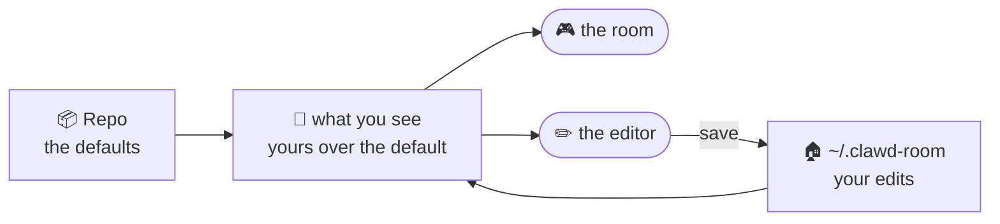
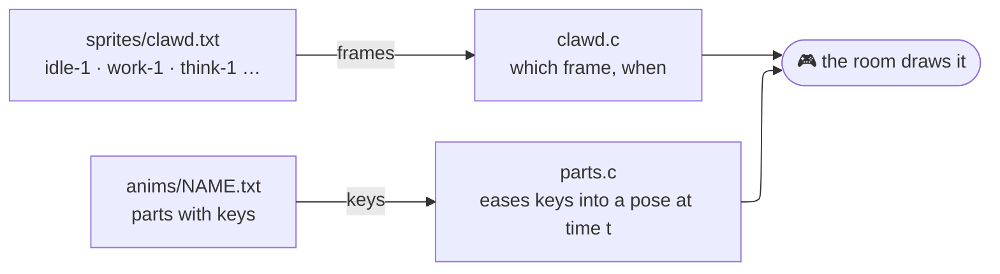
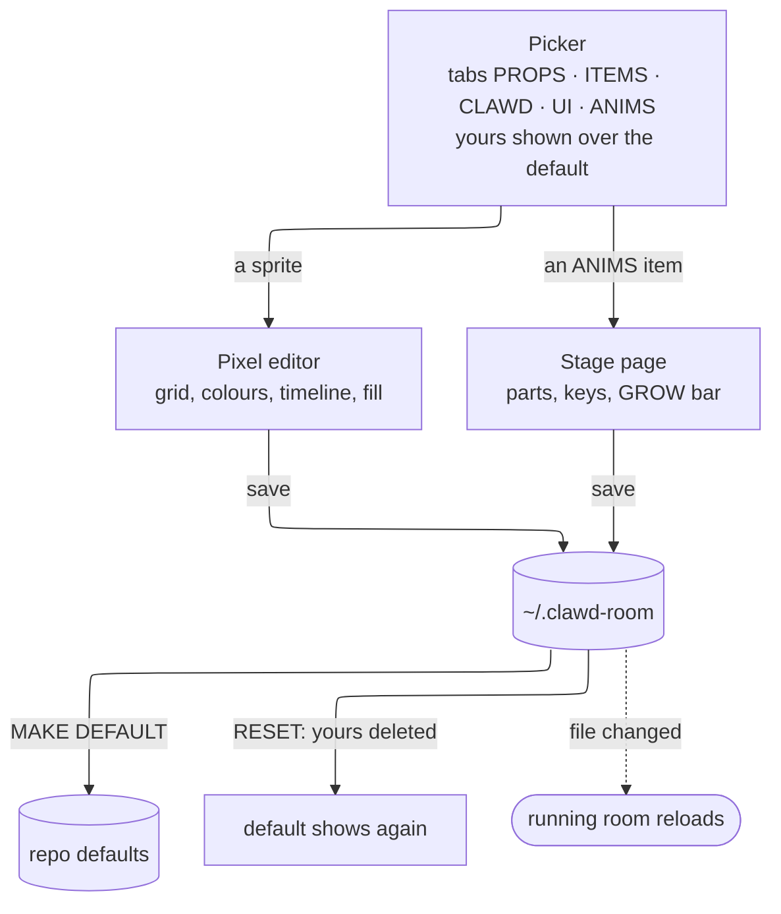
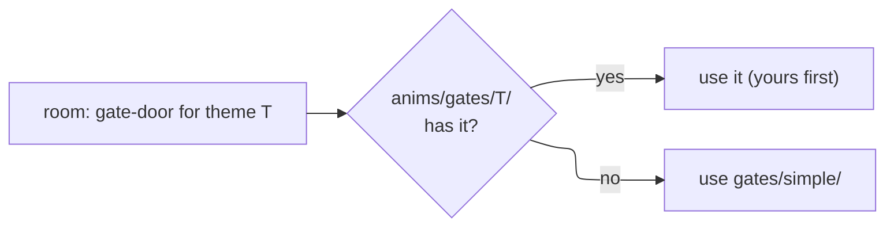

> [!abstract] In short
> The pixel art and the animations are text files. The repo holds the **defaults**; your edits go to `~/.clawd-room/` and are shown **over** them. The pixel editor (`--edit`) reads both and only ever writes your copy, except for MAKE DEFAULT. The running room reads the files again when they change.

---
## 🗂️ The folders

| Kind | In the repo (default) | Yours (`~/.clawd-room/`) | Merged |
| --- | --- | --- | --- |
| Sprites | `sprites/` `props` `items` `clawd` `ui` | `sprites/` only what you changed | one sprite at a time |
| Part animations | `anims/` `swing` `brew` | `anims/` a whole file once saved | the whole file |
| Gate files | `anims/gates/THEME/` `gate-door` `gate-stairs` `gate-well` | `anims/gates/THEME/` | the whole file |
| Wall plans | `rooms/` `office` `coffee` `park` | none (edited by hand) | none |

> [!info] Yours over the default
> - **Sprites** merge one sprite at a time: `~/.clawd-room/sprites/props.txt` holds only what differs, the rest comes from `sprites/props.txt`.
> - **Part animations** are all or nothing: if `~/.clawd-room/anims/swing.txt` exists it is used, otherwise `anims/swing.txt`.
> - Test hooks: `CLAWD_MY_SPRITES`, `CLAWD_MY_ANIMS` (the tests use none).

> [!note] `rooms/` is not in the editor
> The wall plans (what the placer puts on the walls) are edited by hand; the room reloads them while it runs.

---
## 🎞️ Two kinds of animation

| | Frame animation | Part animation |
| --- | --- | --- |
| File | `sprites/clawd.txt` (and the other sprite files) | `anims/NAME.txt` |
| What it holds | drawn pictures, one per frame | named parts with keys: `x y turn glow show grow` |
| Edited in | the pixel editor (grid, timeline, onion skin) | the stage page (the room's scene, parts outlined, keys, GROW bar) |
| Used by | the Clawds' poses | the swing (moves the Clawd's y), gates appearing (grow, and x / y / glow / show) |

> [!tip] A part animation also carries its scene
> `scene` lines in the file say which room the editor's stage shows (`scene theme park`, `scene appear up` …), so the stage is at the frame you are on. The format is in the header of `anims/swing.txt`.

---
## ✏️ How the editor reads and writes

> [!warning] Only MAKE DEFAULT writes into the repo
> Saving touches your copy only. MAKE DEFAULT copies yours over the default (for an animation, the file; for sprites, the ones you changed) and a repo change is then something to commit. RESET removes yours.

> [!example]- Try it
> 1. `./clawd-room.sh --edit` opens the picker in its own window.
> 2. Pick a prop, change a pixel, save: look in `~/.clawd-room/sprites/props.txt`.
> 3. Pick an ANIMS item, add a key, save: look in `~/.clawd-room/anims/`.
> 4. RESET both to go back.

---
## 🚪 Gate themes

> [!info] Gate themes (branch `feat/gate-themes`, PR #24)
> A gate theme is a folder `anims/gates/NAME/` with `gate-door`, `gate-stairs` and `gate-well`. The active theme comes from `--gate-theme NAME`, `CLAWD_GATE_THEME`, or `gate_theme = NAME` in `~/.clawd-room/settings.conf` (in that order); a file a theme lacks comes from `simple`. The room draws a gate part's `grow`, `x`, `y`, `glow` and `show`; `turn` is not drawn yet. `simple` brings the parts in turn; `construct` (`style construct`, one part `build` as the clock) builds the gate from its own pieces. In the picker the **THEMES** tab has a card per theme: Space makes it active (writes `settings.conf`), Enter opens its files on the ANIMS tab, the dashed card makes a copy under a name. The construct's pieces as authored sprites are not built yet ([[Dev Status]], "Art as Sprite Pieces").

