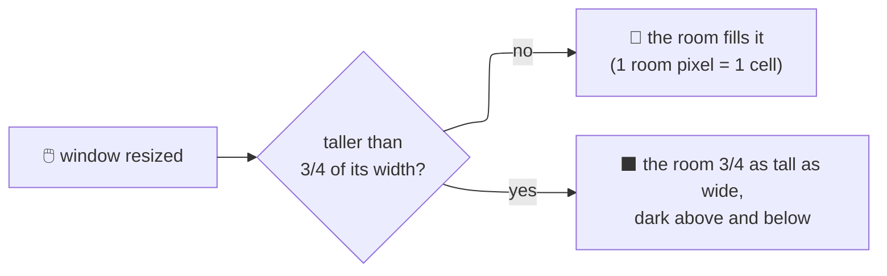
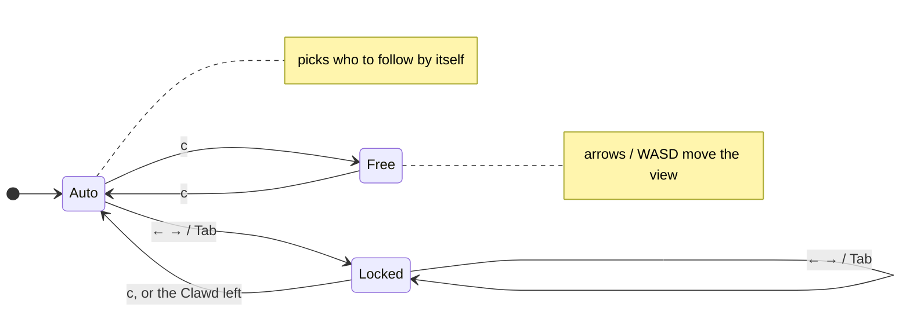
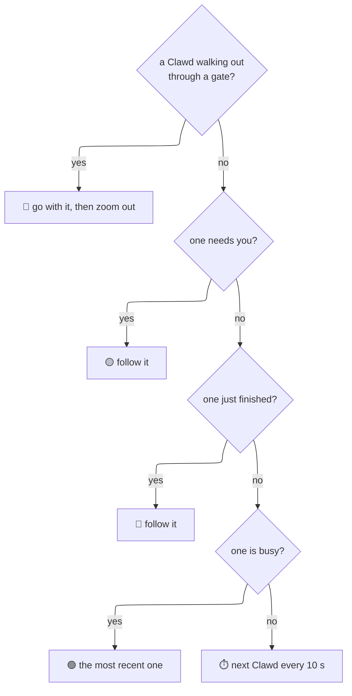
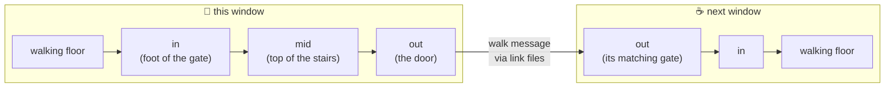
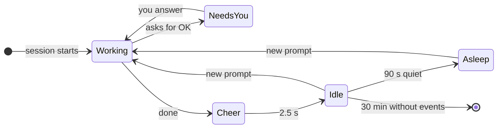

> [!abstract] In short
> Every Claude Code session is a Clawd. Keys zoom and steer a camera and send Clawds to linked windows. Linked windows find each other by themselves; Clawds walk through doors and stairs between them. Looks are in [[Rooms and Art]], window handling in [[Platforms and Windows]], the editor in [[Pixel Editor]].

---
## ⌨️ Keys

| Key | Does |
| --- | --- |
| `q` | quit |
| Esc | lets go of the picked Clawd (the corners and the dimming fade out; the camera stays on it) |
| `p` | pause |
| `?` | help line |
| `[` `]` | **camera zoom** 1x–4x (the room keeps its layout; only the view gets closer) |
| `z` | **auto zoom** on / off (frames the busy Clawds) |
| ← → or A D, Tab | while following: pick the previous / next Clawd (the camera stays on it); **yellow corners close in around it and the room dims (60 in 100)**, they glide on the next pick and stay until you press **Esc** |
| `c` | switch **auto follow ↔ free camera** |
| arrows / W A S D | free camera only: move the view a quarter at a time |
| `g` | send an idle Clawd next door; with several linked rooms **hold `g` and press an arrow** (the way to send it); only while `g` (or `m`) is **held** (it goes soon after the key's repeats stop; the room learns how fast the keyboard repeats) the bar along the bottom has one yellow hint for both: `G SEND / M MOVE NAME + ARROW:` (the held key bright) and which arrow goes where |
| `m` | **move** the picked Clawd (`Tab` / `<` `>`; or the only one) to another room: `m` + an arrow; it carries its work there and lives there while the rooms run |
| `b` | **call back**: our Clawds next door walk home; with none away, visitors here are sent home |
| `f` | auto font again (WSL and iTerm2), camera back to 1x |
| `v` | **view** (picked 2026-11-01): the room → the Clawds at laptops (the strip's band) → their faces → the room; in a pane too small for the room it switches band ↔ faces (under 4 rows faces only). The faces fill the pane's height: the 3-row face drawn whole times bigger (its shape kept), but never wider than the pane; the rest on the wall colour. A view other than the room is a strip: no gates to it. |
| `o` | **debug overlay**: each item's box with its **name** (SIGN, DESK, GATE-LEFT …; the park's buildings all say BUILDING), anchors, gate points (in green, mid yellow, out red), where Clawds are walking; handy for pointing at something in a screenshot |

> [!note] The picked Clawd stands out (built 2026-10-24)
> On **Tab** (or `A` / `D` while following) four yellow corners close in around the picked Clawd and the room outside a round, soft spotlight (a circle of radius 20 room pixels, a little above the Clawd's middle) is darkened by 60 in 100. They fade in over 0.25 s, **glide** to the next Clawd on another pick (0.2 s) and stay until you press **Esc** (they fade out over 0.4 s), or the Clawd leaves (Esc no longer quits the room: only `q` does). It is drawn last, in room pixels (`draw_pick` in `c/draw.c`), so the camera zoom scales it with the room; the animator keys are `pick`, `pickox`, `pickoy`.
> ![[2026-10-24 picked Clawd built.gif|300]]

> [!todo]- Picked, not built yet
> - **The bar below the room, tags on the gates** (2026-10-20): the room is laid out above a one-line bar (today the bar covers its bottom, the well included); while `g` / `m` is held each gate gets a tag centred over its door: a pixel arrow (style still to pick) and the room it leads to, cream letters with a thin dark outline; where tags collide only the arrow. ![[2026-10-20 gate tags A, centred (picked).png|250]]
> - **Settings** (2026-10-20): `~/.clawd-room/settings.conf` (one file, `key = value`, reread when it changes) and a panel beside the room on **`.`** (the room keeps running, so a change shows at once). ![[2026-10-20 settings panel A and B (B picked).png|250]]
>
> → [[2026-10-20]]

> [!tip] Zoom tips
> - `]` then wait: the camera finds the Clawd that needs you by itself.
> - In an empty zoomed room, `c` keeps the camera waiting for the first Clawd to come in.

---
## 🎨 The pixel editor

The editor (`--edit`), its sprite picker and the stage page for part animations: [[Pixel Editor]].

---
## 📐 Room size and resizing

- **A Clawd is the same size everywhere** (Zaviel, 2026-11-01): a room pixel is always one cell wide and half a cell tall (scale 1). A bigger window or pane gets a **bigger room** (more floor and desks), never bigger pixels; `[` `]` zoom the camera, Ctrl+- / Ctrl+= change the font.
- The room **fills the width** and is at most **3/4 as tall as wide** (`ROOM_MAX_TALL`); a taller window or pane shows it in its middle with dark above and below. Dragging the window re-lays it out at once.

--- | --- |
| **AUTO** (default) | just big enough to seat every session with floor to walk on; changes when sessions come and go |
| S / M / L / XL | 120x60 / 160x90 / 220x120 / 300x160 (an 80x25 window is 80x50) |

---
## 🎥 The camera

When zoomed, the camera **follows a Clawd** and keeps it in the middle of the view (smooth, no dead zone; changed 2026-10-24).

**Who auto follow picks:**

> [!info] The bar along the bottom
> The status (help, PAUSED, messages, what the camera does) and the `g` / `m` hint are drawn **in the room's pixel font** on a dark bar, wrapped between phrases (the terminal's own last row was tiny at the fixed font). Tests read its text from `CLAWD_STATUS_LOG`.

> [!info] What the status line says while zoomed
> `AUTO FOLLOW (WAITING)` · `AUTO: NAME` · `FOLLOW NAME` · `WITH NAME TO THE GATE` · `FREE CAMERA`

- Visitors count too: a room with only a visitor follows it.
- Words (names, `+N MORE`) stay normal size when zoomed and never cover a Clawd.

---
## 🔗 Linked windows and crossing

Rooms started with `--room NAME` find each other through files in `~/.clawd-room/link/` (no network) and **share the sessions** (each shows its own part). The split is **sticky**: every room says in its heartbeat which sessions it shows (`"shows"`), and a session a running room shows **stays there**, so opening more rooms never takes a Clawd away (shares can be uneven; `m` moves one). A session nobody shows (new, or its room closed) goes to the room that scores highest for it (a hash of session + room); if two rooms show one, the higher score keeps it. A room that goes quiet but has not closed (its presence file is still there: busy drawing, say) keeps its share for 15 s, so its Clawds do not hop away and back. With the window helper (WSL or iTerm2) a gate appears when two windows are **next to each other** (gap up to 30 px, stays attached until 45 px) and **still for 1 s**; both windows animate it in together: each room says in its heartbeat when it was ready to show the gate (`"ready"`), and both start at the later of the two + 1 s (`GATE_SYNC_WAIT`); while the other room has not said, it waits up to 3 s (`GATE_SYNC_ALONE`; an older room never says). iTerm2 **split panes** count as windows.

**Moving** (`m` + arrow): the Clawd walks out like a visit, but the room it walks into **claims** it: its heartbeat lists the sessions that moved in (`"homes"`). A room shows a session if it claimed it, not if a running room claimed it, else by the split below. The room it left keeps showing it (away) until the claim appears, or brings it back after 10 s. Claims last only while that room runs. On the way it **packs** its workspace into a box at its desk and **unpacks** it at the new one (a poof each time); `m` + arrow on one that already carries its box sends it straight to that gate.

Each gate has an **in** point (where a Clawd steps on, on the floor) and an **out** point (the side door, the door on the stairs' platform, the treehouse door, the bottom of the well). The stairs also have a point in between (their top).

- A side door **opens while a Clawd is near it** and closes after.
- On the stairs, along the half floor and in the well a Clawd **walks** (walking pose, behind the railing); only the treehouse ladder is climbed. In the well it **walks down the steps** from the right end and disappears into the hole (the rim and the floor in front stay in front of it); coming up, the other way round.
- Idle Clawds visit by themselves sometimes (20% of their plans when a gate is there). A visitor stays 25–45 s, then walks home; `b` ends visits early.

> [!warning] Windows are never moved
> The room never moves or snaps windows to attach them; gates appear only when you place windows next to each other.

---
## 🫧 Sessions and states

| State | Where | Over the head |
| --- | --- | --- |
| working / thinking | at its workspace | 🟢 dot |
| needs you | walks about | 🟡 sign and its **name** |
| just finished | cheers, sparks | 🟢 dot |
| idle | walks, visits, plays (wave, dance, stretch, jump; swing and slide in the park; ordering coffee) | ⚪ grey dot |
| asleep | at its workspace, Z Z Z | ⚪ grey dot |
| visitor | from another window | 🔵 blue dot |

> [!note] NO SESSIONS
> **NO SESSIONS / START CLAUDE** shows only when **no session runs anywhere**; a linked room whose share happens to be empty just shows an empty room.
