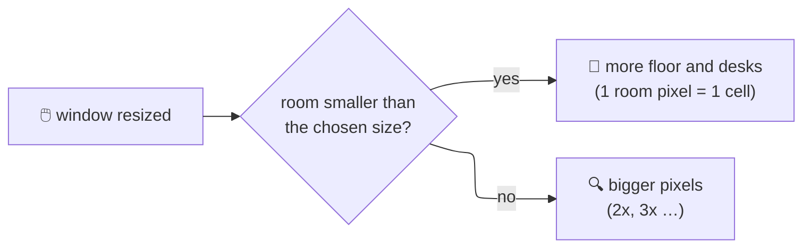
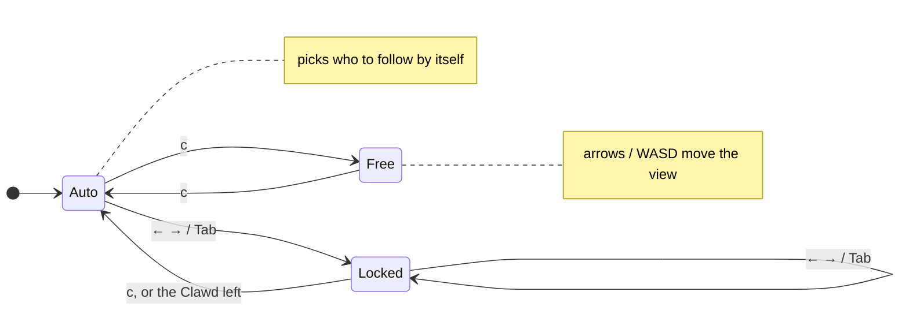
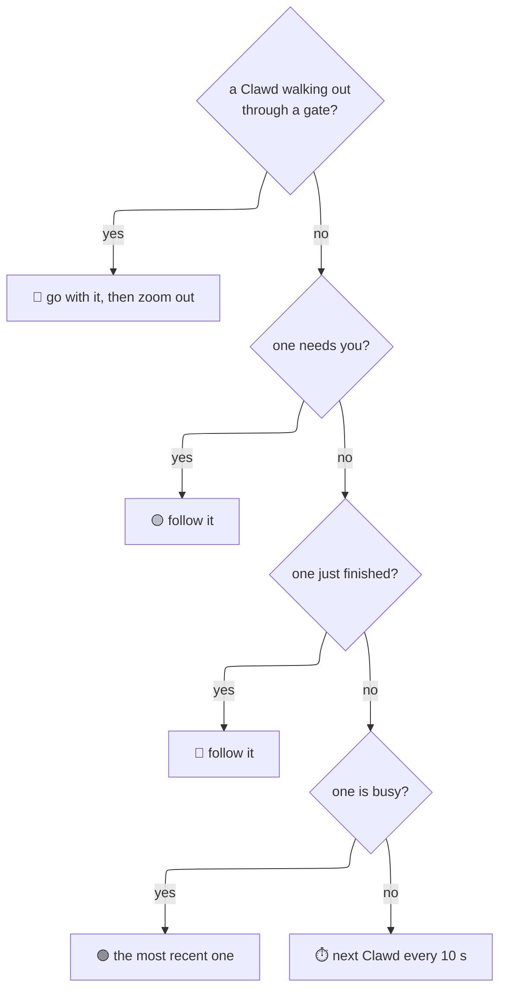
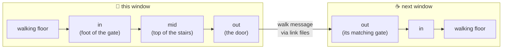
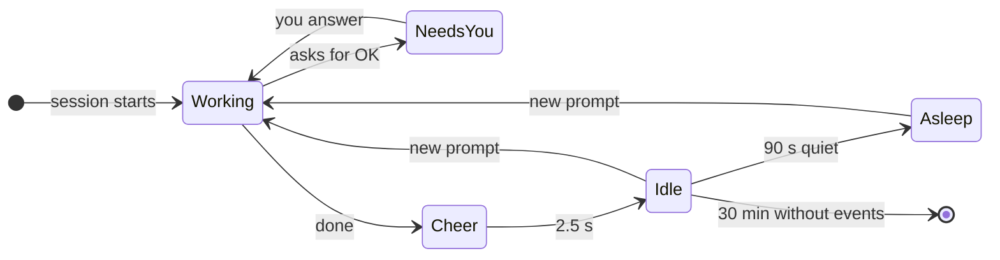

> [!abstract] In short
> Every Claude Code session is a Clawd. Keys zoom and steer a camera, pick the room size, and send Clawds to linked windows. Linked windows find each other by themselves; Clawds walk through doors and stairs between them. Looks are in [[Rooms and Art]], window handling in [[Platforms and Windows]].

---
## ⌨️ Keys

| Key | Does |
| --- | --- |
| `q` | quit |
| Esc | lets go of the picked Clawd (the corners and the dimming fade out; the camera stays on it); it closes the room size list first |
| `p` | pause |
| `?` | help line |
| `r` | **room size list**: AUTO, S, M, L, XL (up/down or W/S, Enter picks, Esc or `r` closes) |
| `[` `]` | **camera zoom** 1x–4x (the room keeps its layout; only the view gets closer) |
| `z` | **auto zoom** on / off (frames the busy Clawds) |
| ← → or A D, Tab | while following: pick the previous / next Clawd (the camera stays on it); **yellow corners close in around it and the room dims (60 in 100)**, they glide on the next pick and fade out 2.5 s after the last one |
| `c` | switch **auto follow ↔ free camera** |
| arrows / W A S D | free camera only: move the view a quarter at a time |
| `g` | send an idle Clawd next door; with several linked rooms **hold `g` and press an arrow** (the way to send it); only while `g` (or `m`) is **held** (it goes soon after the key's repeats stop; the room learns how fast the keyboard repeats) the bar along the bottom has one yellow hint for both: `G SEND / M MOVE NAME + ARROW:` (the held key bright) and which arrow goes where |
| `m` | **move** the picked Clawd (`Tab` / `<` `>`; or the only one) to another room: `m` + an arrow; it carries its work there and lives there while the rooms run |
| `b` | **call back**: our Clawds next door walk home; with none away, visitors here are sent home |
| `f` | auto font and scale again (WSL and iTerm2), camera back to 1x |
| `o` | **debug overlay**: each item's box with its **name** (SIGN, DESK, GATE-LEFT …; the park's buildings all say BUILDING), anchors, gate points (in green, mid yellow, out red), where Clawds are walking; handy for pointing at something in a screenshot |

> [!note] The picked Clawd stands out (built 2026-10-24)
> On **Tab** (or `A` / `D` while following) four yellow corners close in around the picked Clawd and the room outside a round, soft spotlight (a circle of radius 20 room pixels, a little above the Clawd's middle) is darkened by 60 in 100. They fade in over 0.25 s, **glide** to the next Clawd on another pick (0.2 s) and fade out over 0.4 s, 2.5 s after the last pick, at once if the Clawd leaves, or when you press **Esc** (Esc no longer quits the room: only `q` does). It is drawn last, in room pixels (`draw_pick` in `c/draw.c`), so the camera zoom scales it with the room; the animator keys are `pick`, `pickox`, `pickoy`.
> ![[2026-10-24 picked Clawd built.gif|300]]

> [!todo]- Picked, not built yet
> - **The bar below the room, tags on the gates** (2026-10-20): the room is laid out above a one-line bar (today the bar covers its bottom, the well included); while `g` / `m` is held each gate gets a tag centred over its door: a pixel arrow (style still to pick) and the room it leads to, cream letters with a thin dark outline; where tags collide only the arrow. ![[2026-10-20 gate tags A, centred (picked).png|250]]
> - **Settings** (2026-10-20): `~/.clawd-room/settings.conf` (one file, `key = value`, reread when it changes) and a panel beside the room on **`.`** (the room keeps running, so a change shows at once). ![[2026-10-20 settings panel A and B (B picked).png|250]]
>
> → [[2026-10-20]]

> [!tip] Zoom tips
> - `]` then wait: the camera finds the Clawd that needs you by itself.
> - In an empty zoomed room, `c` keeps the camera waiting for the first Clawd to come in.

---
## 🎨 The pixel editor

`./clawd-room.sh --edit` (no name) opens it on the **sprite picker**: every sprite and animation as a **card** with its picture (the picked one plays; a tab per file: PROPS, ITEMS, CLAWD, UI) or, with the view buttons at the top right or `\`, as a **list** by file with the picked one big, its file, size and frames. Type to find (the cards move to the first tab with a match); arrows pick, Enter or a click on the picked one opens it; `q` (or `l`) while editing goes back to the picker, the sprite you were on picked (Enter reopens it); if the sprite changed it first asks **S** keep or **D** discard (back to how it was when you opened it; Esc stays). In the picker the **search box** has the focus as it opens (a yellow frame): letters go into it and **`q` quits** while it is empty. A click elsewhere leaves it (letters do nothing, `q` quits); a click on it focuses it, and then `q` is typed like any letter. Esc clears the search, then leaves a clicked box, then quits. `./clawd-room.sh --edit NAME` opens it in the middle of the screen; the window you typed in stays, and you are back there when you quit. NAME is a sprite (`walk-2`, `window`) or an animation (`walk` opens its first frame). A name that is not there is said in the terminal you typed in, with the closest names (`did you mean: walk`), and no window opens. `./clawd-room.sh --edit list` prints what it can open, by file: each animation once with how many frames it has, in columns that fit the terminal. It saves after each stroke, so running rooms show the change; on quitting you choose to keep or discard.

**Your own sprites over the defaults.** The repo's `sprites/*.txt` are the defaults. What you change is written only to **`~/.clawd-room/sprites/`** (the same file names, holding just the colours you added or changed and the sprites that differ, or that only you have); the room and the editor show yours over the defaults (a sprite painted back to the default stops being yours; a colour you added that nothing uses any more is left out when saving, so a colour picked by mistake and erased or undone goes away; the defaults' colours always stay). In the picker a **blue dot** marks yours; the bar above the hints shows **YOURS: N** (left) and **RESET** (the picked one back to the default), **RESET ALL** (asks first) and **MAKE DEFAULT** (yours in the picked one's file written into the repo's file, then yours goes: new official art, through a commit). Deleting a frame works only on your last added one (the defaults stay).

**Animations.** An animation is the sprites named `NAME-1`, `NAME-2` … (Clawd frames, items) or `NAME`, `NAME~2`, `NAME~3` … (props). The **timeline** along the bottom shows its frames (twice their size when they fit; a long one scrolls to keep the open frame in view): the open one framed in yellow, the one playing marked under it; click one, or ← →, to open it. On the left: `? SHORTCUTS  Q QUIT` in a short window, and under it the sprite **as in the room**, as big as the column lets it be (the frame playing while PLAY is on). On the right (a line between the two sides): the animation's name and frame, ONION / the speed / PLAY, and the frames, at one size for the window (2x or 1x as its height allows, however many there are; the timeline takes at most a quarter of the window); more than fit **scroll sideways** (the mouse wheel over them; a scroll bar under them; opening a frame brings it into view). **Drag the divider** above the timeline (its handle, a short bar in the middle, lights up under the pointer) to make the timeline taller or shorter: the frames and the sprite on the left grow with it; the canvas and the panel keep at least their tools, colour field and hex line (the panel leaves out the shades first, then rows of the file's colours). Dragged down past its smallest size it **folds** to its top line (drag it up again for the frames). Double-click the divider: back to the automatic height.

**Folding the colour panel** (like Obsidian's sidebar): the button at the top right (a window with its right part filled while the panel is open) or `p` folds the panel to a **ribbon** at the right edge (the editor opens with it folded): the four tools one over another and the current colour; the canvas takes the room, in the middle of it. Again to unfold.

**The editor's own icons** (the tools and the fold button) are sprites in **`sprites/ui.txt`** (`tool-paint`, `tool-erase`, `tool-pick`, `tool-fill`, `tool-fill-all`, `fold-open`, `fold-closed`, and the picker's `view-cards`, `view-list`: each a small picture of its page): edit them in the editor like any sprite (`--edit fold-open`, or Tab to the file); the editor reads the file again when it changes. One left out: the built-in drawing. The fold button is drawn dim and brightened under the pointer.
- **PLAY** (Space) runs the animation **at the room's speed** in the grid and the real-size view (a click on the grid stops it, to draw on the open frame): Clawd frames through the room's own poses (`pose_for` with the stand-in sessions of `actions.c`, the same as the sprite sheet), so the order, the timing, the bounce and the blinks are the room's; a pose the file has no frame for is drawn by the code, as in the room. Props change every 0.3 s, the thinking dots three times a second. **1X** switches 1x, 2x, 0.5x (not saved). When the panel has no room for the real-size view, it plays at the right end of the timeline.
- **ONION** (`o`, on at the start): where the open frame is see-through, the frame before shows faintly red and the one after blue (both: purple), to draw the motion in between.
- **New and deleted frames are for props only** (`f` a copy at the end, `+` in the timeline; `x` twice deletes the open one, never the first: that is the prop; the ones after it are numbered on, since the room stops at the first missing `~N`). Clawd and item frames are picked by the room's code, so a new one would never be shown.

| Input | Does |
| --- | --- |
| left click / drag | paint with the chosen colour |
| right click | erase (see-through) |
| Alt + click, or **PICK** then click | take the colour under the pointer |
| **FILL** (`b`) | a click fills the touching pixels of the colour under it (right click: erases them); the area it would fill is outlined in dashes under the pointer. Click FILL again for **FILL ALL**: every pixel of that colour in the frame. (Shift + click is kept by Windows Terminal and iTerm2 for selecting text, so it is a mode, not a modifier.) |
| the panel | the tools as **icons on key caps**, their names under them (PAINT a pencil, ERASE an eraser, PICK an eyedropper, FILL a paint bucket, with a sparkle for FILL ALL; the one in use pressed in, a yellow line under it); a **colour field** (saturation across, brightness down) and a **hue bar** like Figma's; the colour's **hex** and **red / green / blue**; **IN THIS FILE**, the colours to paint with (a ring: the one in hand; a dot: used in this sprite). Its first block is the **+ slot**: changing the colour (field, hue bar, typing) never changes a file colour but makes a new one there (an empty + slot clicked: a new colour from the one in hand); painting with it, or clicking the filled slot, puts it in the file. **Double-click** a file colour to change it in the file instead (every pixel using it, in the whole file; its ring yellow); **SHADES** darker to lighter, as many as a row of the file's colours. A wider window makes the panel wider (beside the real-size view when that goes right of it): more colours in a row, more shades; the sprite **as in the room** |
| typing a colour | click the **hex code** (or press `#`) and type `RRGGBB` (or `RGB`), or click a **red / green / blue number** and type 0–255; Enter applies, Backspace deletes, Esc cancels |
| pointer over the grid | the pixel is outlined; its place and colour show under the grid |
| Ctrl+Z / Ctrl+Y (`u` / `r`) | undo / redo (Ctrl+C asks like `q`) |
| ← → (or `<` `>`, `,` `.`) | the frame before / after in the animation (wrapping) |
| `[` `]` | the sprite before / after (the first frame of the next animation); Tab: the next file (props, items, Clawd) |
| Space / `o` | play / stop; onion skin on / off |
| `p` | fold / unfold the colour panel (the button at the top right does the same) |
| `q`, `l` | back to the sprite picker, asking keep / discard if the sprite changed (`q` there quits; Ctrl+C quits from anywhere, asking about all changes) |
| `f` / `x` `x` | a new frame / delete this one (props) |
| `+` `-` | zoom |
| hold `w` / `n` + an arrow | grow / shrink the sprite on that side (← left, → right, ↑ top, ↓ bottom); on the left or the top the drawing moves over by one. While `w` or `n` is held a hint says so; let go, the arrows step through frames again |
| `?` | the shortcuts in a box (a short window shows only `? SHORTCUTS  Q QUIT`; a very short one has no timeline) |
| Esc in the picker, Ctrl+C | quit: with changes it asks **S** save, **D** discard (the files go back to how they were when you opened them), **Esc** back |

![[2026-10-20 editor timeline, onion skin and fill.png|774]]

![[2026-10-20 editor playing a Clawd at the room's speed.png|774]]

### 🎬 The stage page: part animations

A **part animation** is a file in `anims/` (`swing.txt`, `brew.txt`; the format is in the header of `swing.txt`): a thing made of **parts** (the swing's bar, chains, seat and Clawd; the coffee machine, cup, steam and barista), each with **keys**. A key is a saved pose of one part at one frame: where it is (move x / y), rotate, show, glow, and the ease into it. Between keys the part is moved for you (the frames in between are worked out), so a few keys make the whole animation. A part marked `sprite` (a Clawd) moves but does not rotate (a turned pixel drawing breaks up). The room plays the swing's Clawd from `swing.txt`; your edits go to `~/.clawd-room/anims/` and are used over the defaults, read again when they change.

**Gates appearing** are part animations too: `anims/gate-door.txt` (a door on a side wall), `gate-stairs.txt` (the way up: steps, platform, opening, rail) and `gate-well.txt` (the way down). Each part comes in by its **GROW** (0 not there, 100 whole); the files hold what the room always did (every part 0 to 100 in 0.8 s, ease out), so nothing looks different until you change them. Their stage is the office with that gate appearing (`scene still`, `scene appear SIDE`). On the page, GROW is the bar under the panel beside a small running Clawd (no words; faster while you drag the bar or PLAY runs; the sprites `grow-walk-1` … `-4` in `sprites/ui.txt`, the picker's UI tab, so they can be repainted): click or drag it to set how much of the picked part has come in at this frame. The room uses only GROW for a gate part; the other values are for later.

`./clawd-room.sh --edit anims/swing` (or the **ANIMS** tab in the sprite picker, Enter) opens it on the stage page, laid out as the editor (layout B, picked 2026-10-21):

<<<<<<< HEAD
- **The stage** (where the canvas is): the room with the thing, every part outlined (the picked one yellow), the picked part's keys as small marks joined in time order (`v` or **KEYS ON** under the stage: off); **ONION** (`o`) shows the frame before faintly red and the one after blue. `+ -` or the wheel zoom it, `W A S D` or a right drag move the view (it may go past the room's edge by half a view, so a part at the edge can be in the middle); the view puts the picked part in the middle when the page opens and when a part is picked from the list or with `[ ]`; `0` zooms back and does the same.
=======
- **The stage** (where the canvas is): the room with the thing, every part outlined (the picked one yellow), the picked part's keys as small marks joined in time order (`v` or the **eye + KEYS** button under the stage hides them: the eye shuts); **ONION** (`o`) shows the frame before faintly red and the one after blue. `+ -` or the wheel zoom it, `W A S D` or a right drag move the view, `0` puts it back.
>>>>>>> origin/main
- **The tools** work on the part pressed on (pressing where there is none does nothing): **SELECT** picks a part and shows handles on its border (drag one to resize the part's box); **MOVE** drags the part pressed on (it stays inside the stage); **ROTATE** drags its angle (greyed for a sprite, and a sprite cannot be picked while it is on); **KEY** is not a tool but a toggle beside them: pressed in when this frame is a key of the picked part; a click puts a key here or takes it away.
- **The panel**: the picked part, its values at this frame with `<` `>` (`< >` keys; up / down picks a value), the key's **EASE**, the parts. It scrolls in a short window.
- **The timeline**: the frames as pictures with a diamond under each key of the picked part, the real-size view at its left, PLAY and the speed; its scroll bar and the wheel scroll it. Drag the line above it down to fold it to its one line, up to open it (the editor's grip).
- **Folding**: `p` or the fold button (top right, the editor's) folds the panel to a ribbon of the four tools (no values, no grow bar) and the stage takes the room. Open, the panel has the same gap (9 pixels) to the stage as to the window's edge.
- A change makes a key at this frame if there is none. `u` / `r` undo / redo, `?` the keys (scrolls), `q` asks like the editor (S save, D discard, Esc back); from the picker, `q` comes back to it.

> [!todo]- Picked, not built yet
> - **Rotation drawn in the room**: only the stage's outline turns; how the swing's chains and seat and a Clawd should look turned is parked (a mockup of three ways, 2026-10-21, in `gallery/mock/out/19-rotate/`, not picked).
> - **More cases in the room**: the barista's brewing; gates leaving, the park's own gates, and the construct style (the office's gates appearing are built).
>   ![[2026-10-21 part animations in the editor, a Clawd on the swing (now, A dope sheet, B frames, B picked).png|300]]
>   ![[2026-10-21 part animations in the editor, the barista brewing (now, A dope sheet, B frames, B picked).png|300]]

## 📐 Room size and resizing

- The room **always fills the window** and takes its shape; dragging the window re-lays it out at once.
- **Grow, then scale:** the room gains floor up to the chosen size, past that every room pixel gets bigger.

| Size | Biggest room (room pixels) |
| --- | --- |
| **AUTO** (default) | just big enough to seat every session with floor to walk on; changes when sessions come and go |
| S / M / L / XL | 120x60 / 160x90 / 220x120 / 300x160 (an 80x25 window is 80x50) |

---
## 🎥 The camera

When zoomed, the camera **follows a Clawd** and only moves when that Clawd nears the edge of the view (dead zone a quarter of the view, smooth).

**Who auto follow picks:**

> [!info] The bar along the bottom
> The status (help, PAUSED, messages, what the camera does) and the `g` / `m` hint are drawn **in the room's pixel font** on a dark bar, wrapped between phrases (the terminal's own last row was tiny at the fixed font). Tests read its text from `CLAWD_STATUS_LOG`.

> [!info] What the status line says while zoomed
> `AUTO FOLLOW (WAITING)` · `AUTO: NAME` · `FOLLOW NAME` · `WITH NAME TO THE GATE` · `FREE CAMERA`

- Visitors count too: a room with only a visitor follows it.
- Words (names, `+N MORE`) stay normal size when zoomed and never cover a Clawd.

---
## 🔗 Linked windows and crossing

Rooms started with `--room NAME` find each other through files in `~/.clawd-room/link/` (no network) and **share the sessions** (each shows its own part). The split is **sticky**: every room says in its heartbeat which sessions it shows (`"shows"`), and a session a running room shows **stays there**, so opening more rooms never takes a Clawd away (shares can be uneven; `m` moves one). A session nobody shows (new, or its room closed) goes to the room that scores highest for it (a hash of session + room); if two rooms show one, the higher score keeps it. A room that goes quiet but has not closed (its presence file is still there: busy drawing, say) keeps its share for 15 s, so its Clawds do not hop away and back. With the window helper (WSL or iTerm2) a gate appears when two windows are **next to each other** (gap up to 30 px, stays attached until 45 px) and **still for 1 s**; both windows animate it in together. iTerm2 **split panes** count as windows.

**Moving** (`m` + arrow): the Clawd walks out like a visit, but the room it walks into **claims** it: its heartbeat lists the sessions that moved in (`"homes"`). A room shows a session if it claimed it, not if a running room claimed it, else by the split below. The room it left keeps showing it (away) until the claim appears, or brings it back after 10 s. Claims last only while that room runs. On the way it **packs** its workspace into a box at its desk and **unpacks** it at the new one (a poof each time); `m` + arrow on one that already carries its box sends it straight to that gate.

Each gate has an **in** point (where a Clawd steps on, on the floor) and an **out** point (the side door, the door on the stairs' platform, the treehouse door, the bottom of the well). The stairs also have a point in between (their top).

- A side door **opens while a Clawd is near it** and closes after.
- On the stairs, along the half floor and in the well a Clawd **walks** (walking pose, behind the railing); only the treehouse ladder is climbed. In the well it **walks down the steps** from the right end and disappears into the hole (the rim and the floor in front stay in front of it); coming up, the other way round.
- Idle Clawds visit by themselves sometimes (20% of their plans when a gate is there). A visitor stays 25–45 s, then walks home; `b` ends visits early.

> [!warning] Windows are never moved
> The room never moves or snaps windows to attach them; gates appear only when you place windows next to each other.

---
## 🫧 Sessions and states

| State | Where | Over the head |
| --- | --- | --- |
| working / thinking | at its workspace | 🟢 dot |
| needs you | walks about | 🟡 sign and its **name** |
| just finished | cheers, sparks | 🟢 dot |
| idle | walks, visits, plays (wave, dance, stretch, jump; swing and slide in the park; ordering coffee) | ⚪ grey dot |
| asleep | at its workspace, Z Z Z | ⚪ grey dot |
| visitor | from another window | 🔵 blue dot |

> [!note] NO SESSIONS
> **NO SESSIONS / START CLAUDE** shows only when **no session runs anywhere**; a linked room whose share happens to be empty just shows an empty room.
