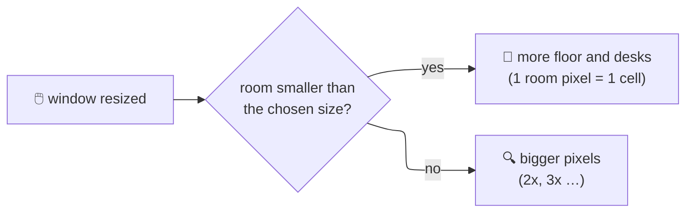
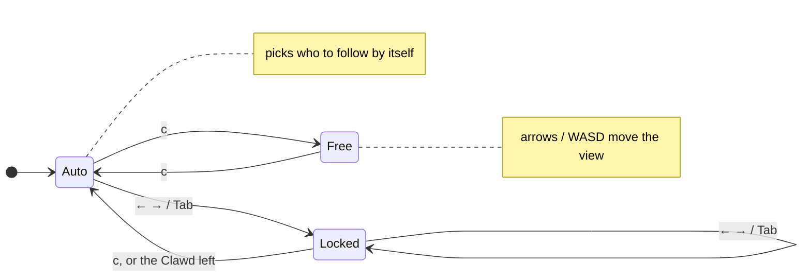
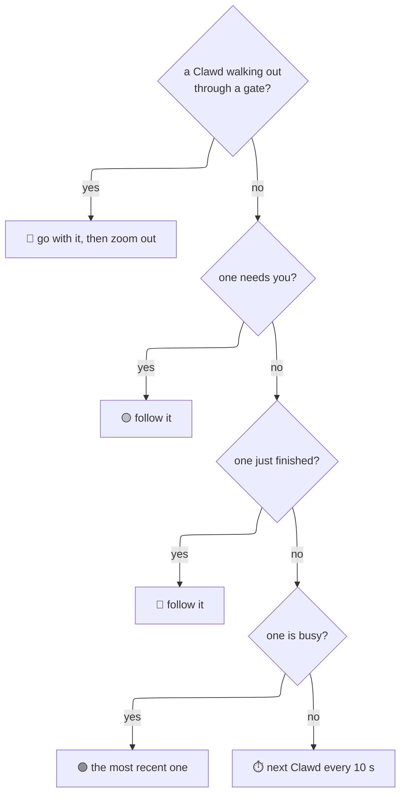
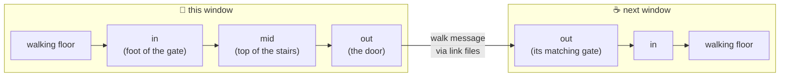
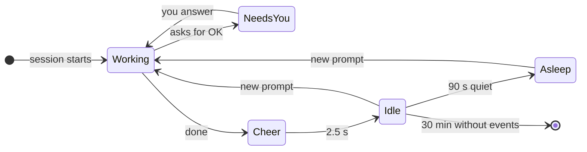

> [!abstract] In short
> Every Claude Code session is a Clawd. Keys zoom and steer a camera, pick the room size, and send Clawds to linked windows. Linked windows find each other by themselves; Clawds walk through doors and stairs between them. Looks are in [[Rooms and Art]], window handling in [[Platforms and Windows]].

---
## ⌨️ Keys

| Key | Does |
| --- | --- |
| `q`, Esc | quit (Esc closes the room size list first) |
| `p` | pause |
| `?` | help line |
| `r` | **room size list**: AUTO, S, M, L, XL (up/down or W/S, Enter picks, Esc or `r` closes) |
| `[` `]` | **camera zoom** 1x–4x (the room keeps its layout; only the view gets closer) |
| `z` | **auto zoom** on / off (frames the busy Clawds) |
| ← → or A D, Tab | while following: pick the previous / next Clawd (the camera stays on it) |
| `c` | switch **auto follow ↔ free camera** |
| arrows / W A S D | free camera only: move the view a quarter at a time |
| `g` | send an idle Clawd next door; with several linked rooms **hold `g` and press an arrow** (the way to send it); only while `g` (or `m`) is **held** (it goes soon after the key's repeats stop; the room learns how fast the keyboard repeats) the bar along the bottom has one yellow hint for both: `G SEND / M MOVE NAME + ARROW:` (the held key bright) and which arrow goes where |
| `m` | **move** the picked Clawd (`Tab` / `<` `>`; or the only one) to another room: `m` + an arrow; it carries its work there and lives there while the rooms run |
| `b` | **call back**: our Clawds next door walk home; with none away, visitors here are sent home |
| `f` | auto font and scale again (WSL and iTerm2), camera back to 1x |
| `o` | **debug overlay**: each item's box with its **name** (SIGN, DESK, GATE-LEFT …; the park's buildings all say BUILDING), anchors, gate points (in green, mid yellow, out red), where Clawds are walking; handy for pointing at something in a screenshot |

> [!todo]- Picked, not built yet
> - **The picked Clawd stands out** (2026-10-20): on Tab yellow corners close in around it and the rest of the room dims (60 in 100); they glide to the next Clawd on Tab and fade out (0.4 s). ![[2026-10-20 picked Clawd, corners and spotlight fading (picked).gif|250]]
> - **The bar below the room, tags on the gates** (2026-10-20): the room is laid out above a one-line bar (today the bar covers its bottom, the well included); while `g` / `m` is held each gate gets a tag centred over its door: a pixel arrow (style still to pick) and the room it leads to, cream letters with a thin dark outline; where tags collide only the arrow. ![[2026-10-20 gate tags A, centred (picked).png|250]]
> - **Settings** (2026-10-20): `~/.clawd-room/settings.conf` (one file, `key = value`, reread when it changes) and a panel beside the room on **`.`** (the room keeps running, so a change shows at once). ![[2026-10-20 settings panel A and B (B picked).png|250]]
>
> → [[2026-10-20]]

> [!tip] Zoom tips
> - `]` then wait: the camera finds the Clawd that needs you by itself.
> - In an empty zoomed room, `c` keeps the camera waiting for the first Clawd to come in.

---
## 🎨 The pixel editor

`./clawd-room.sh --edit NAME` opens it in its own Clawd Room window in the middle of the screen; the window you typed in stays, and you are back there when you quit. NAME is a sprite (`walk-2`, `window`) or an animation (`walk` opens its first frame). `./clawd-room.sh --edit list` prints what it can open, by file: each animation once with how many frames it has, in columns that fit the terminal. It saves after each stroke, so running rooms show the change; on quitting you choose to keep or discard.

**Animations.** An animation is the sprites named `NAME-1`, `NAME-2` … (Clawd frames, items) or `NAME`, `NAME~2`, `NAME~3` … (props). The **timeline** along the bottom shows its frames (twice their size when they fit; a long one scrolls to keep the open frame in view): the open one framed in yellow, the one playing marked under it; click one, or ← →, to open it.
- **PLAY** (Space) runs the animation **at the room's speed** in the grid and the real-size view (a click on the grid stops it, to draw on the open frame): Clawd frames through the room's own poses (`pose_for` with the stand-in sessions of `actions.c`, the same as the sprite sheet), so the order, the timing, the bounce and the blinks are the room's; a pose the file has no frame for is drawn by the code, as in the room. Props change every 0.3 s, the thinking dots three times a second. **1X** switches 1x, 2x, 0.5x (not saved). When the panel has no room for the real-size view, it plays at the right end of the timeline.
- **ONION** (`o`, on at the start): where the open frame is see-through, the frame before shows faintly red and the one after blue (both: purple), to draw the motion in between.
- **New and deleted frames are for props only** (`f` a copy at the end, `+` in the timeline; `x` twice deletes the open one, never the first: that is the prop; the ones after it are numbered on, since the room stops at the first missing `~N`). Clawd and item frames are picked by the room's code, so a new one would never be shown.

| Input | Does |
| --- | --- |
| left click / drag | paint with the chosen colour |
| right click | erase (see-through) |
| Alt + click, or **PICK** then click | take the colour under the pointer |
| **FILL** (`b`) | a click fills the touching pixels of the colour under it (right click: erases them); the area it would fill is outlined in dashes under the pointer. Click FILL again for **FILL ALL**: every pixel of that colour in the frame. (Shift + click is kept by Windows Terminal and iTerm2 for selecting text, so it is a mode, not a modifier.) |
| the panel | the tools as **icons on key caps**, their names under them (PAINT a pencil, ERASE an eraser, PICK an eyedropper, FILL a paint bucket, with a sparkle for FILL ALL; the one in use pressed in, a yellow line under it); a **colour field** (saturation across, brightness down) and a **hue bar** like Figma's (on a file colour they recolour every pixel using it, in the whole file); the colour's **hex** and **red / green / blue**; **IN THIS FILE** (a dot: used in this sprite; **+ ADD** puts a new colour in); **SHADES** darker to lighter; the sprite **as in the room** |
| typing a colour | click the **hex code** (or press `#`) and type `RRGGBB` (or `RGB`), or click a **red / green / blue number** and type 0–255; Enter applies, Backspace deletes, Esc cancels |
| pointer over the grid | the pixel is outlined; its place and colour show under the grid |
| Ctrl+Z / Ctrl+Y (`u` / `r`) | undo / redo (Ctrl+C asks like `q`) |
| ← → (or `<` `>`, `,` `.`) | the frame before / after in the animation (wrapping) |
| `[` `]` | the sprite before / after (the first frame of the next animation); Tab: the next file (props, items, Clawd) |
| Space / `o` | play / stop; onion skin on / off |
| `f` / `x` `x` | a new frame / delete this one (props) |
| `+` `-` | zoom |
| `w` `n` / `t` `s` | wider / narrower, taller / shorter |
| `?` | the shortcuts in a box (a short window shows only `? SHORTCUTS  Q QUIT`; a very short one has no timeline) |
| `q` | quit: with changes it asks **S** save, **D** discard (the files go back to how they were when you opened them), **Esc** back to editing |

![[2026-10-20 editor timeline, onion skin and fill.png|300]] ![[2026-10-20 editor playing a Clawd at the room's speed.png|300]]

## 📐 Room size and resizing

- The room **always fills the window** and takes its shape; dragging the window re-lays it out at once.
- **Grow, then scale:** the room gains floor up to the chosen size, past that every room pixel gets bigger.

| Size | Biggest room (room pixels) |
| --- | --- |
| **AUTO** (default) | just big enough to seat every session with floor to walk on; changes when sessions come and go |
| S / M / L / XL | 120x60 / 160x90 / 220x120 / 300x160 (an 80x25 window is 80x50) |

---
## 🎥 The camera

When zoomed, the camera **follows a Clawd** and only moves when that Clawd nears the edge of the view (dead zone a quarter of the view, smooth).

**Who auto follow picks:**

> [!info] The bar along the bottom
> The status (help, PAUSED, messages, what the camera does) and the `g` / `m` hint are drawn **in the room's pixel font** on a dark bar, wrapped between phrases (the terminal's own last row was tiny at the fixed font). Tests read its text from `CLAWD_STATUS_LOG`.

> [!info] What the status line says while zoomed
> `AUTO FOLLOW (WAITING)` · `AUTO: NAME` · `FOLLOW NAME` · `WITH NAME TO THE GATE` · `FREE CAMERA`

- Visitors count too: a room with only a visitor follows it.
- Words (names, `+N MORE`) stay normal size when zoomed and never cover a Clawd.

---
## 🔗 Linked windows and crossing

Rooms started with `--room NAME` find each other through files in `~/.clawd-room/link/` (no network) and **share the sessions** (each shows its own part). The split is **sticky**: every room says in its heartbeat which sessions it shows (`"shows"`), and a session a running room shows **stays there**, so opening more rooms never takes a Clawd away (shares can be uneven; `m` moves one). A session nobody shows (new, or its room closed) goes to the room that scores highest for it (a hash of session + room); if two rooms show one, the higher score keeps it. A room that goes quiet but has not closed (its presence file is still there: busy drawing, say) keeps its share for 15 s, so its Clawds do not hop away and back. With the window helper (WSL or iTerm2) a gate appears when two windows are **next to each other** (gap up to 30 px, stays attached until 45 px) and **still for 1 s**; both windows animate it in together. iTerm2 **split panes** count as windows.

**Moving** (`m` + arrow): the Clawd walks out like a visit, but the room it walks into **claims** it: its heartbeat lists the sessions that moved in (`"homes"`). A room shows a session if it claimed it, not if a running room claimed it, else by the split below. The room it left keeps showing it (away) until the claim appears, or brings it back after 10 s. Claims last only while that room runs. On the way it **packs** its workspace into a box at its desk and **unpacks** it at the new one (a poof each time); `m` + arrow on one that already carries its box sends it straight to that gate.

Each gate has an **in** point (where a Clawd steps on, on the floor) and an **out** point (the side door, the door on the stairs' platform, the treehouse door, the bottom of the well). The stairs also have a point in between (their top).

- A side door **opens while a Clawd is near it** and closes after.
- On the stairs, along the half floor and in the well a Clawd **walks** (walking pose, behind the railing); only the treehouse ladder is climbed. In the well it **walks down the steps** from the right end and disappears into the hole (the rim and the floor in front stay in front of it); coming up, the other way round.
- Idle Clawds visit by themselves sometimes (20% of their plans when a gate is there). A visitor stays 25–45 s, then walks home; `b` ends visits early.

> [!warning] Windows are never moved
> The room never moves or snaps windows to attach them; gates appear only when you place windows next to each other.

---
## 🫧 Sessions and states

| State | Where | Over the head |
| --- | --- | --- |
| working / thinking | at its workspace | 🟢 dot |
| needs you | walks about | 🟡 sign and its **name** |
| just finished | cheers, sparks | 🟢 dot |
| idle | walks, visits, plays (wave, dance, stretch, jump; swing and slide in the park; ordering coffee) | ⚪ grey dot |
| asleep | at its workspace, Z Z Z | ⚪ grey dot |
| visitor | from another window | 🔵 blue dot |

> [!note] NO SESSIONS
> **NO SESSIONS / START CLAUDE** shows only when **no session runs anywhere**; a linked room whose share happens to be empty just shows an empty room.
