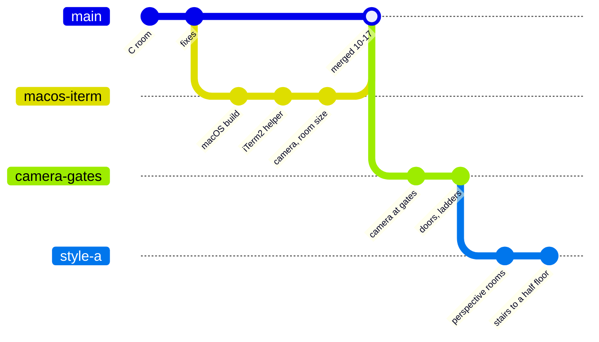

# 📝 clawd-room Dev Log

What changed and when, in short. How things work now is in the topic notes:

| Note | About |
| --- | --- |
| [[Rooms and Art]] | the look: perspective rooms, workspaces, gates, signs, art rules, layout numbers |
| [[Interaction]] | keys, camera, room size, linked windows, crossing, sessions |
| [[Platforms and Windows]] | WSL + Windows Terminal, macOS + iTerm2, window helpers |
| [[Engine and Tests]] | the code, the tests, random numbers |
| [[Test Checklist]] | what is still to check by eye |
| [[Animations]] | every Clawd frame |

Pictures are in `Screenshots/`. Details of every change: `git log`.

> [!info] Where the work is (branches)
> `main` has everything up to macOS support. The newer work waits on two branches for Zaviel's checks.

---
## 2026-10-18

### 🦶 Feet on the steps, a lower rail
> [!info] Branch `feat/style-a`
- On the stairs a Clawd is drawn with its feet on the **line through the steps' front edges** (its legs no longer hang into the steps below).
- The hand rail runs **parallel to that line**, 2 rows thick and 3–4 rows up: one solid line (no broken pixels), and it passes **under the Clawds' eyes**.

![[2026-10-18 office Clawds behind the railing.png|320]]

### 🚶 Walking the stairs behind the railing
> [!info] Branch `feat/style-a`
- Clawds **walk** up and down the stairs, along the half floor and through the well (the walking pose); only the treehouse ladder still uses the climbing pose.
- Clawds on the stairs and the half floor are **behind the railing**: it is drawn in among the Clawds, after those on the stairs and before those on the floor.
- No more **gap** in the railing where the stairs meet the half floor: the hand rail turns level at the last step and the balusters carry on at an even spacing.

![[2026-10-18 railing without the gap.png|320]] ![[2026-10-18 Clawds behind the railing.png|320]]

### ↙️ The well at the front left, fewer balusters
> [!info] Branch `feat/style-a`
- The stair well moved to the **front left** of the floor in every room; workspace rows near the front start right of it (in the park the front-left bush gives way).
- The half floor's railing has **fewer balusters** (every 7 px in the coffee shop, 9 px in the office).

![[2026-10-18 coffee well at the front left, fewer balusters.png|300]] ![[2026-10-18 park well at the front left.png|300]]

### ↔️ The well's steps run right to left, steps stand out
> [!info] Branch `feat/style-a`
- The stair well's steps now go **down from its right end to the left**, carrying on the stairs that go up to the right in the room below. A Clawd going down steps in at the right end and walks down to the left.
- No more lines from each step down to the floor. The coffee shop's stairs and platform are **darker wood** than the wall and the floor, with a **dark skirting** along the floor, so they no longer blend in.

![[2026-10-18 coffee well steps run right to left.png|300]] ![[2026-10-18 well close-up right to left.png|240]] ![[2026-10-18 coffee steps and skirting close-up.png|260]]

### 🔧 The steps inside the opening stay inside
> [!info] Branch `feat/style-a`
- The steps going up inside the opening are drawn as blocks from each tread down to the opening's floor; before, the first step's riser poked out below the opening onto the platform's edge.

![[2026-10-18 opening steps close-up.png|200]]

### 🪜 Real steps, no gaps, the window out from behind the sign
> [!info] Branch `feat/style-a`
- The stairs are **real steps**: blocks rising from the floor with a **lit tread** on each, a **baluster on each step** and the hand rail **parallel to the steps' edges** (a newel post at the foot). Same in the coffee shop.
- No **gap** at the back right corner (the platform stopped a pixel short of the wall) or **under the side doors** (each column now reaches the floor's pixel edge).
- The office **window** is drawn with the sign and goes where it is free (over the platform when there are stairs). The coffee shop's lamps moved left, clear of the opening.

![[2026-10-18 office real steps, window over the platform.png|300]] ![[2026-10-18 coffee real steps, lamps moved.png|300]] ![[2026-10-18 steps close-up.png|220]]

### 🚀 iTerm2: the profile starts the room
> [!info] Branch `feat/style-a`
- **Profiles → Clawd Room** now starts the room directly (no shell first); the window closes when the room quits.
- The room's window **opens at a quarter of the screen** (the launcher writes the quarter's grid into the profile), so it no longer opens small and then resizes.
- Typing `./clawd-room.sh` in a normal window **hands over**: the room's window opens in the quarter that window was in and the typed-in window closes, so no extra shell window is left (`--keep` keeps it; not closed when it has other tabs or panes).

### 🛝 A real swing, the park's well at the back right
> [!info] Branch `feat/style-a`
- The **swing** is a small swing set seen from the front: splayed wooden posts, a bar, chains and a red seat. At a swing workspace the Clawd **sits on the seat** between the chains; on the playground swing it swings towards you and back.
- The park's well moved to the **back right** like indoors, and the rows near the back **stop short of the well**: it no longer lands on a workspace (in any room).
- The Clawd Room profile **ignores Cmd = + − 0**, so iTerm2's font keys cannot change the pixel size.

![[2026-10-18 park swing set and well clear of workspaces.png|300]] ![[2026-10-18 park swing set.png|300]] ![[2026-10-18 swing workspace close-up.png|200]]

### 🔲 iTerm2: a fixed pixel size
> [!info] Branch `feat/style-a`
- On iTerm2 the room runs in **its own window with a "Clawd Room" profile** (Menlo 6, line spacing 1.1): every cell is 4x8 pt, so a **room pixel is always a square 4x4 pt** and the pixel art lines up the same each time. `--here` keeps the current window.
- iTerm2 3.5 ignores the escape code that would switch the open window's profile, hence the new window (details in [[Platforms and Windows]]).

### 🪨 The park's way down is a small stone well
> [!info] Branch `feat/style-a`
- The park's stone steps at the front were far too big and ran into the slide. The way down is now the **same small well as indoors** with a **stone rim and steps**, at the back of the lawn **between the swing and the slide** (`PARK_WELL_X` 0.4), clear of the tree.

![[2026-10-18 park stone well.png|300]]

### 📏 Taller doors and way up, the well on open floor, no glass
> [!info] Branch `feat/style-a`
- The **way up** (the opening on the platform) and the **side doors** are taller (up to 16 and 22 room pixels).
- The **stair well** moved forward onto open floor, away from the platform's face, with a **wooden rim all round** and no railing (the posts made it look like a bench).
- The **office railing** has no glass any more: slim **steel balusters**, further apart than the coffee shop's wooden ones.

![[2026-10-18 office steel balusters taller doors.png|300]] ![[2026-10-18 coffee taller doors well on the floor.png|300]]

### 🪜 Way up at the platform's right end, stair well at the back right
> [!info] Branch `feat/style-a`
- Following Zaviel's sketch: the **way up** sits at the **right end of the platform**; the platform **ends at the back corner** (it no longer runs along the right-hand wall).
- The **stair well** (way down) is small, at the **back right** of the floor in front of the platform's end; its steps go down from the back edge towards the front, a railing along its sides. Side doors a little narrower.

![[2026-10-18 office stairs well and doors.png|300]] ![[2026-10-18 coffee stairs well and doors.png|300]] ![[2026-10-18 stair well close-up.png|220]]

### 🚪 The way up, on the left of the platform
> [!info] Branch `feat/style-a`
- After mocking up five ideas and trying the lit archway, Zaviel kept the **opening where the stairs carry on upwards** (steps into the dark, a warm light at the top), now **small and on the left of the platform**, right where the stairs arrive.
- The platform sits a bit lower (**40%** of the wall instead of half); side doors are a normal width; the coffee shop's lamps moved over the right part of the room.

![[2026-10-18 way up coffee.png|300]] ![[2026-10-18 way up office.png|300]]

> [!example]- The ideas that were mocked up
> ![[2026-10-18 lit archway coffee.png|250]] ![[2026-10-18 entrance idea 3.png|250]] ![[2026-10-18 entrance idea 4.png|250]] ![[2026-10-18 entrance idea 5.png|250]]

### 🏢 Steel stairs in the office, a new way up, a smaller playground
> [!info] Branch `feat/style-a`
- The office's stairs are **steel with a glass railing**; the coffee shop keeps wooden stairs with balusters.
- The way up is an **opening where the stairs carry on upwards** into the dark, a warm light at the top (instead of a plain dark door).
- The park's swing and slide are **about half the size and simpler** (posts instead of A-frames, a plain chute).

![[2026-10-18 office steel stairs.png|300]] ![[2026-10-18 stairs to a half floor.png|300]] ![[2026-10-18 park playground at 45 degrees.png|300]]

### 🌳 Park playground at an angle, cleaner doors
> [!info] Branch `feat/style-a`
- The park's **swing and slide stand at 45°** into the room (the slide mirrored, sliding down to the front left); Clawds play on them where they are drawn.
- **Bushes only where there is no fence**, so a fence gate no longer overlaps them.
- Side doors are drawn column by column: clean edges, a frame, the leaf with its knob; the platform's door sits on the platform floor.

![[2026-10-18 park playground at 45 degrees.png|300]] ![[2026-10-18 coffee door closed and open.png|200]]

### 🗂️ Notes: plugins, diagrams, callouts
- Installed the Obsidian plugins ZeLedgerOS uses (Dataview, Templater, Calendar, Hover Editor, make.md, Style Settings, Minimal Theme Settings, CSS Editor, Mermaid ELK Renderer, Git; Git is turned off in this vault).
- The topic notes got diagrams (mermaid) and callouts; the Dev Log moved into `Docs/`.

### 🪜 The stairs go up to a half floor
> [!info] Branch `feat/style-a`
- The stairs now climb to a **platform half way up the back wall**; it runs to the right-hand wall, and the way up is a **door with dark inside** at the platform's end, behind the banister (no more hole in the ceiling).
- A Clawd going up walks up the stairs, along the platform and through the door; coming down it does the reverse.
- Side doors got a dark outline and a light frame: the coffee shop's doors had melted into its brown walls.

![[2026-10-18 half floor sketch (Zaviel).png|300]] ![[2026-10-18 stairs to a half floor.png|300]]
![[2026-10-18 coffee door closed and open.png|200]]

→ [[Rooms and Art]]

### 🏛️ The rooms in perspective are built
> [!info] Branch `feat/style-a` (on top of `feat/camera-gates`), not merged yet
- The three rooms are drawn in one-point perspective: workspaces in rows on the floor, Clawds sitting behind them, a sign with the room's name instead of the top banner, a dot over each head.
- Coffee shop and park have their own activities: a barista at a low bar; customers at cafe tables with a laptop, tablet or phone and a coffee or matcha; park Clawds on a bench, a swing or a picnic table.
- Gates live on the walls, ceiling and floor: doors that open while a Clawd passes, stairs on the back wall (drawn the way Zaviel sketched them, with a landing, a banister and an opening in the ceiling), a stair well, and in the park a fence gate, a treehouse and stone steps.
- Every test snapshot was rewritten on purpose.

![[2026-10-18 style A built office.png|250]] ![[2026-10-18 style A built coffee.png|250]] ![[2026-10-18 style A built park.png|250]]

Zaviel's sketch for the stairs and the doors that needed fixing:
![[2026-10-18 stairs as drawn (Zaviel).png|300]] ![[2026-10-18 doors to fix (Zaviel).png|200]]

→ [[Rooms and Art]]

### 🎨 A new look, picked from mockups
- The flat front view made doors and ladders look wrong, so Zaviel chose a new style from three rendered options: **A, one-point perspective** (chosen), B, 3/4 top-down, C, isometric.
- Mockup rounds settled the details: brighter rooms, a low bar with the machine on it, square chairs, stairs on the back wall with the menu on them, a stair well, a treehouse and stone steps in the park, names only for Clawds that need you.

![[2026-10-18 style options A perspective.png|200]] ![[2026-10-18 style options B three-quarter.png|200]] ![[2026-10-18 style options C isometric.png|200]]
![[2026-10-18 style A mockup coffee.png|250]] ![[2026-10-18 style A mockup park.png|250]] ![[2026-10-18 style A mockup stair well.png|250]]

### 🚪 Doors and ladders before the new look (replaced)
- Several rounds of doors and ladders at the window edge (slanted doors, rope ladders, framed hatches, a Terraria-style edge-on door, a slim ladder). The new look replaced them all.

![[2026-10-18 four windows before style A (Zaviel).png|350]]

---
## 2026-10-17

### 🎬 The camera at the gates
> [!info] Branch `feat/camera-gates`, not merged yet
- A Clawd walking out through a gate takes the camera with it; afterwards the camera zooms out to the whole room.
- Zooming never moves the gates. A room with only a visitor follows the visitor; an empty zoomed room waits for the first Clawd.
- `c` switches auto follow / free camera; ← → or Tab pick a Clawd; the status line shows what the camera does.
- Gates appear with a short animation, in both windows at the same moment.
- New iTerm2 windows open as a quarter of the screen.

![[2026-10-17 door option A open.png|300]] ![[2026-10-17 ladder option A.png|160]]

→ [[Interaction]]

### 🔗 Linked rooms
- Visitors step in through the door at once (they used to wait out of sight).
- `b` calls our Clawds back (or sends visitors home).
- NO SESSIONS shows only when no session runs anywhere.

### 🩹 Resizing in iTerm2
- After a resize the picture no longer stays scrolled up: the room stopped clearing the screen and parks the cursor at the top.
- Zoom magnifies only the room; words and signs stay normal size.
- Stripes while dragging come from iTerm2 re-wrapping the screen; they cannot be switched off.

![[2026-10-17 iTerm2 resize stripes (Zaviel).png|300]]

→ [[Platforms and Windows]]

### 🎥 Camera, room size and the iTerm2 helper
- `[` `]` zoom a camera that follows Clawds; `z` auto zoom.
- `r` picks the room size (AUTO, S, M, L, XL); the room grows with the window, then scales.
- On macOS the window helper is `osascript`: it finds iTerm2 windows and split panes, so gates work there too.

### 🍎 Runs on macOS
> [!success] Branch `feat/macos-iterm`, merged into `main`
- Builds and passes all tests on macOS; the scripts are executable; the hook works unchanged.

---
## 2026-10-16

### 🔧 The room is written in C
- The terminal room was rewritten from Python to C, checked line by line against the Python version; the Python room was removed (it is in git history). C uses a tenth of the CPU and memory.
- `clawd-room.sh` builds and starts it.

### 🧭 Opening at the right size (WSL)
- The room opens at 110x32 cells at 8 pt; the window is sized once from real window pixels.

### 🌱 New repo
- History restarted as one commit; the old history (pygame prototype, terminal room, linked windows) is archived in `zelvet-velvet/clawd-room-archive`.

---
## ⏳ Pending

> [!todo] Waiting
> - Merge `feat/camera-gates` and `feat/style-a` into `main` (after Zaviel's checks).
> - `README.md` still describes the old flat look in places (banner, gates at the window edge).
> - WSL: the profile from the dropdown opens at Windows Terminal's default size, then jumps once; planned a shortcut with `wt.exe -w new --size 60,18 -p "Clawd Room"`.
> - The room can block writing if the terminal stops reading (seen with iTerm2 in full screen).
> - Windows Terminal split panes are not seen separately yet.

## 💡 Ideas

> [!question] Maybe later
> - A seesaw in the park; an empty-desk look for Clawds that are away.
> - Camera polish: smooth zoom, a slight lead in the walking direction, a small bounce when a Clawd finishes, parallax in the park.
> - Full screen: a "hub" room that others visit, or several rooms side by side in one window.
