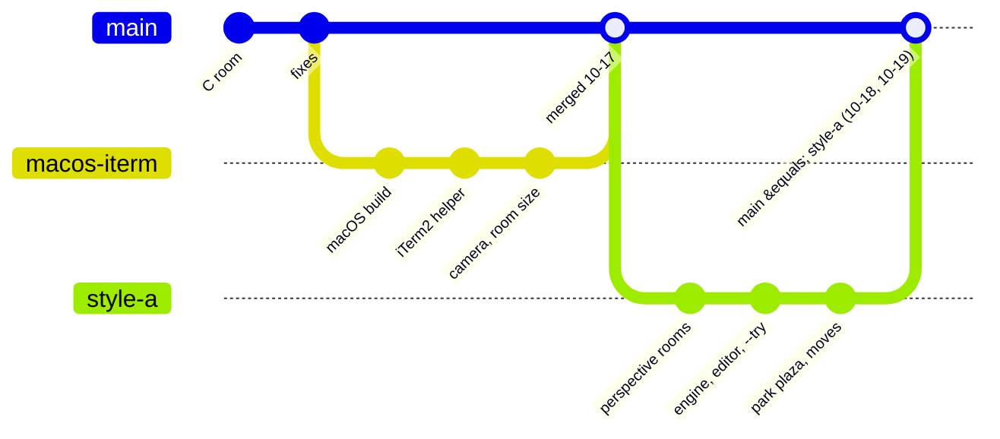

# 📝 clawd-room Dev Log

What changed and when, in short. How things work now is in the topic notes:

| Note | About |
| --- | --- |
| [[Rooms and Art]] | the look: perspective rooms, workspaces, gates, signs, art rules, layout numbers |
| [[Interaction]] | keys, camera, room size, linked windows, crossing, sessions |
| [[Platforms and Windows]] | WSL + Windows Terminal, macOS + iTerm2, window helpers |
| [[Engine and Tests]] | the code, the tests, random numbers |
| [[Test Checklist]] | what is still to check by eye |
| [[Animations]] | every Clawd frame |

Pictures are in `Screenshots/`, one folder per subject; browse them from [[Screenshots index]] (in `Screenshot Log/`). Details of every change: `git log`.

> [!info] Where the work is (branches)
> Since 2026-10-19 (William joined) every change is a branch and a pull request into `main`, merged by Zaviel ([[Collaboration]]). Before that `main` was kept equal to `feat/style-a`.

---
## 2026-10-18

## 2026-10-19

### 📷 Notes to browse the screenshots (Zaviel)
- `Screenshots/` is the **source** (the picture files, one folder per subject). A new folder **`Screenshot Log/`** has a note per subject (e.g. [[Park screenshots]]) showing its pictures newest first, each with its caption and the [[Dev Log]] entry or note it is in, and [[Screenshots index]] (subjects, counts, the newest picture).
- `python3 tools/vault_gallery.py` writes them from the files and the log; CMD_SYNC runs it. Notes named like their folder stay make.md's folder notes. The Interaction folder became "Interaction (keys, moving)".

### 🎨 The pixel editor: a colour picker like Figma's (Zaviel)
> [!info] Branch `test/wsl-queue`
- Picked from three mockups (A Office colour menu, **B Figma**, C Photoshop swatches): **Paint / Erase / Pick** buttons, a **colour field** (saturation × brightness) and a **hue bar** to click or drag, then the colour's hex and red / green / blue on one line (click to type), the file's colours with **+ Add** for a new one, and shades. The four sliders and the 16-colour set are gone.
- Changing a file colour still recolours its pixels everywhere; starting from the body colour or Erase makes a new colour.
- Fixed: in a short window the shortcut list ran over the colours. Now it is one line (`? SHORTCUTS  Q QUIT`) and **`?`** shows them in a box.

![[2026-10-19 editor palette mockup A, office.png|250]] ![[2026-10-19 editor palette mockup B, figma (picked).png|250]] ![[2026-10-19 editor palette mockup C, photoshop.png|250]]
![[2026-10-19 pixel editor, colour field palette.png|300]] ![[2026-10-19 pixel editor, a new colour added and painted.png|300]] ![[2026-10-19 pixel editor, shortcuts box in a short window.png|300]]

### 🎨 The pixel editor opens in its own window on WSL (Zaviel)
> [!info] Branch `test/wsl-queue`
- `./clawd-room.sh --edit NAME` opens the editor in its own **Clawd Room** window in the middle of the screen (70 x 78 %), as on the Mac; the window you typed in stays. `--here` runs it in the current window.
- The test queue is grouped (`Group A · …`), each test with an ID (**T1** … **T17**, questions **Q1**) to refer to, a `✅ date (who)` line for results and a folded *how to run* per group.

### 🪟 `--try` on WSL opens as one layout (Zaviel)
> [!info] Branch `test/wsl-queue`
- The four rooms open minimized, wait until each room has started, then **show together**, their visible frames edge to edge on the quarters like a snap layout (Windows 11's invisible window border is taken into account).
- Fixed: starting a `--try` closed the new rooms when an old one quit late (a WSL room takes a second to quit); `--desktop` is checked before anything is closed.
- They then form a **snap group** (one "Group" entry in the taskbar, minimise and bring back all four at once): Windows has no API for that, but doing what a person does works: the first room is snapped into the top-left quarter with **Win + ← + ↑**, then the other three are **picked in Snap Assist** (found by their titles). Each goes straight into its quarter. It takes the focus for a few seconds, only on your own desktop (not with `--desktop N`); `CLAWD_TRY_SNAP=0` skips it. (Tried step by step on Zaviel's screen; on the way a window snapped twice jumped to the other monitor.)

### 🗂️ Screenshots in folders (Zaviel)
- `Screenshots/` is sorted into one folder per subject: Office, Coffee shop, Park, Gates (stairs, doors, wells), Interaction (keys, moving), Engine and tools, Platforms, Style and mockups, Old look. Every picture in the notes still shows (Obsidian finds them by name).

### 🧪 A test queue (Zaviel)
- The [[Test Checklist]] starts with a **test queue**: what to test next, one big callout per group with a bold title per test and its checks as boxes under it, and a foldable **How to test** with the steps. Five WSL tests are queued (the profile at 5 pt, the rooms and the bar, sending and moving, desks staying, the pixel editor).
- Done tests move down into their subject; the old WSL list and the 8 pt checks it replaced are gone.

### 🤝 A collaborator: William (Zaviel)
- William Pan (`WilliamPanTW`) joins. From now on **everyone works on branches and pull requests**; only Zaviel merges into `main` (the old "`feat/style-a` = `main`" practice ends).
- `CONTRIBUTING.md` (setup, the everyday loop, what to work on, tests, rules), [[Collaboration]] (the same in short, and how to share this vault), a pull request template; `CLAUDE.md` and the [[LLM_GUIDE]] tell each person's Claude Code whom it works with.

### 🪟 On WSL again (Zaviel)
- All tests pass on WSL. The Mac's snapshots were made with fused multiply-add (one rounding for `a*b+c`); the build now uses it on both platforms, so they agree (Zaviel's choice).
- **`--try` on WSL**: four linked rooms in the screen quarters with Windows Terminal; `--try --desktop 3` opens them on another virtual desktop without switching to it (for testing while you work).
- **5 pt, like the Mac**: the Clawd Room profile's font is 5 pt and a room opens as the quarter of the screen it is in, so a room shows as many pixels as on the Mac (it was 117x68 room pixels a quarter at 8 pt, now about 188x100). Needs `python3 setup_profile.py --update` once.

![[2026-10-19 wsl try, four rooms at 8 pt.png|300]] → ![[2026-10-19 wsl try, four rooms at 5 pt.png|300]]

### 🧭 Desks stay in their room
> [!bug] Fixed
> With several rooms open, workspaces vanished from one room and showed up in another. Two causes: the split was `crc32 % number of rooms`, so a room opening or closing moved nearly **every** session; and a room busy drawing that missed its heartbeat for 4 s counted as gone, so everything was split again (and back).
- Now the split is **sticky**: each room says which sessions it shows, and a session a running room shows **stays there** (Zaviel: one session, four rooms opening one by one, and the desk moved each time). A session nobody shows (new, or its room closed) goes to the room that scores highest for it (rendezvous hashing). A quiet room whose presence file is still there keeps its share for 15 s.
- `--try` starts its made-up sessions once all four rooms are up, so they spread over the rooms.
- `tools/split_smoke.py`: one room, three more open one by one (nothing moves), new sessions (each in one room), a room freezes 7 s (nothing moves), the first closes (only its Clawds go elsewhere).

### ⌨️ The g / m hint only while the key is held
- It goes soon after the key's repeats stop (a terminal never says a key was let go); the room learns the keyboard's repeat delay and rate from the repeats it gets.

### 💬 One bar along the bottom
> [!info] Branch `feat/style-a`
- The white status line was the terminal's last row, tiny at the fixed font: it is now drawn **in the room's pixel font** on a dark bar (as big as the yellow hint), centred, wrapped between phrases, growing upwards for the help.
- The `g` and `m` hints are **one yellow line** under it: `G SEND / M MOVE NAME + ARROW:` with the key held bright and the other dim, then which arrow goes where.
- The pixel font got `[ ] ( ) , =`. Tests read the bar's text from `CLAWD_STATUS_LOG` (it is pixels now).

![[2026-10-19 bottom bar, status and g m hint.png|420]]

### 📦 Moving a Clawd: packing and unpacking (step 2 of 3)
> [!info] Branch `feat/style-a`
- `m` + arrow: the Clawd goes to its desk, the **workspace shrinks into a cardboard box** (1.4 s), **poof**, it carries the box out by the gate; in the new room it walks to its new desk, sets the box down, **poof**, the workspace **grows out of it** (1.2 s). A move nobody takes comes back and unpacks at the old desk.
- `m` + arrow again on a Clawd that **already carries its box** (on its way out, or just moved in) sends it **straight to the new gate** with it, no packing again.
- Fixed: the room it left **blinked one frame** of the Clawd and its desk after it crossed: the desks were laid out for the Clawds before that frame's moves, and one had just left, so a desk slot drew a stale Clawd. Now the layout is done again when the room's Clawds change during a frame (found with a frame log of two linked rooms in ptys).
- The box can be drawn in the pixel editor as `box` in `sprites/items.txt`.

![[2026-10-19 move, packing in the office.png|420]] ![[2026-10-19 move, unpacking in the park.png|420]]

### 📦 Moving a Clawd to another room (step 1 of 3)
> [!info] Branch `feat/style-a`
- Pick a Clawd (`Tab` or `<` `>`), then **`m` + an arrow**: it walks to that gate (even while it works) and goes through, and from then on it **lives in that room**. A line at the bottom says `MOVE NAME:` and which arrow goes where.
- How the rooms agree: the room it moved into says so in its **heartbeat** (`"homes": [sids]`); every room shows a session there if that room runs, otherwise by its crc32 as before. The room it left keeps it until it sees that claim (back home after 10 s if none comes). Remembered **only while the rooms run**: when that room closes, the Clawd goes back to its usual room.
- Next: packing into a box with a poof, carrying it, unpacking at the new desk (step 2); dragging a Clawd onto a gate with the mouse (step 3). `tools/move_smoke.py` checks the move with two rooms in ptys.

### 🏙️ One building each
> [!info] Branch `feat/style-a`
- From Zaviel's outlines: with the way up, the **right-hand building is the side of the sandstone building** at the back right (the same colours and windows, floors up out of the picture, no roof deck), so the two read as **one corner building**; the brick building's piers are subtle so it reads as **one building** too.

![[2026-10-19 park, one corner building on the right.png|420]]

### 🏢 The park's building, redesigned
> [!info] Branch `feat/style-a`
- From a mockup and Zaviel's notes: a **tall building** (floors of windows up out of the picture, piers between bays, staggered brick, a stone ground floor with low windows), **behind the side buildings**; a **short stoop** (stone steps, an iron railing, a landing as wide as the entrance); a **double door** with a lit transom, a canopy, a plaque and two lamps. The building is its own item (`backdrop`), so desks and the side buildings may stand in front of it. Beyond the park's back corner (above the right-hand building) **another building** rises, in the **same style in sandstone** (it was a grey modern block first), so the brick one does not just carry on.

![[2026-10-18 park, sandstone neighbour.png|300]]

![[2026-10-18 park, another building beyond the corner.png|300]] ![[2026-10-18 park, another building (no side building).png|300]]

![[2026-10-18 park building mockup.png|300]] ![[2026-10-18 park tall building and stoop.png|420]]

### 🏛️ The park's way up: a terrace and a stair tower
> [!info] Branch `feat/style-a`
- The treehouse did not fit a city plaza. Picked from three mockups (A): **stone stairs** up to a **terrace** along the back right with a **stone balustrade**. The stair tower first put at its end did not make sense, so the terrace is now the **front steps of a brick building** (a stoop): windows on every floor, its **front door at the top of the steps** is the way up. The side buildings' flat roofs became **decks seen from above**. Then the building **fills the back right** (from the stairs' foot to the edge, up out of the picture, down to the ground behind the steps), with the side buildings in front of it.

![[2026-10-18 park building fills the back right.png|420]] It is the indoor stairs code with a stone style (Clawds walk up behind the railing); the tree moved to the back right corner; the third lamp only shows without the terrace.

![[2026-10-18 park way up mockups.png|300]] ![[2026-10-18 park terrace and stair tower.png|600]]

### 🔍 `o` works, and names what it shows
> [!bug] Fixed
> The key reader only passed on a fixed list of keys and `o` was not in it, so the debug overlay never came on from the keyboard. Now it does, and each box is labelled with what it is (SIGN, LAMP, DESK, GATE-LEFT, RAIL …).

![[2026-10-18 debug overlay with labels.png|420]]

### 🧱 The park's gates are buildings
> [!info] Branch `feat/style-a`
- A hedge with an opening did not say where it leads: a side with a gate is now the side wall of a **brick building** (courses, cornice, windows upstairs) with a **door** on the ground floor, opening like the indoor doors.
- Then: a **flat roof** (a stone parapet); the building is taller so the **door fits the ground floor**; three **framed windows** upstairs, evenly spaced; the floor line, courses and parapet drawn as clean pixel lines.

![[2026-10-18 park buildings, flat roof.png|420]]

![[2026-10-18 park buildings with doors.png|420]]
![[2026-10-18 park buildings, all gates.png|600]]

### 🏙️ The park is a city plaza
> [!info] Branch `feat/style-a`
- Picked from three mockups (C): a **far city skyline** instead of hills, a **stone promenade** along the back of the lawn with **street lamps and benches** (wall items in `rooms/park.txt`, so the placer keeps desks off them), and on a side with a gate a low **hedge wall with a stone archway** showing the street beyond (instead of the wooden fence). The tree, treehouse, playground and stone well stay.

![[2026-10-18 city park mockups.png|300]] ![[2026-10-18 city plaza park.png|420]]
![[2026-10-18 city plaza park, all gates.png|600]]

### 🕳️ Down the well, not across it
> [!info] Branch `feat/style-a`
- A Clawd going down the stair well now **walks down its steps**: drawn lower the further along the steps it is, and cut off at the hole's front edge, so it disappears into the hole (and rises out of it coming up).

![[2026-10-18 down the well.png|600]]

### 🔀 Merged into main
> [!success] `main` = `feat/style-a` (with `feat/camera-gates` in it), fast-forwarded on 2026-10-18.

### 🎞️ Engine step 4: the animator, animated props
> [!info] Branch `feat/style-a`
- `c/anim.c` eases named values over time; the **gates appearing** (ease out) and the **doors swinging** (ease in-out, turning back from wherever they are) use it instead of their own timers.
- **Props can be animated**: frames `lamp~2`, `lamp~3` … are shown in turn; in the editor **`F`** adds the next frame. The pixel font got `~`.
- With this the engine plan is done: scene and layers, the placer, sprites and room files with the editor, the animator.

### 🎨 Engine step 3: props as sprites, rooms as text files, the pixel editor
> [!info] Branch `feat/style-a`
- **`sprites/props.txt`** holds the window, plant, menu, lamps and shelf (made from the drawing code: every picture stayed the same). **`rooms/*.txt`** say where each room's wall items go.
- Running rooms **read the sprite and room files again when they change**.
- **`./clawd-room.sh --edit NAME`**: a pixel editor in the terminal with the mouse (paint, erase, pick, add colours, undo, resize, other sprites and files); it saves after each stroke, so the rooms next to it change as you draw.
- Fixed on the way: on macOS the room never found the `sprites/` folder (edits to the sprite files were ignored).
- Then the editor opens **in the middle of the screen**; the help is grouped (MOUSE / EDIT / SIZE) with **key caps**; the panel shows the **colour to paint with sliders** (a file colour recolours all its pixels), its **shades**, the file's colours (a dot: used in this sprite) and more colours; the **pixel under the pointer** is outlined with its place and colour. A colour can also be **typed**: its hex code (`#` or a click, `RRGGBB`) or each red / green / blue number (0–255).

  ![[2026-10-18 pixel editor, new palette and help.png|480]]
- From Zaviel: `--edit list` prints what can be opened; `q` asks **save (S) or discard (D)** (discard puts the files back as they were when opened; the rooms change back too); the editor opens in its own window **without closing the one you typed in**, so `q` takes you back to your prompt.

![[2026-10-18 pixel editor with rooms.png|480]]

### 🚪 Gates stay put; `g` asks where to
> [!info] Branch `feat/style-a`
- **Gates no longer come and go.** Each room's window helper walks every iTerm2 window; with several rooms open a list could take over 3 s, so the room thought its window was gone, dropped its gates and waited again. The last list is kept for 10 s now, and a neighbour's heartbeat without its grid is not taken as a move. In a 50 s `--try` run all gates appeared after about 10 s and stayed.
- **`g` lets you pick where to send a Clawd**: with several linked rooms, hold `g` and press an arrow. While `g` is held (its key repeats keep it on; terminals do not report key releases) a line along the bottom of the room, in the room's pixel font, says which arrow goes where (`G + ARROW:  > COFFEE DOOR  V PARK STAIRS DOWN`). With one linked room `g` sends straight away, as before. (A list window came first; Zaviel preferred no window.)

![[2026-10-18 hold g hint.png|360]]

### 📐 Engine step 2: the placer, 107 overlaps → 0
> [!info] Branch `feat/style-a`
- Wall items (sign, window, plant, menu, lamps, cup shelf, park signpost) are placed from each room's data by priority, around what the gates need to keep clear; the sign hangs higher instead of overlapping in small windows.
- Workspaces are measured and only put where they are clear of the stairs, opening, doors, well, treehouse, playground and bushes; the bar first in the coffee shop; packed around obstacles when spreading evenly does not fit.
- The park's swing and slide take the floor that is left (left out when crowded); bushes that would cover something are left out.
- `--check`: **0 overlaps** in every room × gates × crowd × size. Very small rooms seat fewer Clawds than before (they used to overlap); AUTO room size asks the placer.
- Found while testing with `--try`: gates come and go between linked rooms (older than this step); `--try` now uses a fixed scale while that is looked into.

![[2026-10-18 placer office all gates 181x53.png|420]]
![[2026-10-18 placer coffee all gates 181x53.png|420]]
![[2026-10-18 placer park all gates 181x53.png|420]]

### 🧱 Engine step 1: the scene, the overlap check, the gallery, the overlay
> [!info] Branch `feat/style-a`
- The room is now drawn as a **scene of items on layers** (`c/scene.c`). The switch changed no pixel (every snapshot matched before updating).
- A Clawd's **dot, bubbles and swing ropes follow it** in depth; the needs-you **name** stays on top.
- **`--check`** finds items painting over each other in every room × gates × crowd × size: **107** today (desks over desks, gates and the sign; the railing over the sign; park bushes). Kept as a snapshot so new ones fail the tests; step 2 (the placer) brings it to 0.
- **`make -C c gallery`** writes contact sheets of all those scenes; key **`o`** shows the debug overlay.

![[2026-10-18 debug overlay.png|320]]

### 🧪 `--try`: four linked rooms in one command; the engine plan
> [!info] Branch `feat/style-a`
- `./clawd-room.sh --try` opens **four linked Clawd Room windows** in the four quarters (office, coffee shop / park, office) with **made-up Clawds** (`tools/demo_events.py`), so left/right and up/down gates all show at once. Quitting one closes all four (`--try close` from anywhere, `--try real` for real sessions only). They use their own link folder.
- Talked through why fixes kept causing new collisions and **agreed an engine design**: items, seven layers, a placer for wall and floor, rooms as data, props as sprite files with a pixel editor inside the room, an animator, and an overlap check / debug overlay / gallery. See [[Engine Design]].

### 🦶 Feet on the steps, a lower rail
> [!info] Branch `feat/style-a`
- On the stairs a Clawd is drawn with its feet on the **line through the steps' front edges** (its legs no longer hang into the steps below).
- The hand rail runs **parallel to that line**, 2 rows thick and 3–4 rows up: one solid line (no broken pixels), and it passes **under the Clawds' eyes**.
- Their **dot** (and the needs-you sign and name) is drawn **behind the railing** too.

![[2026-10-18 office Clawds behind the railing.png|320]]

### 🚶 Walking the stairs behind the railing
> [!info] Branch `feat/style-a`
- Clawds **walk** up and down the stairs, along the half floor and through the well (the walking pose); only the treehouse ladder still uses the climbing pose.
- Clawds on the stairs and the half floor are **behind the railing**: it is drawn in among the Clawds, after those on the stairs and before those on the floor.
- No more **gap** in the railing where the stairs meet the half floor: the hand rail turns level at the last step and the balusters carry on at an even spacing.

![[2026-10-18 railing without the gap.png|320]] ![[2026-10-18 Clawds behind the railing.png|320]]

### ↙️ The well at the front left, fewer balusters
> [!info] Branch `feat/style-a`
- The stair well moved to the **front left** of the floor in every room; workspace rows near the front start right of it (in the park the front-left bush gives way).
- The half floor's railing has **fewer balusters** (every 7 px in the coffee shop, 9 px in the office).

![[2026-10-18 coffee well at the front left, fewer balusters.png|300]] ![[2026-10-18 park well at the front left.png|300]]

### ↔️ The well's steps run right to left, steps stand out
> [!info] Branch `feat/style-a`
- The stair well's steps now go **down from its right end to the left**, carrying on the stairs that go up to the right in the room below. A Clawd going down steps in at the right end and walks down to the left.
- No more lines from each step down to the floor. The coffee shop's stairs and platform are **darker wood** than the wall and the floor, with a **dark skirting** along the floor, so they no longer blend in.

![[2026-10-18 coffee well steps run right to left.png|300]] ![[2026-10-18 well close-up right to left.png|240]] ![[2026-10-18 coffee steps and skirting close-up.png|260]]

### 🔧 The steps inside the opening stay inside
> [!info] Branch `feat/style-a`
- The steps going up inside the opening are drawn as blocks from each tread down to the opening's floor; before, the first step's riser poked out below the opening onto the platform's edge.

![[2026-10-18 opening steps close-up.png|200]]

### 🪜 Real steps, no gaps, the window out from behind the sign
> [!info] Branch `feat/style-a`
- The stairs are **real steps**: blocks rising from the floor with a **lit tread** on each, a **baluster on each step** and the hand rail **parallel to the steps' edges** (a newel post at the foot). Same in the coffee shop.
- No **gap** at the back right corner (the platform stopped a pixel short of the wall) or **under the side doors** (each column now reaches the floor's pixel edge).
- The office **window** is drawn with the sign and goes where it is free (over the platform when there are stairs). The coffee shop's lamps moved left, clear of the opening.

![[2026-10-18 office real steps, window over the platform.png|300]] ![[2026-10-18 coffee real steps, lamps moved.png|300]] ![[2026-10-18 steps close-up.png|220]]

### 🚀 iTerm2: the profile starts the room
> [!info] Branch `feat/style-a`
- **Profiles → Clawd Room** now starts the room directly (no shell first); the window closes when the room quits.
- The room's window **opens at a quarter of the screen** (the launcher writes the quarter's grid into the profile), so it no longer opens small and then resizes.
- Typing `./clawd-room.sh` in a normal window **hands over**: the room's window opens in the quarter that window was in and the typed-in window closes, so no extra shell window is left (`--keep` keeps it; not closed when it has other tabs or panes).

### 🛝 A real swing, the park's well at the back right
> [!info] Branch `feat/style-a`
- The **swing** is a small swing set seen from the front: splayed wooden posts, a bar, chains and a red seat. At a swing workspace the Clawd **sits on the seat** between the chains; on the playground swing it swings towards you and back.
- The park's well moved to the **back right** like indoors, and the rows near the back **stop short of the well**: it no longer lands on a workspace (in any room).
- The Clawd Room profile **ignores Cmd = + − 0**, so iTerm2's font keys cannot change the pixel size.

![[2026-10-18 park swing set and well clear of workspaces.png|300]] ![[2026-10-18 park swing set.png|300]] ![[2026-10-18 swing workspace close-up.png|200]]

### 🔲 iTerm2: a fixed pixel size
> [!info] Branch `feat/style-a`
- On iTerm2 the room runs in **its own window with a "Clawd Room" profile** (Menlo 6, line spacing 1.1): every cell is 4x8 pt, so a **room pixel is always a square 4x4 pt** and the pixel art lines up the same each time. `--here` keeps the current window.
- iTerm2 3.5 ignores the escape code that would switch the open window's profile, hence the new window (details in [[Platforms and Windows]]).

### 🪨 The park's way down is a small stone well
> [!info] Branch `feat/style-a`
- The park's stone steps at the front were far too big and ran into the slide. The way down is now the **same small well as indoors** with a **stone rim and steps**, at the back of the lawn **between the swing and the slide** (`PARK_WELL_X` 0.4), clear of the tree.

![[2026-10-18 park stone well.png|300]]

### 📏 Taller doors and way up, the well on open floor, no glass
> [!info] Branch `feat/style-a`
- The **way up** (the opening on the platform) and the **side doors** are taller (up to 16 and 22 room pixels).
- The **stair well** moved forward onto open floor, away from the platform's face, with a **wooden rim all round** and no railing (the posts made it look like a bench).
- The **office railing** has no glass any more: slim **steel balusters**, further apart than the coffee shop's wooden ones.

![[2026-10-18 office steel balusters taller doors.png|300]] ![[2026-10-18 coffee taller doors well on the floor.png|300]]

### 🪜 Way up at the platform's right end, stair well at the back right
> [!info] Branch `feat/style-a`
- Following Zaviel's sketch: the **way up** sits at the **right end of the platform**; the platform **ends at the back corner** (it no longer runs along the right-hand wall).
- The **stair well** (way down) is small, at the **back right** of the floor in front of the platform's end; its steps go down from the back edge towards the front, a railing along its sides. Side doors a little narrower.

![[2026-10-18 office stairs well and doors.png|300]] ![[2026-10-18 coffee stairs well and doors.png|300]] ![[2026-10-18 stair well close-up.png|220]]

### 🚪 The way up, on the left of the platform
> [!info] Branch `feat/style-a`
- After mocking up five ideas and trying the lit archway, Zaviel kept the **opening where the stairs carry on upwards** (steps into the dark, a warm light at the top), now **small and on the left of the platform**, right where the stairs arrive.
- The platform sits a bit lower (**40%** of the wall instead of half); side doors are a normal width; the coffee shop's lamps moved over the right part of the room.

![[2026-10-18 way up coffee.png|300]] ![[2026-10-18 way up office.png|300]]

> [!example]- The ideas that were mocked up
> ![[2026-10-18 lit archway coffee.png|250]] ![[2026-10-18 entrance idea 3.png|250]] ![[2026-10-18 entrance idea 4.png|250]] ![[2026-10-18 entrance idea 5.png|250]]

### 🏢 Steel stairs in the office, a new way up, a smaller playground
> [!info] Branch `feat/style-a`
- The office's stairs are **steel with a glass railing**; the coffee shop keeps wooden stairs with balusters.
- The way up is an **opening where the stairs carry on upwards** into the dark, a warm light at the top (instead of a plain dark door).
- The park's swing and slide are **about half the size and simpler** (posts instead of A-frames, a plain chute).

![[2026-10-18 office steel stairs.png|300]] ![[2026-10-18 stairs to a half floor.png|300]] ![[2026-10-18 park playground at 45 degrees.png|300]]

### 🌳 Park playground at an angle, cleaner doors
> [!info] Branch `feat/style-a`
- The park's **swing and slide stand at 45°** into the room (the slide mirrored, sliding down to the front left); Clawds play on them where they are drawn.
- **Bushes only where there is no fence**, so a fence gate no longer overlaps them.
- Side doors are drawn column by column: clean edges, a frame, the leaf with its knob; the platform's door sits on the platform floor.

![[2026-10-18 park playground at 45 degrees.png|300]] ![[2026-10-18 coffee door closed and open.png|200]]

### 🗂️ Notes: plugins, diagrams, callouts
- Installed the Obsidian plugins ZeLedgerOS uses (Dataview, Templater, Calendar, Hover Editor, make.md, Style Settings, Minimal Theme Settings, CSS Editor, Mermaid ELK Renderer, Git; Git is turned off in this vault).
- The topic notes got diagrams (mermaid) and callouts; the Dev Log moved into `Docs/`.

### 🪜 The stairs go up to a half floor
> [!info] Branch `feat/style-a`
- The stairs now climb to a **platform half way up the back wall**; it runs to the right-hand wall, and the way up is a **door with dark inside** at the platform's end, behind the banister (no more hole in the ceiling).
- A Clawd going up walks up the stairs, along the platform and through the door; coming down it does the reverse.
- Side doors got a dark outline and a light frame: the coffee shop's doors had melted into its brown walls.

![[2026-10-18 half floor sketch (Zaviel).png|300]] ![[2026-10-18 stairs to a half floor.png|300]]
![[2026-10-18 coffee door closed and open.png|200]]

→ [[Rooms and Art]]

### 🏛️ The rooms in perspective are built
> [!info] Branch `feat/style-a` (on top of `feat/camera-gates`), not merged yet
- The three rooms are drawn in one-point perspective: workspaces in rows on the floor, Clawds sitting behind them, a sign with the room's name instead of the top banner, a dot over each head.
- Coffee shop and park have their own activities: a barista at a low bar; customers at cafe tables with a laptop, tablet or phone and a coffee or matcha; park Clawds on a bench, a swing or a picnic table.
- Gates live on the walls, ceiling and floor: doors that open while a Clawd passes, stairs on the back wall (drawn the way Zaviel sketched them, with a landing, a banister and an opening in the ceiling), a stair well, and in the park a fence gate, a treehouse and stone steps.
- Every test snapshot was rewritten on purpose.

![[2026-10-18 style A built office.png|250]] ![[2026-10-18 style A built coffee.png|250]] ![[2026-10-18 style A built park.png|250]]

Zaviel's sketch for the stairs and the doors that needed fixing:
![[2026-10-18 stairs as drawn (Zaviel).png|300]] ![[2026-10-18 doors to fix (Zaviel).png|200]]

→ [[Rooms and Art]]

### 🎨 A new look, picked from mockups
- The flat front view made doors and ladders look wrong, so Zaviel chose a new style from three rendered options: **A, one-point perspective** (chosen), B, 3/4 top-down, C, isometric.
- Mockup rounds settled the details: brighter rooms, a low bar with the machine on it, square chairs, stairs on the back wall with the menu on them, a stair well, a treehouse and stone steps in the park, names only for Clawds that need you.

![[2026-10-18 style options A perspective.png|200]] ![[2026-10-18 style options B three-quarter.png|200]] ![[2026-10-18 style options C isometric.png|200]]
![[2026-10-18 style A mockup coffee.png|250]] ![[2026-10-18 style A mockup park.png|250]] ![[2026-10-18 style A mockup stair well.png|250]]

### 🚪 Doors and ladders before the new look (replaced)
- Several rounds of doors and ladders at the window edge (slanted doors, rope ladders, framed hatches, a Terraria-style edge-on door, a slim ladder). The new look replaced them all.

![[2026-10-18 four windows before style A (Zaviel).png|350]]

---
## 2026-10-17

### 🎬 The camera at the gates
> [!info] Branch `feat/camera-gates`, not merged yet
- A Clawd walking out through a gate takes the camera with it; afterwards the camera zooms out to the whole room.
- Zooming never moves the gates. A room with only a visitor follows the visitor; an empty zoomed room waits for the first Clawd.
- `c` switches auto follow / free camera; ← → or Tab pick a Clawd; the status line shows what the camera does.
- Gates appear with a short animation, in both windows at the same moment.
- New iTerm2 windows open as a quarter of the screen.

![[2026-10-17 door option A open.png|300]] ![[2026-10-17 ladder option A.png|160]]

→ [[Interaction]]

### 🔗 Linked rooms
- Visitors step in through the door at once (they used to wait out of sight).
- `b` calls our Clawds back (or sends visitors home).
- NO SESSIONS shows only when no session runs anywhere.

### 🩹 Resizing in iTerm2
- After a resize the picture no longer stays scrolled up: the room stopped clearing the screen and parks the cursor at the top.
- Zoom magnifies only the room; words and signs stay normal size.
- Stripes while dragging come from iTerm2 re-wrapping the screen; they cannot be switched off.

![[2026-10-17 iTerm2 resize stripes (Zaviel).png|300]]

→ [[Platforms and Windows]]

### 🎥 Camera, room size and the iTerm2 helper
- `[` `]` zoom a camera that follows Clawds; `z` auto zoom.
- `r` picks the room size (AUTO, S, M, L, XL); the room grows with the window, then scales.
- On macOS the window helper is `osascript`: it finds iTerm2 windows and split panes, so gates work there too.

### 🍎 Runs on macOS
> [!success] Branch `feat/macos-iterm`, merged into `main`
- Builds and passes all tests on macOS; the scripts are executable; the hook works unchanged.

---
## 2026-10-16

### 🔧 The room is written in C
- The terminal room was rewritten from Python to C, checked line by line against the Python version; the Python room was removed (it is in git history). C uses a tenth of the CPU and memory.
- `clawd-room.sh` builds and starts it.

### 🧭 Opening at the right size (WSL)
- The room opens at 110x32 cells at 8 pt; the window is sized once from real window pixels.

### 🌱 New repo
- History restarted as one commit; the old history (pygame prototype, terminal room, linked windows) is archived in `zelvet-velvet/clawd-room-archive`.

---
## ⏳ Pending

> [!todo] Next session (2026-10-20, on Windows WSL2)
> Everything since 2026-10-17 was built and tested on macOS only. On WSL2:
> 1. `git pull` (branch `feat/style-a` = `main`), `make -C c`, then `make -C c test`, `smoke`, `linksmoke`, `movesmoke`, `splitsmoke` and `clawd-room --check`: they should pass as on macOS (the snapshots came from macOS clang; if only float rounding differs, say so before updating anything).
> 2. Check that the hook symlink `~/clawd-room` still points at the WSL copy of the repo.
> 3. By eye in Windows Terminal (see [[Test Checklist]], the WSL2 part): style A rooms and the park, the bottom bar's size at the WSL font, linked rooms side by side and stacked, `g` / `m` with the hint, packing and unpacking, no desks hopping, the pixel editor with the mouse (`--edit`).
> 4. WSL has no `--try` yet (it is iTerm2 only): open the linked windows by hand, or build a WSL `--try` with `wt.exe`.
>
> Then: **moving, step 3**: drag a Clawd onto a door, the stairs or the well with the mouse. (Settled: `--try real` stays split; uneven shares are fine, `m` moves a Clawd.)

> [!todo] Waiting
> - ~~The engine~~: all four steps are built ([[Engine Design]]).
> - `README.md` still describes the old flat look in places (banner, gates at the window edge).
> - WSL: the profile from the dropdown opens at Windows Terminal's default size, then jumps once; planned a shortcut with `wt.exe -w new --size 60,18 -p "Clawd Room"`.
> - The room can block writing if the terminal stops reading (seen with iTerm2 in full screen).
> - Windows Terminal split panes are not seen separately yet.

> [!todo] Later: less CPU (Zaviel, 2026-10-19)
> - **Dirty rects**: redraw only the parts of the canvas that changed (the terminal output is already diffed cell by cell and written once per frame, i.e. double buffered; the cost left is drawing the whole canvas 16 times a second).
> - **Idle frames**: skip drawing when nothing moves (the same frame again).
> - **Hidden windows**: when the room's window is covered, minimised or on another virtual desktop, stop drawing (FPS 0) and only keep reading events and the link heartbeats at a slow rate; draw again when it shows.

## 💡 Ideas

> [!question] Maybe later
> - A seesaw in the park; an empty-desk look for Clawds that are away.
> - Camera polish: smooth zoom, a slight lead in the walking direction, a small bounce when a Clawd finishes, parallax in the park.
> - Full screen: a "hub" room that others visit, or several rooms side by side in one window.
