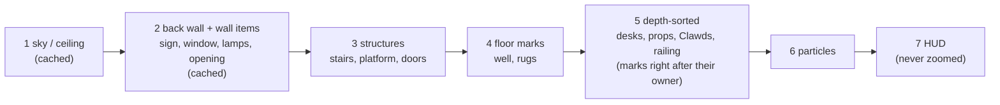
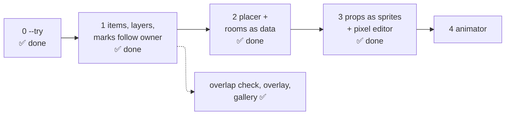

# 🧱 Engine Design (agreed 2026-10-18; steps 1–3 built)

> [!abstract] In short
> Everything on screen becomes an **item** in one list, drawn in **seven layers**, placed by a **placer** that keeps items apart. Rooms are described as **data**, small props are **sprite files** you edit in a **pixel editor inside the room**, and one **animator** moves doors, gates and props. An **overlap check**, a **debug overlay** and a **gallery** come with it. Today's drawing is in [[Engine and Tests]]; the look in [[Rooms and Art]].

> [!info] Why
> Each drawing function knew nothing about the others, so items kept colliding (sign over window, well on a workspace, lamp on the opening, rail over faces, dot over the rail) and each fix was a special case.

> [!success] Step 1 (2026-10-18)
> - `c/scene.c`: items (kind, layer, depth, owner, anchor, draw callback), sorted by layer → depth → owner → order added; it can **measure** each item's box and who paints over whom. `draw_room` builds the scene; the drawing code is unchanged (the refactor matched every snapshot without `--update`).
> - A Clawd's **marks** (dot, bubbles, signs, swing ropes) follow it; its **name** when it needs you is a label on top.
> - **Overlap check** `clawd-room --check` (snapshot `overlap.txt`): **107** today, mostly desks over desks / gates / the sign, the railing over the sign, the park's bushes. Step 2 brings it to 0. Lamps and the plant are still in the cached background, so the check cannot see them yet (e.g. the coffee menu on a lamp in small windows).
> - **Gallery** `make -C c gallery` → `gallery/gallery-{office,coffee,park}.png` (gates × size rows, empty / some / crowded columns).
> - **Debug overlay**: key `o`.
>
> ![[2026-10-18 debug overlay.png|320]] ![[2026-10-18 gallery coffee (part).png|420]]

> [!success] Step 3 (2026-10-18): props as sprites, rooms as text, the pixel editor
> - **`sprites/props.txt`**: the window, plant, menu, lamps and shelf as sprites (made from the code's drawing, so nothing changed); a prop's size is its grid's size, and the placer uses it.
> - **`rooms/office.txt`, `coffee.txt`, `park.txt`**: each room's wall items (kind, size, band, preferred place with / without stairs, priority, when).
> - **Saved changes show at once**: running rooms read the sprite and room files again when they change.
> - **The pixel editor** `./clawd-room.sh --edit NAME` (NAME: a prop like `window`, or any sprite in `items.txt` / `clawd.txt`): the sprite zoomed, the palette and 16 colours to add, the sprite at its real size; left paints, right erases, Alt + click picks, `u` / `r` undo / redo, `<` `>` the sprite before / after, Tab the next file, `+` `-` zoom, `w` `n` wider / narrower, `t` `s` taller / shorter, `q` quits. It saves after each stroke.
> - Found on the way: the room never found `sprites/` on macOS (it looked for `/proc`), so edits to the sprite files were ignored there; fixed.
>
> ![[2026-10-18 pixel editor with rooms.png|480]]

> [!success] Step 2 (2026-10-18): the placer — overlaps 107 → 0
> - `c/place.c` places the **wall items** from each room\'s data (`OFFICE_WALL`, `COFFEE_WALL`, `PARK_WALL` in `theme.c`: kind, size, band, preferred place with / without stairs, priority, when). Highest priority first, nearest free place; a must-show item (the sign) hangs higher, in front of the ceiling, before it would overlap; others are left out.
> - Each gate says what must **stay clear** (`theme_keep_clear`): the steps, their foot and the opening (not the platform's face), the doors, the fence's gate, the well, the treehouse, and the floor between a gate's in and out points (soft: given up when the room is too full).
> - **Workspaces** are measured (`theme_footprint`: the furniture and its seated Clawd, drawn once) and only put where they are clear; evenly spread, or packed around what is in the way. The coffee shop's bar gets its place first.
> - The park's **swing and slide** go in the floor that is left (moved across, or left out in a crowded park; a Clawd who picks a missing one waves). **Bushes** that would cover something are left out.
> - Lamps, the plant, the shelf and the playground are items now (no longer in the cached background).
> - Rooms as data are tables in the code for now; text files come with the sprite files in step 3.

---
## 🧩 Items

| Field | Example (swing) | What for |
| --- | --- | --- |
| kind | `swing` | which art and code |
| anchor | the floor point under its middle | where it stands; its depth |
| layer | `floor` | which pass draws it |
| box | 25×18 around the anchor | overlap check, debug overlay |
| footprint | 25×4 of floor | floor nobody else gets |
| points | `seat` (12,13) | where a Clawd sits / climbs / holds |
| art | sprite frames, or a draw function | data for small props, code for perspective pieces |
| state | `swing_phase`, `open` 0..1 | what the animator changes |
| owner | a dot's owner is its Clawd | marks follow their owner's depth |

---
## 🥞 Layers



> [!tip] One rule instead of special cases
> The railing is a depth-sorted item at the stairs' foot; a Clawd's dot, sign and name follow their owner. "Clawds on the stairs are behind the railing, dots too" falls out by itself.

---
## 📐 Placer

Runs when the layout changes (size, sessions, gates), not every frame.

- **Wall:** free stretches of the back wall; each wall item asks for a place (preferred position, height band, priority: sign > opening > window > lamps > plant); if one does not fit, the lowest priority goes.
- **Floor:** an occupancy map; gates claim first (well at the front left, the stairs' foot, in front of each door), then the playground, then workspace rows fill the rest; what stays free is walked on.
- **Rooms as data:**

```
room coffee
  wall  sign     prefer=left   band=top       priority=9
  wall  opening  prefer=right  band=platform  priority=8   when=gate:up
  wall  lamp×2   prefer=0.6,0.76 band=top     priority=3
  floor well     area=front-left              when=gate:down
  floor bar      area=back-left               role=barista
  floor tables   fill=rows
```

---
## 🎞️ Animation

| Kind | For | How |
| --- | --- | --- |
| sprite frames | Clawd poses, a swinging seat, steam | frames in the sprite file, picked by state (today's `pose_for`, made general) |
| tweens | doors, gates appearing, a lamp swaying | `{item, field, from, to, start, length, easing}`; gates start at the time both windows agree on |
| movement | Clawds walking routes | stays in `room.c`, with a "feet height" hook (stairs, well) |

---
## 🎨 Props as data, and the editor

- Small props become **text sprite files** like `sprites/clawd.txt`: a palette (one character per colour), frames, an anchor and named points.
- **Pixel editor inside the room:** `./clawd-room.sh --edit NAME` in iTerm2, painting with the mouse (left paints, right erases), palette, frames, anchor and points, undo; saves the text file, and a running room shows the change at once.
- Perspective pieces (stairs, well, doors) stay as code.

---
## 🧪 Tools

- **Overlap check:** a test fails when two boxes overlap that must not.
- **Debug overlay:** a key shows boxes, anchors, footprints, gate points, routes and layers on the live room.
- **Gallery:** every room × gates × empty / crowded × three sizes, plus short GIFs of each gate in use; checked before each hand-over.

---
## 🗺️ Steps



> [!note] The room keeps working through every step; the snapshot tests guard each one.
