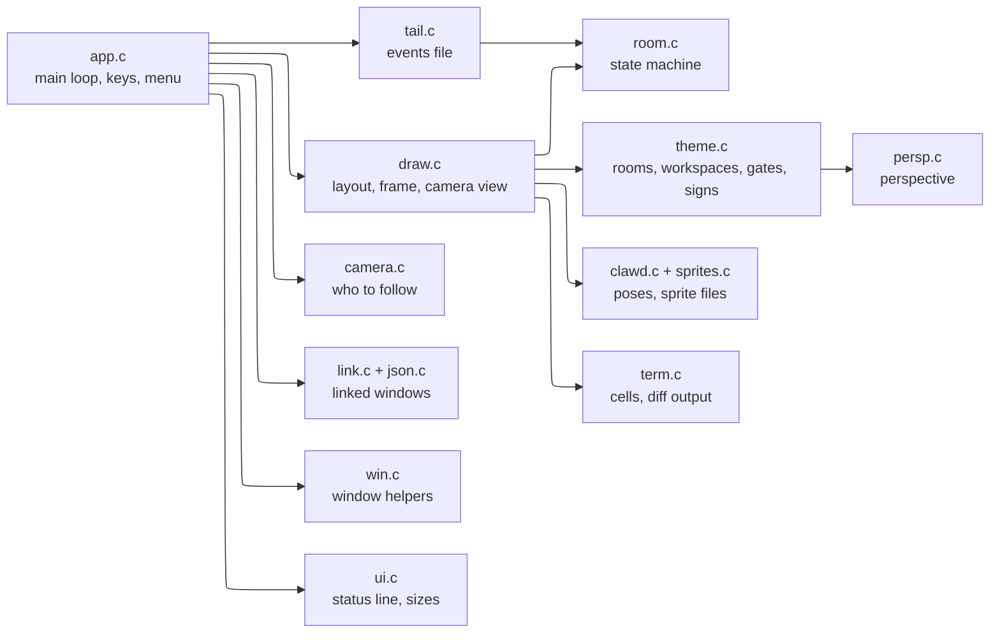
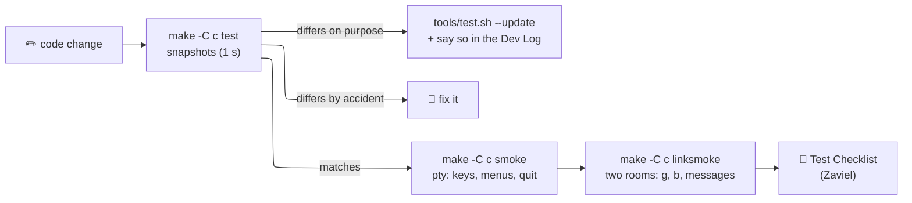

# ⚙️ Engine and Tests

> [!abstract] In short
> The room is a small C11 program (`c/`, no libraries). Snapshot tests pin its output; pty tests drive the real program; one seeded random generator per Clawd keeps behaviour repeatable.

---
## 🗺️ The code (`c/`)

| File | What it does |
| --- | --- |
| `app.c` | arguments, the main loop, keys, the start menu |
| `room.c` | who goes where, visits, crossing |
| `draw.c` | layout (`geo_init`), drawing a frame, the camera view |
| `theme.c` | the three rooms: backgrounds, workspaces, gates, signs |
| `persp.c` | vanishing point, floor mapping, quads, boxes |
| `camera.c` | what the zoomed camera follows |
| `clawd.c`, `sprites.c` | the Clawd's poses and the editable sprite files |
| `link.c`, `json.c` | linked windows talking through files |
| `win.c`, `ps_scripts.h`, `mac_scripts.h` | the window helpers |
| `ui.c` | status line, menus, auto scale, room sizes |
| `tail.c` | reading the events file |
| `art.c` | sprite files, PNG and GIF output (`--build-art`) |

---
## 🧪 Tests

- `make -C c test` compares with `c/tests/expected`: sprite frames, terminal strings, random numbers, fixture frames (`tools/fixtures/*.fx`), scripted scenes over time (`tools/scenarios/*.sc`), gate planning, `--dump` text frames.
- `make -C c winsmoke` uses real Windows Terminal windows.

> [!info] Where the snapshots come from
> First made by the old Python version (the C port matched it line by line); since style A (2026-10-18) they come from the C program.

> [!info] Next: the engine
> The agreed plan to replace this with items, layers and a placer is in [[Engine Design]].

> [!tip] Test hooks
> `CLAWD_EVENTS` (events file) · `CLAWD_LINK_DIR` (link folder) · `CLAWD_SIZE_LOG` (sizes, gate positions, who the camera follows) · `--dump COLSxROWS` with `--zoom`, `--room-size`.

---
## 🎲 Random numbers

- **One generator per Clawd**, seeded from its session id (Python's Mersenne Twister, MT19937, reproduced exactly): a Clawd's habits repeat, different Clawds differ.
- It decides when to plan next, what to do (visit, play, walk), where to walk, how long to chat, and the particles.
- Not random: the park's grass pattern and the walk timing.

> [!warning] Careful with random calls
> Adding or removing a random call changes every scene after it. Fine when meant (update the snapshots and say so), never by accident. Clamping a value after it is drawn does not change the draws.
