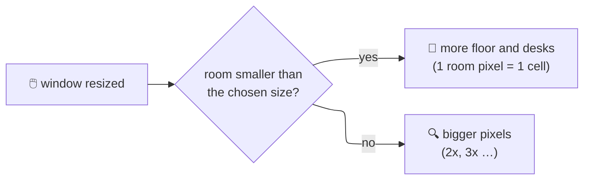
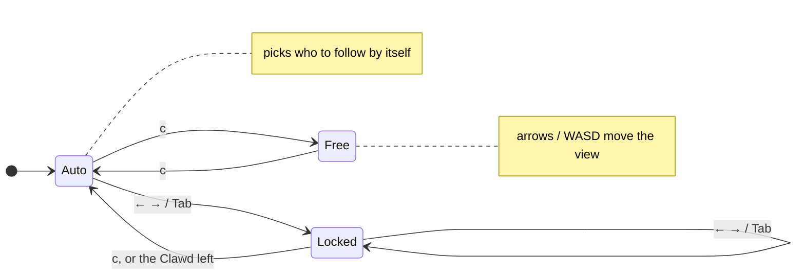
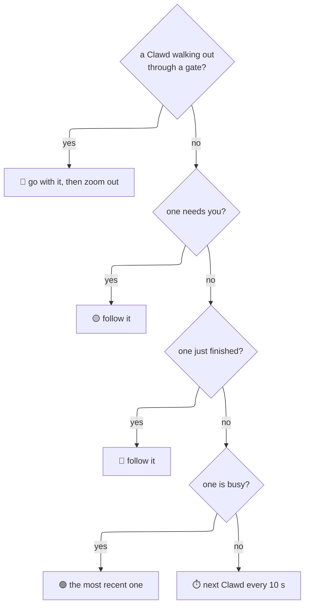
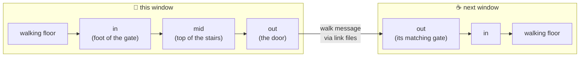
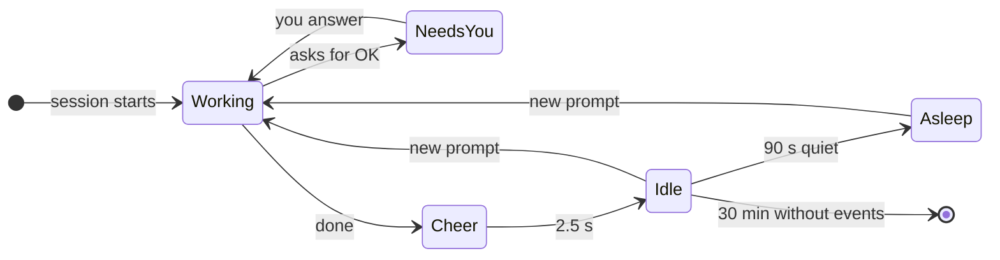

# 🎮 Interaction

> [!abstract] In short
> Every Claude Code session is a Clawd. Keys zoom and steer a camera, pick the room size, and send Clawds to linked windows. Linked windows find each other by themselves; Clawds walk through doors and stairs between them. Looks are in [[Rooms and Art]], window handling in [[Platforms and Windows]].

---
## ⌨️ Keys

| Key | Does |
| --- | --- |
| `q`, Esc | quit (Esc closes the room size list first) |
| `p` | pause |
| `?` | help line |
| `r` | **room size list**: AUTO, S, M, L, XL (up/down or W/S, Enter picks, Esc or `r` closes) |
| `[` `]` | **camera zoom** 1x–4x (the room keeps its layout; only the view gets closer) |
| `z` | **auto zoom** on / off (frames the busy Clawds) |
| ← → or A D, Tab | while following: pick the previous / next Clawd (the camera stays on it) |
| `c` | switch **auto follow ↔ free camera** |
| arrows / W A S D | free camera only: move the view a quarter at a time |
| `g` | send an idle Clawd next door; with several linked rooms a **SEND A CLAWD** list: the arrow pointing that way picks a room (or Tab, then Enter), Esc closes |
| `b` | **call back**: our Clawds next door walk home; with none away, visitors here are sent home |
| `f` | auto font and scale again (WSL and iTerm2), camera back to 1x |
| `o` | **debug overlay**: item boxes by layer, anchors, gate points (in green, mid yellow, out red), where Clawds are walking |

> [!tip] Zoom tips
> - `]` then wait: the camera finds the Clawd that needs you by itself.
> - In an empty zoomed room, `c` keeps the camera waiting for the first Clawd to come in.

---
## 📐 Room size and resizing

- The room **always fills the window** and takes its shape; dragging the window re-lays it out at once.
- **Grow, then scale:** the room gains floor up to the chosen size, past that every room pixel gets bigger.

| Size | Biggest room (room pixels) |
| --- | --- |
| **AUTO** (default) | just big enough to seat every session with floor to walk on; changes when sessions come and go |
| S / M / L / XL | 120x60 / 160x90 / 220x120 / 300x160 (an 80x25 window is 80x50) |

---
## 🎥 The camera

When zoomed, the camera **follows a Clawd** and only moves when that Clawd nears the edge of the view (dead zone a quarter of the view, smooth).

**Who auto follow picks:**

> [!info] What the status line says while zoomed
> `AUTO FOLLOW (WAITING)` · `AUTO: NAME` · `FOLLOW NAME` · `WITH NAME TO THE GATE` · `FREE CAMERA`

- Visitors count too: a room with only a visitor follows it.
- Words (names, `+N MORE`) stay normal size when zoomed and never cover a Clawd.

---
## 🔗 Linked windows and crossing

Rooms started with `--room NAME` find each other through files in `~/.clawd-room/link/` (no network) and **share the sessions** (each shows its own part). With the window helper (WSL or iTerm2) a gate appears when two windows are **next to each other** (gap up to 30 px, stays attached until 45 px) and **still for 1 s**; both windows animate it in together. iTerm2 **split panes** count as windows.

Each gate has an **in** point (where a Clawd steps on, on the floor) and an **out** point (the side door, the door on the stairs' platform, the treehouse door, the bottom of the well). The stairs also have a point in between (their top).

- A side door **opens while a Clawd is near it** and closes after.
- On the stairs, along the half floor and in the well a Clawd **walks** (walking pose, behind the railing); only the treehouse ladder is climbed.
- Idle Clawds visit by themselves sometimes (20% of their plans when a gate is there). A visitor stays 25–45 s, then walks home; `b` ends visits early.

> [!warning] Windows are never moved
> The room never moves or snaps windows to attach them; gates appear only when you place windows next to each other.

---
## 🫧 Sessions and states

| State | Where | Over the head |
| --- | --- | --- |
| working / thinking | at its workspace | 🟢 dot |
| needs you | walks about | 🟡 sign and its **name** |
| just finished | cheers, sparks | 🟢 dot |
| idle | walks, visits, plays (wave, dance, stretch, jump; swing and slide in the park; ordering coffee) | ⚪ grey dot |
| asleep | at its workspace, Z Z Z | ⚪ grey dot |
| visitor | from another window | 🔵 blue dot |

> [!note] NO SESSIONS
> **NO SESSIONS / START CLAUDE** shows only when **no session runs anywhere**; a linked room whose share happens to be empty just shows an empty room.
