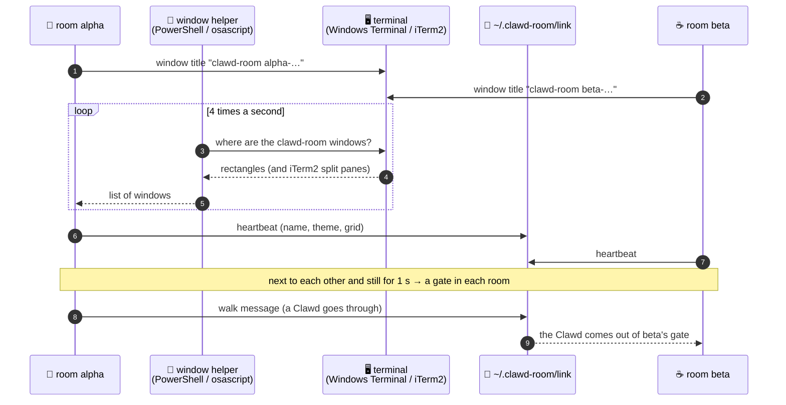

# 🪟 Platforms and Windows

> [!abstract] In short
> The room runs in **Windows Terminal (WSL)** and in **iTerm2 (macOS)**. A small helper the room starts (PowerShell or osascript) tells it where the clawd-room windows are; linked rooms talk through files. Nothing goes over the network.

---
## 🧩 How linked windows find each other

> [!warning] Hands off the user's windows
> The helpers only look at windows titled `clawd-room …`, never move windows to attach them, and never type into a window that does not have the focus.

---
## 🧱 Both platforms

- The room is C11 with no libraries; `clawd-room.sh` builds it when needed and starts it.
- The hook (`hook.py`) writes one line per Claude Code event to `~/.clawd-room/events.jsonl`: only time, session id, event, folder name, tool. Install with `python3 install_hooks.py` (shows the change), then `--apply`.
- **Terminal hygiene:** alternate screen, hidden cursor, one write per frame, only changed cells.

> [!bug] Fixed: the view stayed scrolled up after a resize (2026-10-17)
> iTerm2 copies a cleared screen into its scrollback and pushes lines off the top when a window gets shorter. The room now **never sends clear-screen** (`ESC[2J`) and ends every frame with the cursor at the top-left.

- Minimum terminal size 44x20; below that it says "need 44x20".

---
## 🪟 WSL + Windows Terminal

- A small `powershell.exe` started by the room reports the windows (rectangles, DPI); it stops with the room.
- On open the room sets the window to **110x32 cells** and the font to **8 pt** (`--size`, `--font`; `off` leaves them). `setup_profile.py` makes the "Clawd Room" profile; `--apply-global` edits `settings.json` with a backup.
- Font keys are sent only to a window that already has the focus. Focus mode is not used (it dropped the window in tests).

> [!todo] Not yet
> Windows Terminal split panes are not seen separately (UI Automation exposes each pane's rectangle: an idea to try).

---
## 🍎 macOS + iTerm2

- Used when `TERM_PROGRAM=iTerm.app`, not inside tmux. The helper is `osascript` (JavaScript, `c/mac_scripts.h`): it reports iTerm2 windows **and split panes** in points, and quits when the room is gone.
- iTerm2 does not say where a pane or the text area is, so they are worked out (title bar, tab bar, margins).
- **New windows open as a quarter of the screen** (like macOS's four-window tiling), snapped into the quarter their centre is in, so two rooms land next to each other.
- **A fixed pixel size:** `./clawd-room.sh` started from a normal iTerm2 window opens the room in **its own window with the "Clawd Room" profile**: Menlo 6 at line spacing 1.1, so every cell is **4x8 pt** and a room pixel a square **4x4 pt** (8x8 screen pixels on Retina). The pixel art lines up the same on every run. `--here` keeps the current window.
- The profile is a separate file, `~/Library/Application Support/iTerm2/DynamicProfiles/clawd-room.json`, written by `clawd-room.sh` (delete it to remove the profile); the user's own profiles are not touched.

> [!info] Why a new window (tested 2026-10-18, iTerm2 3.5.14)
> iTerm2 **ignores** the escape code that switches an open window's profile (`OSC 1337;SetProfile=…`; other `1337` codes work), and AppleScript cannot change a session's font or profile. Opening a window **with** a profile works.
>
> | Profile font | Line spacing | Cell (pt) |
> | --- | --- | --- |
> | Menlo 6 | 1.1 | **4 x 8** ✅ |
> | Menlo 8 | 1.0 | 5 x 10 |
> | Menlo 6 | 1.0 | 4 x 7 |
> | FiraCode 6 | 1.0 | 4 x 8 |

> [!tip] Bigger or smaller room pixels with Cmd +/−
> iTerm2 resizes the window on Cmd +/− because of its setting `AdjustWindowForFontSizeChange` (on by default). To change the font inside the same window instead: quit iTerm2, then in Terminal.app
> `defaults write com.googlecode.iterm2 AdjustWindowForFontSizeChange -bool false`

> [!warning] Two iTerm2 quirks
> - **Resize stripes:** iTerm2 re-wraps the screen when a window gets narrower, so during a drag the last frame shows as stripes until the next frame. It cannot be switched off; the room repaints at once.
> - **Native full screen:** with an iTerm2 window in native full screen, new windows open full-screen size and placing them hangs; a room in such a window can block writing. Leave full screen when testing linked windows.

![[2026-10-17 iTerm2 resize stripes (Zaviel).png|320]]
