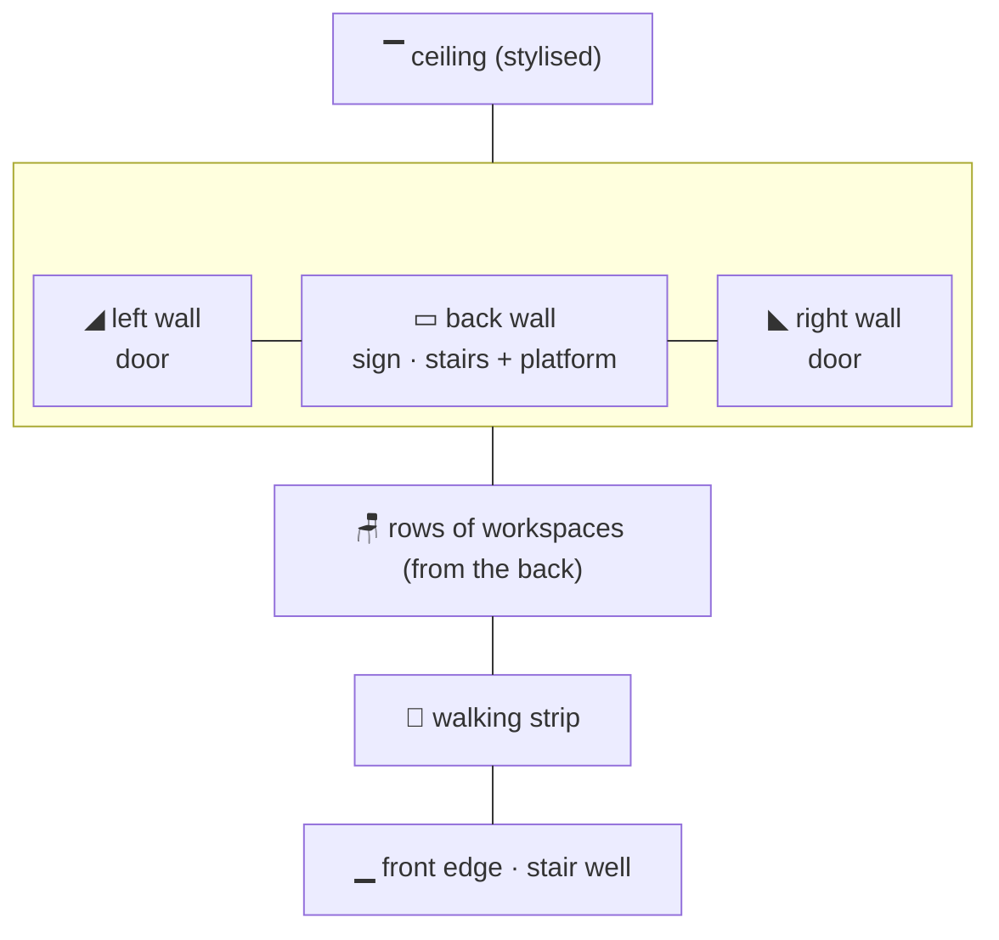
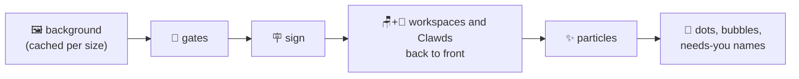

# 🎨 Rooms and Art

> [!abstract] In short
> The rooms are drawn in **one-point perspective** ("style A"): a back wall, slanted side walls, a floor in true perspective. Each session gets a workspace; gates to the next window sit on the walls, ceiling and floor. History is in [[Dev Log]]; keys and behaviour in [[Interaction]].

---
## 🏛️ The style

> [!info] Picked by Zaviel on 2026-10-18
> From three rendered options: **A perspective** (chosen), B 3/4 top-down, C isometric.

![[2026-10-18 style options A perspective.png|300]]

- The **back wall** sits in the middle, the **side walls** slant in towards it, the **ceiling** is a stylised band.
- The **floor and everything on it** come from one vanishing point above the picture (`c/persp.c`).
- The floor **leans forward a little**: the back wall spans 17%–83% of the width and 14%–47% of the height (`VIEW_BL / BR / BT / BB`).
- Furniture keeps the **same size on screen at any depth**, like the sprites; only its shape follows the perspective.

---
## 🏠 The three rooms

| Room | Look | Workspaces (one per session) |
| --- | --- | --- |
| 🏢 **Office** | light walls, a window, a plant, wooden floor boards | a desk with a monitor (the screen shows the tool's colour) |
| ☕ **Coffee shop** | warm walls, a checker floor, hanging lamps, a shelf of cups | the first session is the **barista** behind a **low bar** with the espresso machine on it; the others sit at **round cafe tables** with a square cushioned chair (and an empty one), a **laptop, tablet or phone**, and a **coffee or matcha** |
| 🌳 **Park** | sky, clouds, hills, mowed grass, bushes along the sides (not where a fence is), a big tree, a small **swing and slide standing at 45°** (simple posts and chute; the slide mirrored, down to the front left) | a **bench** (phone), a **swing** (tablet, also at 45°) or a **picnic table** (tablet) |

> [!tip] Same thing every time
> The device, drink or park thing for a session is picked from a hash of its id, so a session keeps it.

![[2026-10-18 style A built office.png|260]] ![[2026-10-18 style A built coffee.png|260]] ![[2026-10-18 style A built park.png|260]]

---
## 📏 Layout

- Workspaces stand in **rows on the floor**, filled from the back; the **walking strip** is in front of the last row, down to the front edge.
- A Clawd **sits behind its workspace** (its lower half hidden by the furniture).
- When there are more sessions than places, the last place says **+N MORE**.

| Constant | Value | Meaning |
| --- | --- | --- |
| `ROW_PITCH` | 15 | room pixels between rows |
| `SLOT_MIN_W` / `SLOT_MAX_W` | 24 / 40 | a workspace's width |
| `ROW_MARGIN` | 3 | kept free at the floor's sides of each row |
| `WALK_MIN` | 16 | floor kept in front of the last row |
| `SEAT_DY` | −12 | a seated Clawd's body top above its furniture's front edge |

**Drawing order of one frame** (later covers earlier):

---
## 🚪 Gates

Gates sit **on the room's walls, ceiling and floor**, not at the window edge, so the two ends do not have to line up pixel for pixel.

| Way | 🏢 Office / ☕ coffee shop | 🌳 Park |
| --- | --- | --- |
| **Side** | a **door** on the side wall facing the neighbour, a normal door's width, drawn column by column along the wall (dark outline, light frame and lintel, leaf with a knob; reads on any wall); **opens while a Clawd passes** | a **fence** along that side with a **gate** (the bushes leave that side) |
| **Up** | **stairs to a half floor** (below): **steel with a glass railing** in the office, **wooden with balusters** in the coffee shop | a **treehouse** in the big tree, a ladder up to it |
| **Down** | a **stair well** at the front: trapezoid opening, side walls going down, steps dropping away into the dark, a railing | **stone steps** into the ground, low stone walls round them |

> [!example] The stairs, as Zaviel drew them
> They start a fifth of the way along the back wall (`STAIRS_FOOT` 0.2) and climb to a **platform** 40% of the way up the wall (`PLATFORM_UP` 0.4, reached at `STAIRS_TOP` 0.42). The platform runs to the right-hand wall; its front face goes down to the floor (the coffee shop's **menu** hangs on it). A **banister** runs up the stairs and along the platform. The way up is a small **opening where the stairs carry on upwards** (steps into the dark, a warm light at the top) on the left of the platform, right where the stairs arrive, standing on the platform floor behind the railing (kept by Zaviel after mockups of other ideas).
>
> ![[2026-10-18 way up coffee.png|300]] ![[2026-10-18 way up office.png|300]]

> [!note] Appearing
> A gate that appears while the room runs animates in over `GATE_ANIM` (0.8 s): doors and fences rise, stairs appear step by step, the well opens, the treehouse ladder grows. Gates there from the first frame are simply there.

---
## 🪧 Text on screen

- **No top banner.** The room's name is a **sign in the room**: a plaque (office), a shop sign (coffee shop), a signpost (park). With stairs in the room the sign **hangs from the ceiling in front of them**.
- Over each Clawd's head a **dot**: 🟢 busy · 🟡 needs you (with its **name**) · ⚪ idle · 🔵 visitor.
- When zoomed, words are written at the normal size and never over a Clawd.

---
## 🦀 Rules for the art

> [!important] The Clawd looks official
> Flat `#CD6E58`, a 14x8 sprite (8-wide torso, 2x2 arms, four 1-pixel legs), 1x1 dark eyes, no mouth. Happy eyes are 1 wide and 2 high (a pale peach top over the dark pupil) plus blush. Frames are editable in `sprites/*.txt`; [[Animations]] shows them all.

- **Pixel text is upper case only** (the 3x5 font has no lower case); keep words short.
- Room pixels are square on screen: a terminal cell is 1 room pixel wide and 2 high.

> [!tip] How visual changes are made
> Rendered **mockups first** (drawn with the room's own canvas code), Zaviel picks, then the code is changed.
