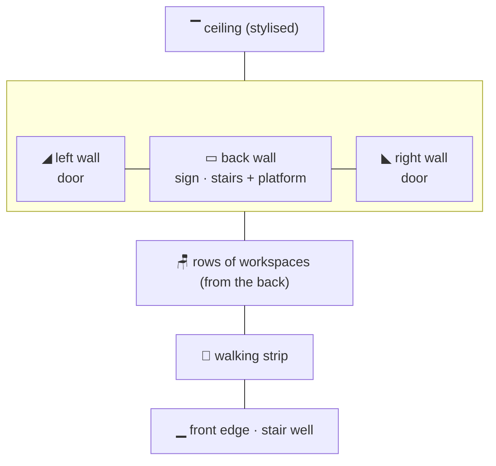
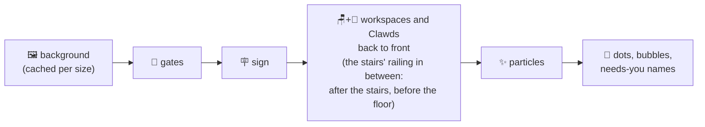

# 🎨 Rooms and Art

> [!abstract] In short
> The rooms are drawn in **one-point perspective** ("style A"): a back wall, slanted side walls, a floor in true perspective. Each session gets a workspace; gates to the next window sit on the walls, ceiling and floor. History is in [[Dev Log]]; keys and behaviour in [[Interaction]].

---
## 🏛️ The style

> [!info] Picked by Zaviel on 2026-10-18
> From three rendered options: **A perspective** (chosen), B 3/4 top-down, C isometric.

![[2026-10-18 style options A perspective.png|300]]

- The **back wall** sits in the middle, the **side walls** slant in towards it, the **ceiling** is a stylised band.
- The **floor and everything on it** come from one vanishing point above the picture (`c/persp.c`).
- The floor **leans forward a little**: the back wall spans 17%–83% of the width and 14%–47% of the height (`VIEW_BL / BR / BT / BB`).
- Furniture keeps the **same size on screen at any depth**, like the sprites; only its shape follows the perspective.

---
## 🏠 The three rooms

| Room | Look | Workspaces (one per session) |
| --- | --- | --- |
| 🏢 **Office** | light walls, a window (left of the sign; with stairs over the platform, never behind the sign), a plant, wooden floor boards | a desk with a monitor (the screen shows the tool's colour) |
| ☕ **Coffee shop** | warm walls, a checker floor, hanging lamps, a shelf of cups | the first session is the **barista** behind a **low bar** with the espresso machine on it; the others sit at **round cafe tables** with a square cushioned chair (and an empty one), a **laptop, tablet or phone**, and a **coffee or matcha** |
| 🌳 **Park** (a **city plaza park**) | sky, clouds, a far **city skyline**, mowed grass, a **stone promenade** along the back with **street lamps and benches**, bushes along the sides without a gate, a big tree, a small **swing set seen from the front** (splayed wooden posts, a bar, chains, a red seat) and a **slide at 45°** (mirrored, down to the front left) | a **bench** (phone), a **swing** (the same small swing set, the Clawd on its seat with a tablet) or a **picnic table** (tablet) |

> [!tip] Same thing every time
> The device, drink or park thing for a session is picked from a hash of its id, so a session keeps it.

![[2026-10-18 style A built office.png|260]] ![[2026-10-18 style A built coffee.png|260]] ![[2026-10-18 style A built park.png|260]]

---
## 📏 Layout

- Workspaces stand in **rows on the floor**, filled from the back; the **walking strip** is in front of the last row, down to the front edge.
- A Clawd **sits behind its workspace** (its lower half hidden by the furniture).
- **The placer** keeps everything apart (see [[Engine Design]]): wall items (sign, window, plant, menu, lamps, shelf, signpost) take free places by priority; workspaces only go where they keep clear of the gates (steps, opening, doors, well, treehouse and the floor in front of them), the playground, posts and bushes; a crowded park leaves out its swing and slide; a bush that would cover something is left out. `clawd-room --check` proves it: 0 overlaps in every room × gates × crowd × size.
- When there are more sessions than places, the last place says **+N MORE**.

| Constant | Value | Meaning |
| --- | --- | --- |
| `ROW_PITCH` | 15 | room pixels between rows |
| `SLOT_MIN_W` / `SLOT_MAX_W` | 24 / 40 | a workspace's width |
| `ROW_MARGIN` | 3 | kept free at the floor's sides of each row |
| `WALK_MIN` | 16 | floor kept in front of the last row |
| `SEAT_DY` | −12 | a seated Clawd's body top above its furniture's front edge |

**Drawing order of one frame** (later covers earlier):

---
## 🚪 Gates

Gates sit **on the room's walls, ceiling and floor**, not at the window edge, so the two ends do not have to line up pixel for pixel.

| Way | 🏢 Office / ☕ coffee shop | 🌳 Park |
| --- | --- | --- |
| **Side** | a **door** on the side wall facing the neighbour, a normal door's width and 22 room pixels tall, drawn column by column along the wall down to the floor's pixel edge (dark outline, light frame and lintel, leaf with a knob; reads on any wall); **opens while a Clawd passes** | the side wall of a **brick building** along that side (brick courses, a cornice, windows upstairs, a pitched slate roof) with a **door** on the ground floor that opens while a Clawd passes; the bushes leave that side |
| **Up** | **stairs to a half floor** (below): **steel with slim steel balusters** in the office, **wooden with balusters** in the coffee shop | a **treehouse** in the big tree, a ladder up to it |
| **Down** | a small **stair well** in the floor at the **front left** (`WELL_FRONT`, `WELL_SIDE`): trapezoid opening with a **wooden rim all round**, its **steps going down from the right end (at floor level, lit) to the left** (deeper, darker), carrying on the stairs that go up to the right in the room below; a Clawd steps in at the right and goes down to the left | the same small **well** with a **stone rim and steps**, at the front left like indoors (the front-left bush gives way) |

> [!example] The stairs, as Zaviel drew them
> They start a fifth of the way along the back wall (`STAIRS_FOOT` 0.2) and climb to a **platform** 40% of the way up the wall (`PLATFORM_UP` 0.4, reached at `STAIRS_TOP` 0.42). The platform runs to the right-hand wall; its front face goes down to the floor (the coffee shop's **menu** hangs on it). The stairs are **real steps** seen from the front: each step a block from the floor (a sawtooth side) with a **lit tread** on top; a **dark skirting** runs along the floor under the steps and the platform. The coffee shop's wood is darker than its wall and floor so the steps stand out. A **banister** runs up them (the hand rail turns level at the last step, which is level with the platform), its balusters carrying on along the platform at an even spacing (7 px wood, 9 px steel); Clawds on the stairs and the platform walk **behind** it, their feet on the line through the steps' front edges; the rail runs parallel to that line, 2 rows thick and 3–4 rows up, so it passes under their eyes (their dot and marks go behind it too), (a newel post at the foot, a baluster on each step, the hand rail parallel to the steps' edges) and along the platform. The platform reaches the corner with the right-hand wall. The way up is an **opening where the stairs carry on upwards** (steps into the dark, a warm light at the top) at the right end of the platform (up to 16 room pixels tall), standing on the platform floor behind the railing (kept by Zaviel after mockups of other ideas).
>
> ![[2026-10-18 coffee stairs well and doors.png|300]] ![[2026-10-18 office stairs well and doors.png|300]]

> [!note] Appearing
> A gate that appears while the room runs animates in over `GATE_ANIM` (0.8 s): doors and fences rise, stairs appear step by step, the well opens, the treehouse ladder grows. Gates there from the first frame are simply there.

---
## 🪧 Text on screen

- **No top banner.** The room's name is a **sign in the room**: a plaque (office), a shop sign (coffee shop), a signpost (park). With stairs in the room the sign **hangs from the ceiling in front of them**.
- Over each Clawd's head a **dot**: 🟢 busy · 🟡 needs you (with its **name**) · ⚪ idle · 🔵 visitor.
- When zoomed, words are written at the normal size and never over a Clawd.

---
## 🦀 Rules for the art

> [!important] The Clawd looks official
> Flat `#CD6E58`, a 14x8 sprite (8-wide torso, 2x2 arms, four 1-pixel legs), 1x1 dark eyes, no mouth. Happy eyes are 1 wide and 2 high (a pale peach top over the dark pupil) plus blush. Frames are editable in `sprites/*.txt`; [[Animations]] shows them all.

- **Pixel text is upper case only** (the 3x5 font has no lower case); keep words short.
- Room pixels are square on screen: a terminal cell is 1 room pixel wide and 2 high.

> [!tip] Editing the art yourself
> - **Props** (window, plant, menu, lamps, shelf) are in `sprites/props.txt`; the Clawd in `sprites/clawd.txt`, bubbles and signs in `sprites/items.txt`. `./clawd-room.sh --edit window` opens the pixel editor; rooms that are running show each stroke.
> - **Animated props**: add frames `lamp~2`, `lamp~3` … (in the editor: `F`); the room shows them in turn.
- **Where things go on the back wall** is in `rooms/<room>.txt` (one line per item: size, band, preferred place, priority, when).

> [!tip] How visual changes are made
> Rendered **mockups first** (drawn with the room's own canvas code), Zaviel picks, then the code is changed.
