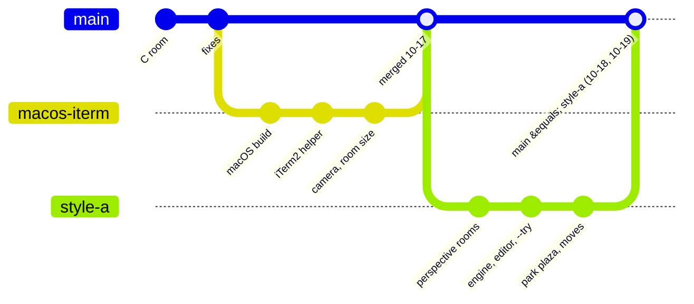

What changed and when, in short: **one note per day** in `Log/` (newest first), listed below with their entries; then what is pending and ideas. How things work now is in the design notes:

| Note | About |
| --- | --- |
| [[Rooms and Art]] | the look: perspective rooms, workspaces, gates, signs, art rules, layout numbers |
| [[Interaction]] | keys, camera, room size, linked windows, crossing, sessions |
| [[Platforms and Windows]] | WSL + Windows Terminal, macOS + iTerm2, window helpers |
| [[Engine and Tests]] | the code, the tests, random numbers |
| [[Test Checklist]] | what is still to check by eye |
| [[Animations]] | every Clawd frame |

Pictures are in `Assets/Snapshots/`, one folder per subject; browse them (and the animations) from [[Gallery index]]. Where everything is: [[Home]]. Details of every change: `git log`.

> [!info] Where the work is (branches)
> Since 2026-10-19 (William joined) every change is a branch and a pull request into `main`, merged by Zaviel ([[Collaboration]]). Before that `main` was kept equal to `feat/style-a`.

---

---
## 📅 Days

### [[2026-10-19]] · Monday
- [[2026-10-19#🗂️ The vault, reorganised (Zaviel)|🗂️ The vault, reorganised (Zaviel)]]
- [[2026-10-19#📷 Snapshots and a gallery to browse them (Zaviel)|📷 Snapshots and a gallery to browse them (Zaviel)]]
- [[2026-10-19#🎨 The pixel editor: a colour picker like Figma's (Zaviel)|🎨 The pixel editor: a colour picker like Figma's (Zaviel)]]
- [[2026-10-19#🎨 The pixel editor opens in its own window on WSL (Zaviel)|🎨 The pixel editor opens in its own window on WSL (Zaviel)]]
- [[2026-10-19#🪟 `--try` on WSL opens as one layout (Zaviel)|🪟 `--try` on WSL opens as one layout (Zaviel)]]
- [[2026-10-19#🗂️ Screenshots in folders (Zaviel)|🗂️ Screenshots in folders (Zaviel)]]
- [[2026-10-19#🧪 A test queue (Zaviel)|🧪 A test queue (Zaviel)]]
- [[2026-10-19#🤝 A collaborator: William (Zaviel)|🤝 A collaborator: William (Zaviel)]]
- [[2026-10-19#🪟 On WSL again (Zaviel)|🪟 On WSL again (Zaviel)]]
- [[2026-10-19#🧭 Desks stay in their room|🧭 Desks stay in their room]]
- [[2026-10-19#⌨️ The g / m hint only while the key is held|⌨️ The g / m hint only while the key is held]]
- [[2026-10-19#💬 One bar along the bottom|💬 One bar along the bottom]]
- [[2026-10-19#📦 Moving a Clawd: packing and unpacking (step 2 of 3)|📦 Moving a Clawd: packing and unpacking (step 2 of 3)]]
- [[2026-10-19#📦 Moving a Clawd to another room (step 1 of 3)|📦 Moving a Clawd to another room (step 1 of 3)]]
- [[2026-10-19#🏙️ One building each|🏙️ One building each]]

### [[2026-10-18]] · Sunday
- [[2026-10-18#🏢 The park's building, redesigned|🏢 The park's building, redesigned]]
- [[2026-10-18#🏛️ The park's way up: a terrace and a stair tower|🏛️ The park's way up: a terrace and a stair tower]]
- [[2026-10-18#🔍 `o` works, and names what it shows|🔍 `o` works, and names what it shows]]
- [[2026-10-18#🧱 The park's gates are buildings|🧱 The park's gates are buildings]]
- [[2026-10-18#🏙️ The park is a city plaza|🏙️ The park is a city plaza]]
- [[2026-10-18#🕳️ Down the well, not across it|🕳️ Down the well, not across it]]
- [[2026-10-18#🔀 Merged into main|🔀 Merged into main]]
- [[2026-10-18#🎞️ Engine step 4: the animator, animated props|🎞️ Engine step 4: the animator, animated props]]
- [[2026-10-18#🎨 Engine step 3: props as sprites, rooms as text files, the pixel editor|🎨 Engine step 3: props as sprites, rooms as text files, the pixel editor]]
- [[2026-10-18#🚪 Gates stay put; `g` asks where to|🚪 Gates stay put; `g` asks where to]]
- [[2026-10-18#📐 Engine step 2: the placer, 107 overlaps → 0|📐 Engine step 2: the placer, 107 overlaps → 0]]
- [[2026-10-18#🧱 Engine step 1: the scene, the overlap check, the gallery, the overlay|🧱 Engine step 1: the scene, the overlap check, the gallery, the overlay]]
- [[2026-10-18#🧪 `--try`: four linked rooms in one command; the engine plan|🧪 `--try`: four linked rooms in one command; the engine plan]]
- [[2026-10-18#🦶 Feet on the steps, a lower rail|🦶 Feet on the steps, a lower rail]]
- [[2026-10-18#🚶 Walking the stairs behind the railing|🚶 Walking the stairs behind the railing]]
- [[2026-10-18#↙️ The well at the front left, fewer balusters|↙️ The well at the front left, fewer balusters]]
- [[2026-10-18#↔️ The well's steps run right to left, steps stand out|↔️ The well's steps run right to left, steps stand out]]
- [[2026-10-18#🔧 The steps inside the opening stay inside|🔧 The steps inside the opening stay inside]]
- [[2026-10-18#🪜 Real steps, no gaps, the window out from behind the sign|🪜 Real steps, no gaps, the window out from behind the sign]]
- [[2026-10-18#🚀 iTerm2: the profile starts the room|🚀 iTerm2: the profile starts the room]]
- [[2026-10-18#🛝 A real swing, the park's well at the back right|🛝 A real swing, the park's well at the back right]]
- [[2026-10-18#🔲 iTerm2: a fixed pixel size|🔲 iTerm2: a fixed pixel size]]
- [[2026-10-18#🪨 The park's way down is a small stone well|🪨 The park's way down is a small stone well]]
- [[2026-10-18#📏 Taller doors and way up, the well on open floor, no glass|📏 Taller doors and way up, the well on open floor, no glass]]
- [[2026-10-18#🪜 Way up at the platform's right end, stair well at the back right|🪜 Way up at the platform's right end, stair well at the back right]]
- [[2026-10-18#🚪 The way up, on the left of the platform|🚪 The way up, on the left of the platform]]
- [[2026-10-18#🏢 Steel stairs in the office, a new way up, a smaller playground|🏢 Steel stairs in the office, a new way up, a smaller playground]]
- [[2026-10-18#🌳 Park playground at an angle, cleaner doors|🌳 Park playground at an angle, cleaner doors]]
- [[2026-10-18#🗂️ Notes: plugins, diagrams, callouts|🗂️ Notes: plugins, diagrams, callouts]]
- [[2026-10-18#🪜 The stairs go up to a half floor|🪜 The stairs go up to a half floor]]
- [[2026-10-18#🏛️ The rooms in perspective are built|🏛️ The rooms in perspective are built]]
- [[2026-10-18#🎨 A new look, picked from mockups|🎨 A new look, picked from mockups]]
- [[2026-10-18#🚪 Doors and ladders before the new look (replaced)|🚪 Doors and ladders before the new look (replaced)]]

### [[2026-10-17]] · Saturday
- [[2026-10-17#🎬 The camera at the gates|🎬 The camera at the gates]]
- [[2026-10-17#🔗 Linked rooms|🔗 Linked rooms]]
- [[2026-10-17#🩹 Resizing in iTerm2|🩹 Resizing in iTerm2]]
- [[2026-10-17#🎥 Camera, room size and the iTerm2 helper|🎥 Camera, room size and the iTerm2 helper]]
- [[2026-10-17#🍎 Runs on macOS|🍎 Runs on macOS]]

### [[2026-10-16]] · Friday
- [[2026-10-16#🔧 The room is written in C|🔧 The room is written in C]]
- [[2026-10-16#🧭 Opening at the right size (WSL)|🧭 Opening at the right size (WSL)]]
- [[2026-10-16#🌱 New repo|🌱 New repo]]
---
## ⏳ Pending

> [!todo] Next session (2026-10-20, on Windows WSL2)
> Everything since 2026-10-17 was built and tested on macOS only. On WSL2:
> 1. `git pull` (branch `feat/style-a` = `main`), `make -C c`, then `make -C c test`, `smoke`, `linksmoke`, `movesmoke`, `splitsmoke` and `clawd-room --check`: they should pass as on macOS (the snapshots came from macOS clang; if only float rounding differs, say so before updating anything).
> 2. Check that the hook symlink `~/clawd-room` still points at the WSL copy of the repo.
> 3. By eye in Windows Terminal (see [[Test Checklist]], the WSL2 part): style A rooms and the park, the bottom bar's size at the WSL font, linked rooms side by side and stacked, `g` / `m` with the hint, packing and unpacking, no desks hopping, the pixel editor with the mouse (`--edit`).
> 4. WSL has no `--try` yet (it is iTerm2 only): open the linked windows by hand, or build a WSL `--try` with `wt.exe`.
>
> Then: **moving, step 3**: drag a Clawd onto a door, the stairs or the well with the mouse. (Settled: `--try real` stays split; uneven shares are fine, `m` moves a Clawd.)

> [!todo] Waiting
> - ~~The engine~~: all four steps are built ([[Engine Design]]).
> - `README.md` still describes the old flat look in places (banner, gates at the window edge).
> - WSL: the profile from the dropdown opens at Windows Terminal's default size, then jumps once; planned a shortcut with `wt.exe -w new --size 60,18 -p "Clawd Room"`.
> - The room can block writing if the terminal stops reading (seen with iTerm2 in full screen).
> - Windows Terminal split panes are not seen separately yet.

> [!todo] Later: less CPU (Zaviel, 2026-10-19)
> - **Dirty rects**: redraw only the parts of the canvas that changed (the terminal output is already diffed cell by cell and written once per frame, i.e. double buffered; the cost left is drawing the whole canvas 16 times a second).
> - **Idle frames**: skip drawing when nothing moves (the same frame again).
> - **Hidden windows**: when the room's window is covered, minimised or on another virtual desktop, stop drawing (FPS 0) and only keep reading events and the link heartbeats at a slow rate; draw again when it shows.

## 💡 Ideas

> [!question] Maybe later
> - A seesaw in the park; an empty-desk look for Clawds that are away.
> - Camera polish: smooth zoom, a slight lead in the walking direction, a small bounce when a Clawd finishes, parallax in the park.
> - Full screen: a "hub" room that others visit, or several rooms side by side in one window.
