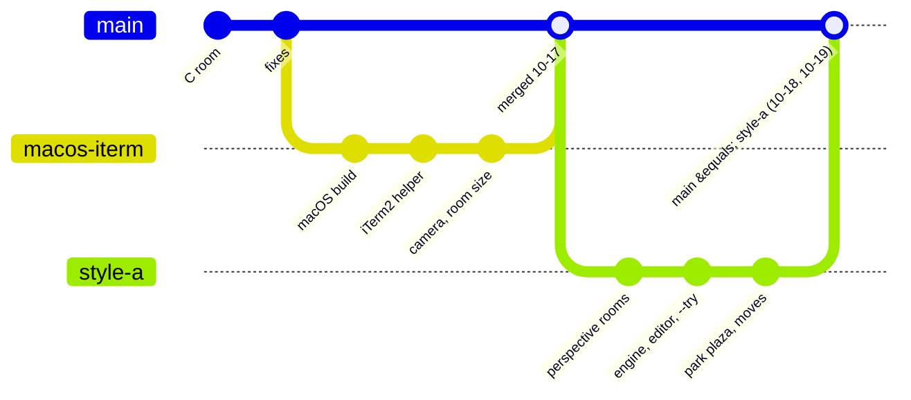

What changed and when, in short: **one note per day** in `Log/` (newest first), listed below with their entries; then what is pending and ideas. How things work now is in the design notes:

| Note | About |
| --- | --- |
| [[Rooms and Art]] | the look: perspective rooms, workspaces, gates, signs, art rules, layout numbers |
| [[Interaction]] | keys, camera, room size, linked windows, crossing, sessions |
| [[Platforms and Windows]] | WSL + Windows Terminal, macOS + iTerm2, window helpers |
| [[Engine and Tests]] | the code, the tests, random numbers |
| [[Test Checklist]] | what is still to check by eye |
| [[Animations]] | every Clawd frame |

Pictures are in `Assets/Snapshots/`, one folder per subject; browse them (and the animations) from [[Gallery index]]. Where everything is: [[Home]]. Details of every change: `git log`.

> [!info] Where the work is (branches)
> Since 2026-10-19 (William joined) every change is a branch and a pull request into `main`, merged by Zaviel ([[Collaboration]]). Before that `main` was kept equal to `feat/style-a`.



---

---
## 📅 Days

One note per day in `Review/Log/<year>/<month>/<ISO week>/` (e.g. `2026/10/W43/2026-10-19`). **Open today's daily note** (or the Calendar) makes today's in the right folder from [[Day note]]. In Obsidian the list below is built from those notes (newest first, with each day's entries).

```dataviewjs
const days = dv.pages('"Review/Log"').where(p => /^\d{4}-\d{2}-\d{2}$/.test(p.file.name)).sort(p => p.file.name, "desc");
let year = "", month = "", week = "";
for (const p of days) {
  const d = moment(p.file.name, "YYYY-MM-DD");
  if (d.format("YYYY") !== year) { year = d.format("YYYY"); month = ""; dv.header(3, year); }
  if (d.format("MM") !== month) { month = d.format("MM"); week = ""; dv.header(4, d.format("MMMM")); }
  if (d.format("[W]WW") !== week) { week = d.format("[W]WW"); dv.paragraph("**" + week + "**"); }
  const file = app.vault.getAbstractFileByPath(p.file.path);
  const heads = (app.metadataCache.getFileCache(file)?.headings || []).filter(h => h.level === 2);
  dv.paragraph(p.file.link + " · " + d.format("dddd"));
  dv.list(heads.map(h => dv.sectionLink(p.file.path, h.heading, false, h.heading)));
}
```

---
## ⏳ Pending

> [!todo] Next session (2026-10-20, on Windows WSL2)
> Everything since 2026-10-17 was built and tested on macOS only. On WSL2:
> 1. `git pull` (branch `feat/style-a` = `main`), `make -C c`, then `make -C c test`, `smoke`, `linksmoke`, `movesmoke`, `splitsmoke` and `clawd-room --check`: they should pass as on macOS (the snapshots came from macOS clang; if only float rounding differs, say so before updating anything).
> 2. Check that the hook symlink `~/clawd-room` still points at the WSL copy of the repo.
> 3. By eye in Windows Terminal (see [[Test Checklist]], the WSL2 part): style A rooms and the park, the bottom bar's size at the WSL font, linked rooms side by side and stacked, `g` / `m` with the hint, packing and unpacking, no desks hopping, the pixel editor with the mouse (`--edit`).
> 4. WSL has no `--try` yet (it is iTerm2 only): open the linked windows by hand, or build a WSL `--try` with `wt.exe`.
>
> Then: **moving, step 3**: drag a Clawd onto a door, the stairs or the well with the mouse. (Settled: `--try real` stays split; uneven shares are fine, `m` moves a Clawd.)

> [!todo] Waiting
> - ~~The engine~~: all four steps are built ([[Engine Design]]).
> - `README.md` still describes the old flat look in places (banner, gates at the window edge).
> - WSL: the profile from the dropdown opens at Windows Terminal's default size, then jumps once; planned a shortcut with `wt.exe -w new --size 60,18 -p "Clawd Room"`.
> - The room can block writing if the terminal stops reading (seen with iTerm2 in full screen).
> - Windows Terminal split panes are not seen separately yet.

> [!todo] Later: less CPU (Zaviel, 2026-10-19)
> - **Dirty rects**: redraw only the parts of the canvas that changed (the terminal output is already diffed cell by cell and written once per frame, i.e. double buffered; the cost left is drawing the whole canvas 16 times a second).
> - **Idle frames**: skip drawing when nothing moves (the same frame again).
> - **Hidden windows**: when the room's window is covered, minimised or on another virtual desktop, stop drawing (FPS 0) and only keep reading events and the link heartbeats at a slow rate; draw again when it shows.

## 💡 Ideas

> [!question] Maybe later
> - A seesaw in the park; an empty-desk look for Clawds that are away.
> - Camera polish: smooth zoom, a slight lead in the walking direction, a small bounce when a Clawd finishes, parallax in the park.
> - Full screen: a "hub" room that others visit, or several rooms side by side in one window.
