What changed and when, in short: **one note per day** in `Log/` (newest first), listed below with their entries. Where things stand now (today, ongoing, ideas, done): [[Dev Status]]. How things work now is in the design notes:

| Note | About |
| --- | --- |
| [[Rooms and Art]] | the look: perspective rooms, workspaces, gates, signs, art rules, layout numbers |
| [[Interaction]] | keys, camera, room size, linked windows, crossing, sessions |
| [[Platforms and Windows]] | WSL + Windows Terminal, macOS + iTerm2, window helpers |
| [[Engine and Tests]] | the code, the tests, random numbers |
| [[Test Checklist]] | what is still to check by eye |
| [[Animations]] | every Clawd frame |

Pictures are in `Assets/Snapshots/`, one folder per subject; browse them (and the animations) from [[Index|Gallery index]]. Where everything is: [[Home]]. Details of every change: `git log`.

> [!info] Where the work is (branches)
> Since 2026-10-19 (William joined) every change is a branch and a pull request into `main`, merged by Zaviel ([[Collaboration]]). Before that `main` was kept equal to `feat/style-a`. The graph is made by `python3 tools/git_graph.py --write "Clawd Room Note/Review/Dev Log.md"` (a summary of the first-parent line of `main`; the numbers are pull requests): run it again after a merge.

```mermaid
gitGraph
    commit id: "earlier history"
    checkout main
    branch wsl-queue
    checkout main
    branch vault-layout
    checkout main
    branch mockups-2026-10-20
    checkout wsl-queue
    commit id: "wait until a running --try has really q…"
    checkout wsl-queue
    commit id: "on wsl the pixel editor opens in its ow…"
    checkout vault-layout
    commit id: "reorganise by purpose (start, review, d…"
    checkout vault-layout
    commit id: "dev status note (today, yesterday, ongo…"
    checkout wsl-queue
    commit id: "ctrl+z undoes, ctrl+y redoes (the edito…"
    checkout vault-layout
    commit id: "remove the empty root note vault.md"
    checkout mockups-2026-10-20
    commit id: "mockups of 2026-10-20 in snapshots and…"
    checkout mockups-2026-10-20
    commit id: "design notes show how things are now, w…"
    checkout main
    merge wsl-queue id: "#6 (10-20)"
    checkout main
    merge vault-layout id: "#7 (10-20)"
    checkout main
    branch editor-animation
    checkout main
    branch fixture-names
    checkout main
    branch pr-icon-eyes
    checkout mockups-2026-10-20
    commit id: "editor mockup frames, play, onion skin…"
    checkout editor-animation
    commit id: "the editor edits animations a timeline…"
    checkout fixture-names
    commit id: "made-up folder names in the simulator a…"
    checkout fixture-names
    commit id: "nothing private in the repo, notes or p…"
    checkout pr-icon-eyes
    commit id: "the pr signature clawd's eyes filled da…"
    checkout pr-icon-eyes
    commit id: "day note the pr clawd's eyes"
    checkout main
    merge mockups-2026-10-20 id: "#9 (10-20)"
    checkout main
    branch vault-readme-plan
    checkout vault-readme-plan
    commit id: "gate styles developers can add, the pla…"
    checkout editor-animation
    commit id: "calmer colour panel dim section titles…"
    checkout editor-animation
    commit id: "the four tool buttons spread evenly ove…"
    checkout main
    merge editor-animation id: "#10 (10-20)"
    checkout main
    merge fixture-names id: "#11 (10-20)"
    checkout main
    merge pr-icon-eyes id: "#12 (10-20)"
    checkout main
    branch stage-page
    checkout vault-readme-plan
    commit id: "13 became 16, part animations in the ed…"
    checkout stage-page
    commit id: "part animations, the first step a file…"
    checkout stage-page
    commit id: "an ANIMS tab in the sprite picker opens…"
    checkout stage-page
    commit id: "Group G folded as done"
    checkout main
    merge stage-page id: "#19 (10-21)"
    checkout vault-readme-plan
    commit id: "part_anim_mock's tool caps renamed (sta…"
    checkout main
    merge vault-readme-plan id: "#20 (10-21)"
    checkout main
    branch stage-unselect
    checkout main
    branch vault-sync-2026-10-21b
    checkout main
    branch gate-parts
    checkout main
    branch gate-themes
    checkout stage-unselect
    commit id: "Esc (or a click on no part with SELECT)…"
    checkout gate-parts
    commit id: "gates appearing are part animations (th…"
    checkout gate-parts
    commit id: "the grow bar's Clawd always runs (faste…"
    checkout vault-sync-2026-10-21b
    commit id: "sync"
    checkout vault-sync-2026-10-21b
    commit id: "mockups go to gallery/mock/out/NN-slug/…"
    checkout vault-sync-2026-10-21b
    commit id: "the eye + KEYS button in the notes (the…"
    checkout gate-parts
    commit id: "the stage page's KEYS ON is an eye + KE…"
    checkout main
    merge stage-unselect id: "#21 (10-22)"
    checkout main
    merge vault-sync-2026-10-21b id: "#23 (10-22)"
    checkout gate-themes
    commit id: "gate animations live in a theme folder…"
    checkout main
    merge gate-parts id: "#22 (10-22)"
    checkout gate-themes
    commit id: "W43.md stays untracked (it was added by…"
    checkout gate-themes
    commit id: "Test Checklist group K (T51-T57) ticked"
    checkout main
    merge gate-themes id: "#24 (10-22)"
    checkout main
    branch readme-screenshots
    checkout main
    branch vault-sync-2026-10-23
    checkout main
    branch prepare-public
    checkout readme-screenshots
    commit id: "the room pictures drawn again by the cu…"
    checkout readme-screenshots
    commit id: "the README redesigned with 11 GIFs draw…"
    checkout readme-screenshots
    commit id: "Test Checklist group K folded (done)"
    checkout vault-sync-2026-10-23
    commit id: "sync 2"
    checkout prepare-public
    commit id: "prepare for going public (MIT license,…"
    checkout main
    merge readme-screenshots id: "#25 (10-23)"
    checkout main
    merge vault-sync-2026-10-23 id: "#26 (10-23)"
    checkout main
    merge prepare-public id: "#27 (10-23)"
    checkout main
    branch generic-contributing
    checkout generic-contributing
    commit id: "contributing notes for anyone Claude ma…"
    checkout generic-contributing
    commit id: "last example name in Collaboration is g…"
    checkout main
    merge generic-contributing id: "#28 (10-23)"
    checkout main
    branch status-before-rewrite
    checkout status-before-rewrite
    commit id: "status before the history rewrite the a…"
    checkout main
    merge status-before-rewrite id: "#29 (10-23)"
    checkout main
    branch new-repo-notes
    checkout new-repo-notes
    commit id: "the history rewrite and the new repo"
    checkout main
    merge new-repo-notes id: "#1 (10-24)"
    checkout main
    branch codeowners
    checkout codeowners
    commit id: "CODEOWNERS and the public status"
    checkout main
    merge codeowners id: "#2 (10-24)"
    checkout main
    branch new-look-docs
    checkout main
    branch task-queue
    checkout new-look-docs
    commit id: "linked rooms and usage describe the cur…"
    checkout task-queue
    commit id: "a task queue anyone can claim"
    checkout main
    merge new-look-docs id: "#3 (10-24)"
    checkout main
    merge task-queue id: "#4 (10-24)"
    checkout main
    branch task-queue-callouts
    checkout task-queue-callouts
    commit id: "the task queue as callouts with checkbo…"
    checkout main
    merge task-queue-callouts id: "#5 (10-24)"
    checkout main
    branch picked-clawd
    checkout picked-clawd
    commit id: "W4 claimed (picked Clawd)"
    checkout picked-clawd
    commit id: "Tab and c put the followed Clawd in the…"
    checkout picked-clawd
    commit id: "tested T60 and T62 by hand"
    checkout main
    merge picked-clawd id: "#6 (10-24)"
    checkout main
    branch mock-workflow
    checkout mock-workflow
    commit id: "mockups stay local, the picked option a…"
    checkout mock-workflow
    commit id: "what to do when a moved repo leaves a s…"
    checkout mock-workflow
    commit id: "no absolute or symlinked paths for the…"
    checkout main
    merge mock-workflow id: "#8 (10-27)"
```




---

---
## 📅 Days

One note per day in `Review/Log/<year>/<month>/<ISO week>/` (e.g. `2026/10/W43/2026-10-19`). **Open today's daily note** (or the Calendar) makes today's in the right folder from [[Day note]]. In Obsidian the list below is built from those notes (newest first, with each day's entries).

```dataviewjs
const days = dv.pages('"Review/Log"').where(p => /^\d{4}-\d{2}-\d{2}$/.test(p.file.name)).sort(p => p.file.name, "desc");
let year = "", month = "", week = "";
for (const p of days) {
  const d = moment(p.file.name, "YYYY-MM-DD");
  if (d.format("YYYY") !== year) { year = d.format("YYYY"); month = ""; dv.header(3, year); }
  if (d.format("MM") !== month) { month = d.format("MM"); week = ""; dv.header(4, d.format("MMMM")); }
  if (d.format("[W]WW") !== week) { week = d.format("[W]WW"); dv.paragraph("**" + week + "**"); }
  const file = app.vault.getAbstractFileByPath(p.file.path);
  const heads = (app.metadataCache.getFileCache(file)?.headings || []).filter(h => h.level === 2);
  dv.paragraph(p.file.link + " · " + d.format("dddd"));
  dv.list(heads.map(h => dv.sectionLink(p.file.path, h.heading, false, h.heading)));
}
```

---
