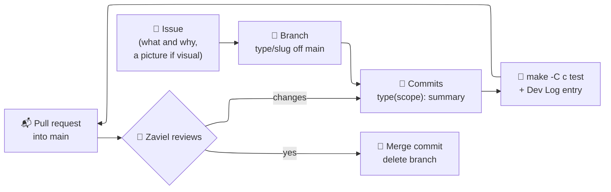

How Zaviel (owner) and William (collaborator) work on clawd-room together, and how to share this vault through git. The full rules are in `CONTRIBUTING.md` at the repo root; this note is the short version plus what is special about Obsidian.

---
## 🔁 The loop

| Who | Role |
| --- | --- |
| **Zaviel** (`zelvet-velvet`) | owner: decides the look and features, merges PRs into `main` |
| **William** (`WilliamPanTW`) | collaborator: issues, branches, PRs; reviews Zaviel's PRs when asked |

> [!important] The three rules people trip on
> - Nobody pushes to `main`; everything goes through a pull request.
> - Visual changes start as a **picture** (mockup or screenshot) that Zaviel picks.
> - `make -C c test` passes; snapshots are only updated on purpose, and the PR says why.

---
## 🗂️ Sharing this vault

The vault is plain Markdown in git, so it travels with the code: notes change on the same branch and in the same PR as the change they describe.

**Setup (once):**
1. In Obsidian: *Open folder as vault* → the `Clawd Room Note` folder (not the repo root).
2. Settings → Community plugins → turn on community plugins, then install the ones listed in `.obsidian/community-plugins.json` (the plugin code is not in git): Dataview, Dataview Serializer, Templater, Calendar, Hover Editor, Breadcrumbs, Note Refactor, HTML Tags Autocomplete, make.md, Style Settings, Minimal Theme Settings, CSS Editor, Mermaid ELK Renderer. Without them the notes still read fine; the mermaid diagrams just lay out differently.
3. **Templater** (its settings are not in git): Settings → Templater → template folder `_Meta/Templates`, turn on *Trigger Templater on new file creation* and *Enable folder templates*, folder template `Review/Log` → `_Meta/Templates/Day note.md`. Daily notes is set already (in git).
4. Do **not** turn on an Obsidian Git plugin: commit with git (or Claude Code) like the code, on your branch.

**What is shared and what is yours:**

| In git (shared) | Not in git (yours) |
| --- | --- |
| notes (`Start/`, `Review/`, `Design/`), `Gallery/`, `Assets/` | `.obsidian/workspace.json` (open tabs, layout) |
| `.obsidian/app.json`, `appearance.json`, `snippets/`, `themes/` | `.obsidian/plugins/` (plugin code and settings) |
| `.obsidian/community-plugins.json`, `core-plugins.json` | `.makemd/`, `.space/`, `.trash/`, `Tags/` |

> [!warning] Settings changes
> Changing a setting, theme or hotkey rewrites files in `.obsidian/`. If you did not mean to share it, undo it before committing: `git restore "Clawd Room Note/.obsidian"`. Shared setting changes get their own small PR.

---
## ✍️ Writing in the vault

- **Dev Log:** every PR adds a short entry to **today's note** in `Review/Log/<year>/<month>/<week>/` (`2026/10/W43/2026-10-21.md`; a `## ` heading per entry, newest first), with the author after the title, e.g. `## 🛝 A seesaw in the park (William)`. Two to four plain bullets about what changed for someone using the room; a picture if visual. A new day: **Open today's daily note** (or the Calendar) makes it in the right folder from [[Day note]]; the [[Dev Log]] index lists it by itself.
- **Design notes** (`Design/`: [[Rooms and Art]], [[Interaction]], [[Platforms and Windows]], [[Engine and Tests]]) describe how things work **now**: rewrite the part that changed, do not append history.
- **[[Test Checklist]]:** add what still needs someone's eyes to the **test queue** at the top (a `Group X` callout per group, each test a box with an ID like **T14** or a question **Q2**, a `✅ date: … (who)` line for the result, and a folded *how to run*); refer to tests by their ID in issues and PRs. Tick only what **you** checked, and say who: `- [x] the seesaw tips both ways (William, 2026-10-21)`. Visual items stay for Zaviel to tick.
- **Pictures:** `Assets/Snapshots/<subject folder>/YYYY-MM-DD subject.png`, a row in [[Snapshot status]], then `python3 tools/vault_gallery.py` (it writes the browsing notes in `Gallery/`) (folders: `Office/`, `Coffee shop/`, `Park/`, `Gates (stairs, doors, wells)/`, `Interaction (keys, moving)/`, `Engine and tools/`, `Platforms/`, `Style and mockups/`, `Old look/`; a new one if none fits); your own captures add your name, `... (William).png`. Embed with `![[name.png|300]]`.
- **Renaming a note** updates links in the vault you have open, not in other people's branches: rename notes only in a PR of their own, and say so.
- **Conflicts** in Markdown (two PRs adding to the same day's note): keep **both** entries, newest first. Separate day notes make this rare.
- `CMD_SYNC` (see [[LLM Guide]]) is the bigger tidy-up of all the notes; whoever runs it does it on its own branch and PR.

---
## 💬 Where to talk

| About | Where |
| --- | --- |
| a task | its GitHub issue |
| a change | its pull request |
| a new idea | a new issue labelled `idea` |
| a bug you will not fix now | an issue: what you did, what you saw, a screenshot |
