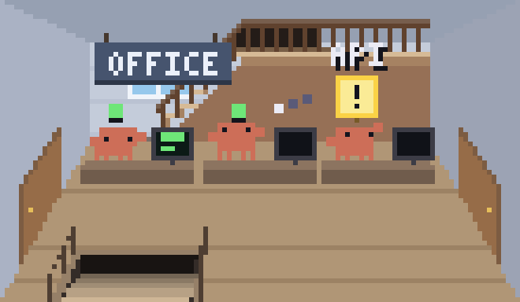
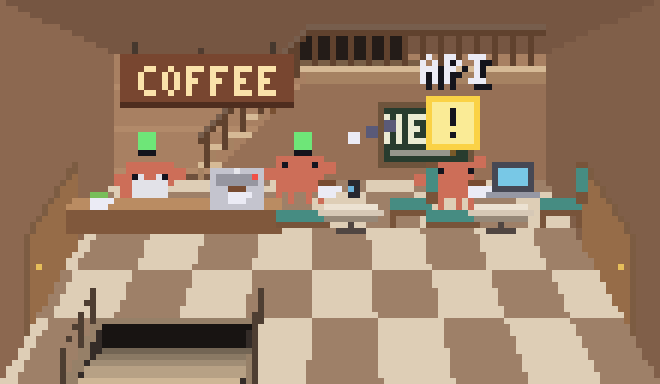
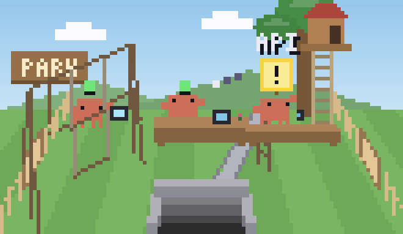
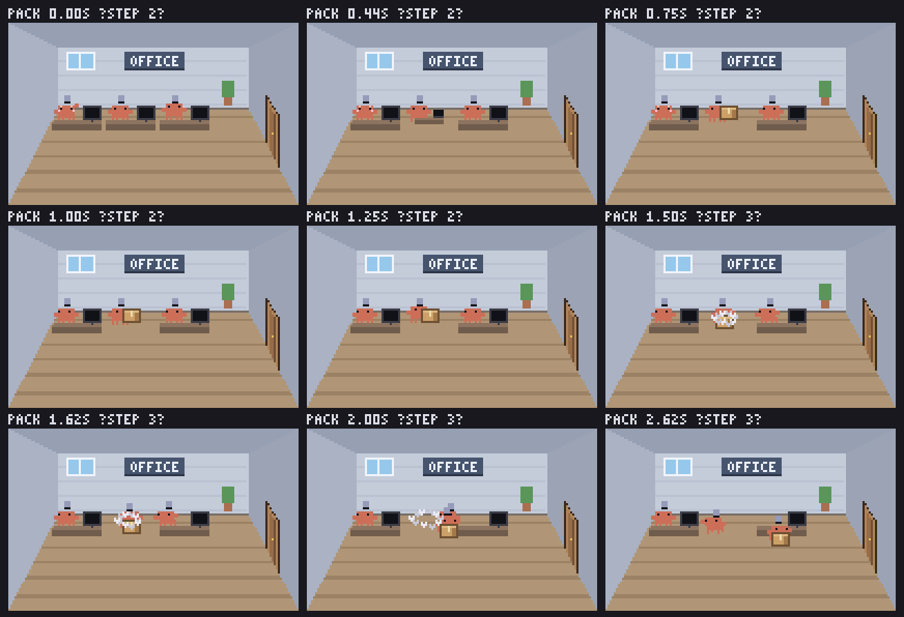
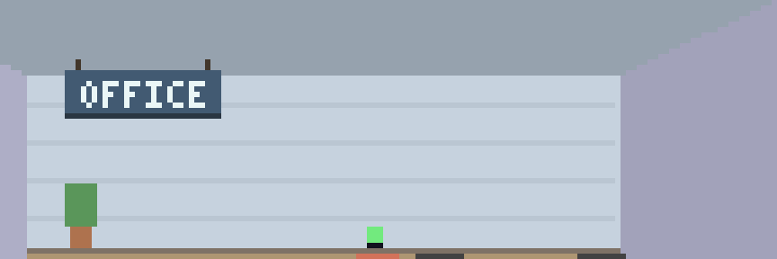
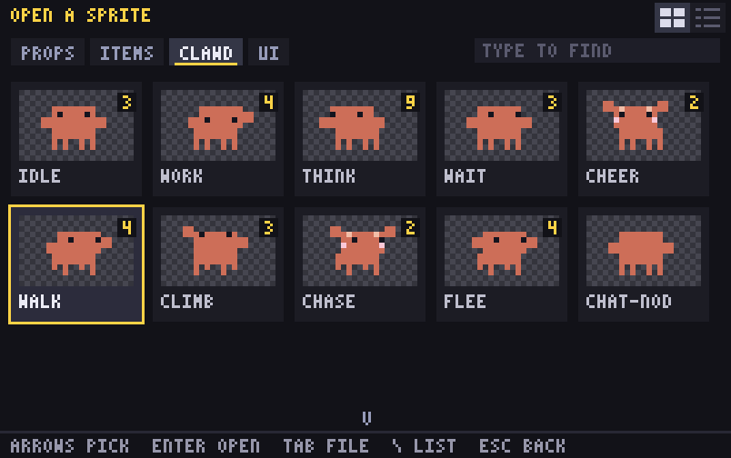
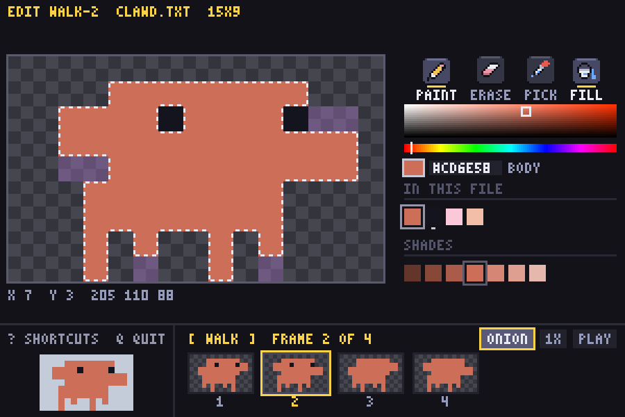

<p align="center">
  
</p>

<h1 align="center">clawd-room</h1>

<p align="center">
  A pixel room in your terminal where every running <b>Claude Code</b> session is a little Clawd.<br>
  Busy ones type at their desk, waiting ones hold up a sign, finished ones cheer.
</p>

<p align="center">
  
</p>

## Contents

- [What it does](#what-it-does)
- [Screenshots](#screenshots)
- [Get it](#get-it)
- [Quick start](#quick-start)
- [Keys](#keys)
- [Linked rooms](#linked-rooms)
- [Platforms](#platforms)
- [Pixel editor](#pixel-editor)
- [Privacy](#privacy)
- [Documentation](#documentation)
- [Contributing](#contributing)

## What it does

- **One Clawd per session.** A Claude Code hook writes one small line per event; the room follows that file and animates a Clawd for every session.
- **You see the state at a glance.** Thinking (dots), working (typing, the monitor shows the tool), needs your OK (a sign), done (a cheer), idle for 90 s (asleep), session ended (walks out). A session silent for 30 min is dropped.
- **Three rooms.** Office, coffee shop and park, drawn in one-point perspective.
- **Linked windows.** Put two rooms next to each other: Clawds walk through doors, stairs and wells into the room next door, and you can move one with a key.
- **Camera.** Zoom in and follow the Clawd that needs you.
- **A pixel editor** for the sprites and animations, built in.
- **C11, no libraries, no network, no daemon.** Python 3 (standard library only) is used just for the hook and the helpers.

## Screenshots

<table>
  <tr>
    <td align="center"><br><sub>Office</sub></td>
    <td align="center"><br><sub>Coffee shop</sub></td>
    <td align="center"><br><sub>Park</sub></td>
  </tr>
</table>

**Moving a Clawd to the next room:** it packs its desk into a box and carries it out.

<p align="center"></p>

**Gates appear** when two windows are next to each other:

<p align="center"></p>

## Get it

There is no installer or release yet: clone the repository.

```bash
git clone https://github.com/zelvet-velvet/clawd-room.git
cd clawd-room
```

Needs:
- **Claude Code** (the sessions to watch) and **Python 3**.
- `make` and a C compiler (`sudo apt install build-essential` on WSL / Linux, `xcode-select --install` on macOS). `clawd-room.sh` builds the room by itself the first time.
- A **truecolor terminal**, at least 44 x 20 cells: Windows Terminal (WSL2) or iTerm2 (macOS).

## Quick start

```bash
# 1. See it with made-up Clawds (four linked rooms; iTerm2 on macOS, Windows Terminal on WSL)
./clawd-room.sh --try

# 2. Show your own Claude Code sessions: install the hook once
python3 install_hooks.py            # prints the change to ~/.claude/settings.json
python3 install_hooks.py --apply    # installs it (backs the file up first)
./clawd-room.sh                     # start the room
```

- **Do not move the folder** after `--apply`: the hook calls `hook.py` by its full path (run `--apply` again if you do).
- Remove the hook with `python3 install_hooks.py --remove`.
- **WSL:** run `python3 setup_profile.py --apply` once to add the "Clawd Room" Windows Terminal profile (`--update` after pulling a new version, `--remove` to delete it).
- Quit with `q`.

## Keys

| Key | Does |
| --- | --- |
| `q` / Esc | quit |
| `p` | pause |
| `?` | help line |
| `r` | room size list |
| `[` `]` | camera zoom out / in |
| `z` | auto zoom on / off |
| ← → (`A` `D`) / Tab | pick the Clawd the camera follows |
| `c` | follow / free camera (then arrows or `W A S D` move it) |
| `g` + arrow | send a Clawd next door (hold `g`: which way) |
| `m` + arrow | move the picked Clawd to that room for good |
| `b` | call your Clawds back (or send visitors home) |
| `f` | fit the window and font |

The status line, the help and the `g` / `m` hint show in a bar along the bottom. All the options: [docs/Usage.md](docs/Usage.md).

## Linked rooms

Start more than one room and put the windows next to each other (side by side or stacked):

```bash
./clawd-room.sh --room park       # window 1
./clawd-room.sh --room coffee     # window 2
```

Gates appear on the walls, ceiling and floor; idle Clawds visit the next room, and `g` / `m` send or move one. Sessions are shared, so two windows never show the same Clawd. Rooms talk through small files in `~/.clawd-room/link/` (no network). How it works: [docs/Linked-Rooms.md](docs/Linked-Rooms.md).

## Platforms

| | Terminal | Notes |
| --- | --- | --- |
| **WSL2 on Windows** | Windows Terminal | a "Clawd Room" profile at 5 pt; the room snaps to a quarter of the screen |
| **macOS** | iTerm2 | a "Clawd Room" dynamic profile with a fixed 4 x 8 pt cell |

Details, fonts and profiles: [docs/Platforms.md](docs/Platforms.md).

## Pixel editor

```bash
./clawd-room.sh --edit            # pick a sprite (cards with pictures, or a list)
./clawd-room.sh --edit walk       # an animation: timeline, play, onion skin, fill
```

<p align="center"> </p>

Your edits go to `~/.clawd-room/sprites/` and the running rooms show them at once.

## Privacy

The events file holds only the time, the session id, the event, the **folder name** (not the path) and the tool name. It never stores prompts, tool input or output. Everything stays on your machine: no network, no background daemon, files are mode 600.

## Documentation

| | |
| --- | --- |
| [Usage](docs/Usage.md) | commands, keys, themes, room size, camera |
| [Linked rooms](docs/Linked-Rooms.md) | gates, crossing, moving, sessions |
| [Platforms](docs/Platforms.md) | Windows Terminal, iTerm2, fonts, profiles |
| [Development](docs/Development.md) | code map, build, tests, sprite files, the notes vault |
| [Project notes](Clawd%20Room%20Note/Start/Home.md) | design notes and the day-by-day Dev Log (an Obsidian vault) |

## Contributing

Work on a branch, open a pull request, the owner merges. How we work, how to set up and what you can pick up: [CONTRIBUTING.md](CONTRIBUTING.md). Build and test notes: [docs/Development.md](docs/Development.md).

## Disclaimer

An unofficial fan project. Clawd is Anthropic's character; this project is not made or endorsed by Anthropic.
