<p align="center">
  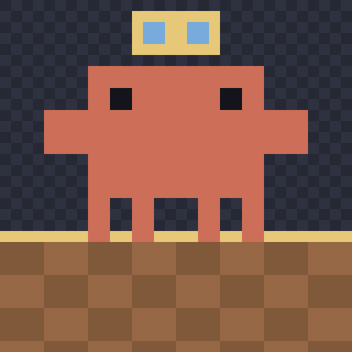
</p>

<h1 align="center">clawd-room</h1>

<p align="center">
  A pixel room in your terminal where every running <b>Claude Code</b> session is a little Clawd.<br>
  Busy ones type at their desk, waiting ones hold up a sign, finished ones cheer.
</p>

<p align="center">
  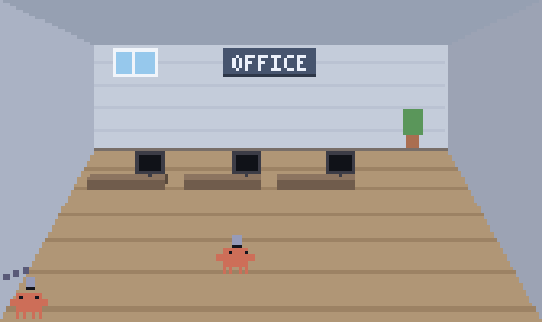
</p>

<p align="center">
  <a href="#get-it">Get it</a> ·
  <a href="#quick-start">Quick start</a> ·
  <a href="#the-rooms">Rooms</a> ·
  <a href="#linked-rooms">Linked rooms</a> ·
  <a href="#gates-and-themes">Gate themes</a> ·
  <a href="#pixel-editor">Pixel editor</a> ·
  <a href="#keys">Keys</a> ·
  <a href="#privacy">Privacy</a>
</p>

## What it does

- **One Clawd per session.** A Claude Code hook writes one small line per event; the room follows that file and animates a Clawd for every session.
- **You see the state at a glance.**

  | A Clawd… | means |
  | --- | --- |
  | thinks (dots over its head) | the session is working out an answer |
  | types at its desk, the monitor shows the tool | it is running a tool |
  | holds up a **sign** | it needs your OK |
  | cheers | it is done |
  | falls asleep after 90 s | idle |
  | walks out | the session ended (a session silent for 30 min is dropped) |

- **Three rooms**, drawn in one-point perspective: office, coffee shop, park.
- **Linked windows.** Put two rooms next to each other: Clawds walk through doors, stairs and wells into the room next door, and you can move one for good with a key.
- **Gates that build themselves.** A gate comes in part by part, or is built from its own pieces that fly in; you pick the theme, or make your own.
- **A pixel editor** for the sprites, the animations and the gate themes, built in.
- **Camera.** Zoom in and follow the Clawd that needs you.
- **C11, no libraries, no network, no daemon.** Python 3 (standard library only) is used just for the hook and the helpers.

## The rooms

<p align="center">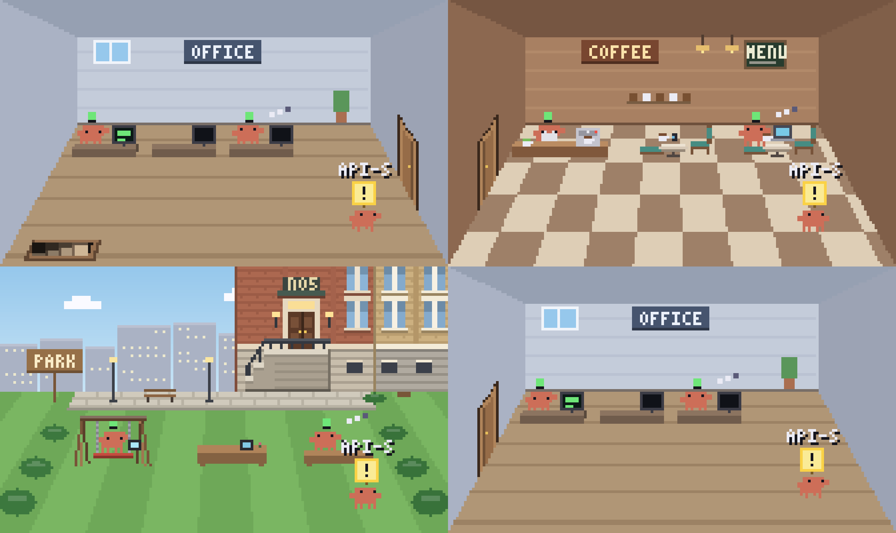</p>

<p align="center">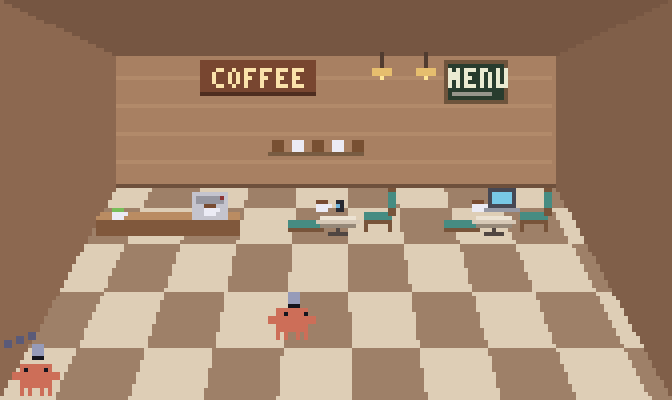</p>
<p align="center"><sub><b>Coffee shop.</b> The barista works behind the bar; the others sit at the tables.</sub></p>

<p align="center">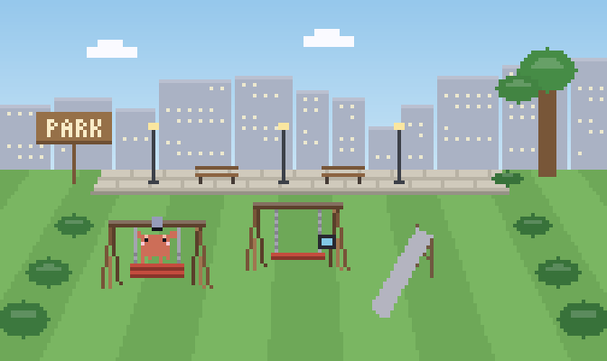</p>
<p align="center"><sub><b>Park.</b> A swing, benches, and a building with a stoop that is the way up. With few sessions the playground has room for a swing and a slide.</sub></p>

## Linked rooms

Start more than one room and put the windows next to each other (side by side or stacked):

```bash
./clawd-room.sh --room park       # window 1
./clawd-room.sh --room coffee     # window 2
```

Gates appear on the walls, ceiling and floor; idle Clawds visit the next room, and `g` / `m` send or move one. Sessions are shared, so two windows never show the same Clawd. Rooms talk through small files in `~/.clawd-room/link/` (no network). How it works: [docs/Linked-Rooms.md](docs/Linked-Rooms.md).

<p align="center">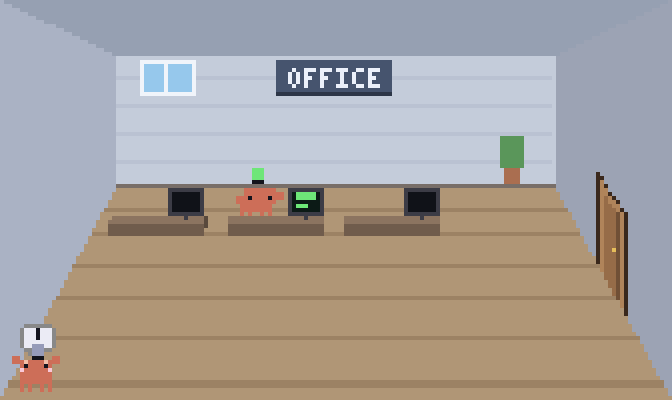</p>
<p align="center"><sub><b>Moving a Clawd to the next room</b> (<code>m</code>): it packs its desk into a box and carries it out.</sub></p>

## Gates and themes

How a gate appears is a **theme**: a folder of part animations in `anims/gates/NAME/`.

<table>
  <tr>
    <td width="50%">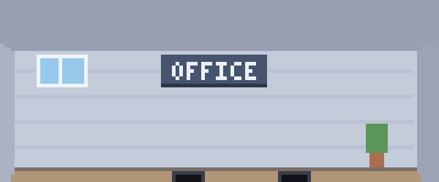</td>
    <td width="50%">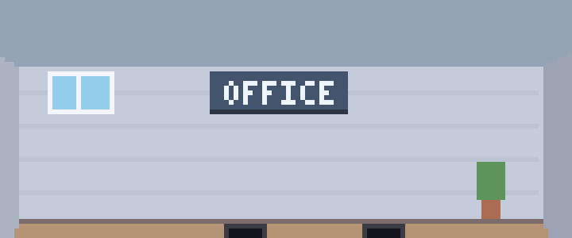</td>
  </tr>
  <tr>
    <td align="center"><sub><b>simple</b> (the default): the parts come in turn.</sub></td>
    <td align="center"><sub><b>construct</b>: real pieces (boards, posts, lengths of rail) fly in under a blue outline.</sub></td>
  </tr>
  <tr>
    <td width="50%">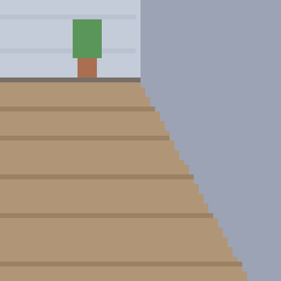</td>
    <td width="50%">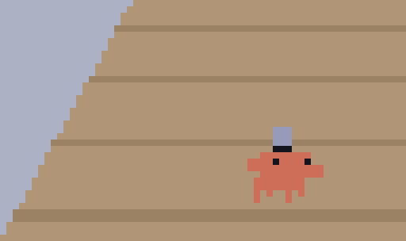</td>
  </tr>
  <tr>
    <td align="center"><sub>The construct builds a door…</sub></td>
    <td align="center"><sub>…and a stair well.</sub></td>
  </tr>
</table>

Pick one with `./clawd-room.sh --gate-theme construct`, or for good in `~/.clawd-room/settings.conf` (read again while the room runs):

```
gate_theme = construct
```

Or in the editor: the **THEMES** tab has a card per theme, Space makes the picked one active, and the dashed card makes your own as a copy. A theme that lacks a gate file uses `simple`'s. Details: [docs/Usage.md](docs/Usage.md).

## Pixel editor

```bash
./clawd-room.sh --edit                      # the picker: props, items, Clawd, UI, animations, gate themes
./clawd-room.sh --edit walk                 # a sprite animation: timeline, play, onion skin, fill
./clawd-room.sh --edit anims/gates/construct/gate-stairs   # a part animation on the stage page
```

<p align="center">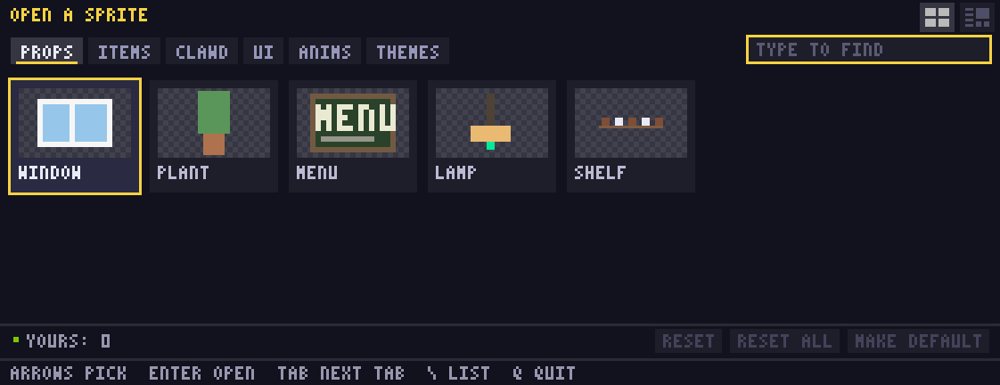</p>
<p align="center"><sub><b>The picker.</b> Cards play; THEMES holds the gate themes.</sub></p>

<p align="center">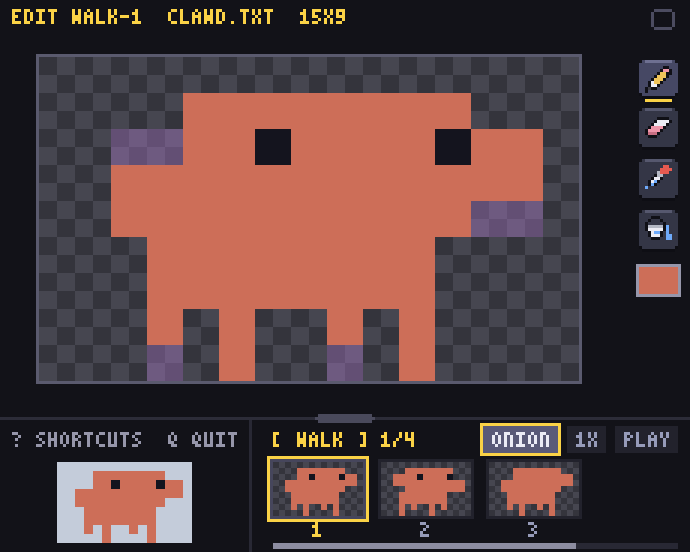</p>
<p align="center"><sub><b>Pixel editor.</b> A Clawd's frames in a timeline, played at the room's speed, with onion skin.</sub></p>

<p align="center">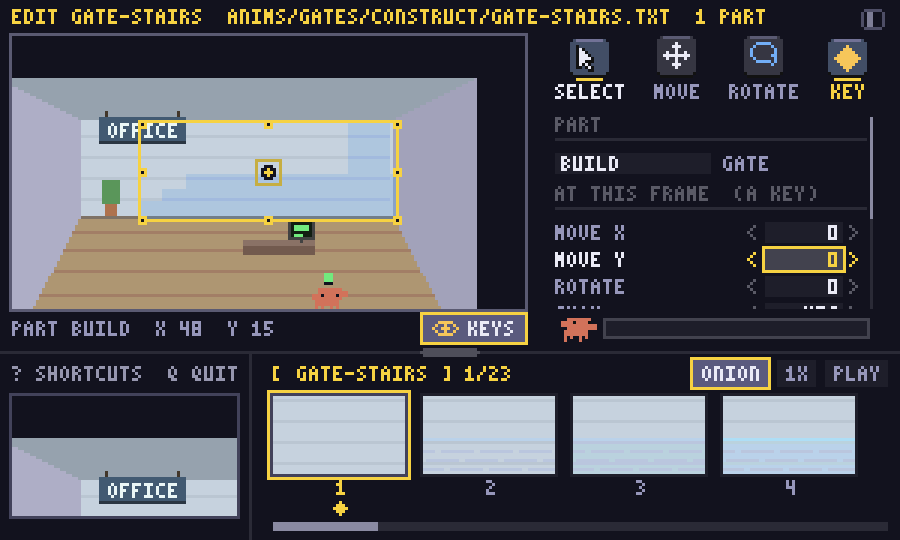</p>
<p align="center"><sub><b>Stage page.</b> A part animation (here the construct's stairs) shown in the room as you step the frames: parts, keys, a grow bar.</sub></p>

Your edits go to `~/.clawd-room/` (shown over the defaults) and the running rooms show them at once. `MAKE DEFAULT` writes yours into the repo's files.

## Get it

There is no installer or release yet: clone the repository.

```bash
git clone https://github.com/zelvet-velvet/clawd-room.git
cd clawd-room
```

Needs:
- **Claude Code** (the sessions to watch) and **Python 3**.
- `make` and a C compiler (`sudo apt install build-essential` on WSL / Linux, `xcode-select --install` on macOS). `clawd-room.sh` builds the room by itself the first time.
- A **truecolor terminal**, at least 44 x 20 cells: Windows Terminal (WSL2) or iTerm2 (macOS).

## Quick start

```bash
# 1. See it with made-up Clawds (four linked rooms; iTerm2 on macOS, Windows Terminal on WSL)
./clawd-room.sh --try

# 2. Show your own Claude Code sessions: install the hook once
python3 install_hooks.py            # prints the change to ~/.claude/settings.json
python3 install_hooks.py --apply    # installs it (backs the file up first)
./clawd-room.sh                     # start the room
```

- **Do not move the folder** after `--apply`: the hook calls `hook.py` by its full path (run `--apply` again if you do).
- Remove the hook with `python3 install_hooks.py --remove`.
- **WSL:** run `python3 setup_profile.py --apply` once to add the "Clawd Room" Windows Terminal profile (`--update` after pulling a new version, `--remove` to delete it).
- Quit with `q`.

## Keys

| Key | Does |
| --- | --- |
| `q` | quit |
| Esc | let go of the picked Clawd (the corners fade out) |
| `p` | pause |
| `?` | help line |
| `r` | room size list |
| `[` `]` | camera zoom out / in |
| `z` | auto zoom on / off |
| `.` | settings panel beside the room (W S pick, A D change; written to `settings.conf` at once) |
| ← → (`A` `D`) / Tab | pick the Clawd the camera follows |
| `c` | follow / free camera (then arrows or `W A S D` move it) |
| `g` + arrow | send a Clawd next door (hold `g`: which way) |
| `m` + arrow | move the picked Clawd to that room for good |
| `b` | call your Clawds back (or send visitors home) |
| `f` | fit the window and font |

The status line, the help and the `g` / `m` hint show in a bar along the bottom. All the options: [docs/Usage.md](docs/Usage.md).

## Platforms

| | Terminal | Notes |
| --- | --- | --- |
| **WSL2 on Windows** | Windows Terminal | a "Clawd Room" profile at 5 pt; the room snaps to a quarter of the screen |
| **macOS** | iTerm2 | a "Clawd Room" dynamic profile with a fixed 4 x 8 pt cell |

Details, fonts and profiles: [docs/Platforms.md](docs/Platforms.md).

## Privacy

The events file holds only the time, the session id, the event, the **folder name** (not the path) and the tool name. It never stores prompts, tool input or output. Everything stays on your machine: no network, no background daemon, files are mode 600.

## Documentation

| | |
| --- | --- |
| [Usage](docs/Usage.md) | commands, keys, themes, room size, camera, gate themes and settings |
| [Linked rooms](docs/Linked-Rooms.md) | gates, crossing, moving, sessions |
| [Platforms](docs/Platforms.md) | Windows Terminal, iTerm2, fonts, profiles |
| [Development](docs/Development.md) | code map, build, tests, sprite files, the notes vault, redrawing the README's GIFs |
| [Project notes](Clawd%20Room%20Note/Start/Home.md) | design notes and the day-by-day Dev Log (an Obsidian vault) |

## Contributing

Work on a branch, open a pull request, the owner merges. How we work, how to set up and what you can pick up: [CONTRIBUTING.md](CONTRIBUTING.md). Build and test notes: [docs/Development.md](docs/Development.md).

## Disclaimer

An unofficial fan project. Clawd is Anthropic's character; this project is not made or endorsed by Anthropic.

## License

[MIT](LICENSE). The license covers this project's code and notes, not Clawd, which belongs to Anthropic.
